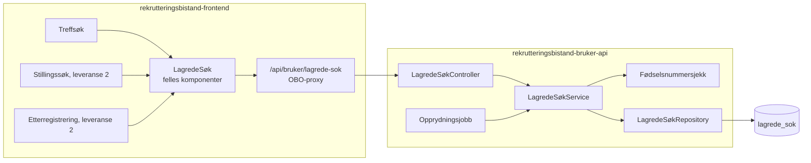
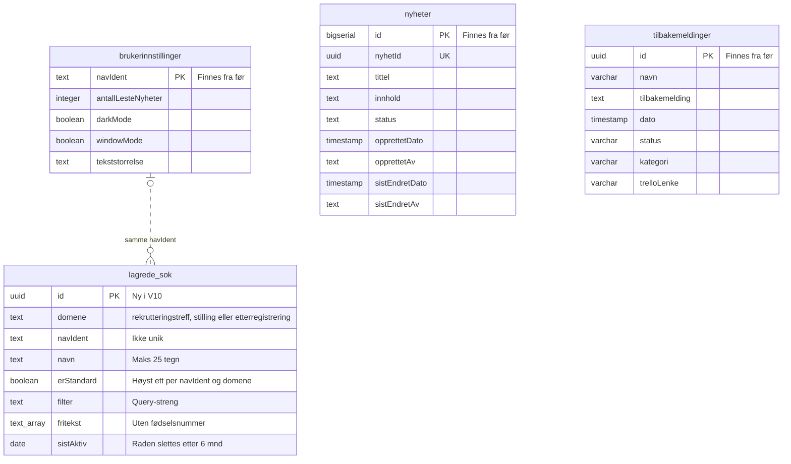
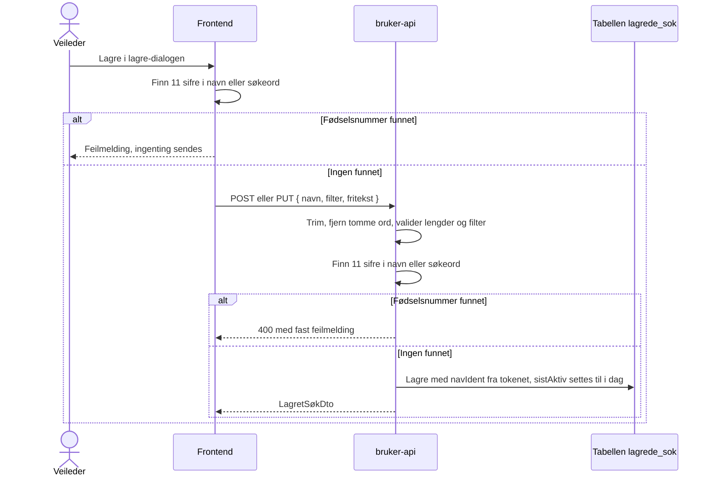
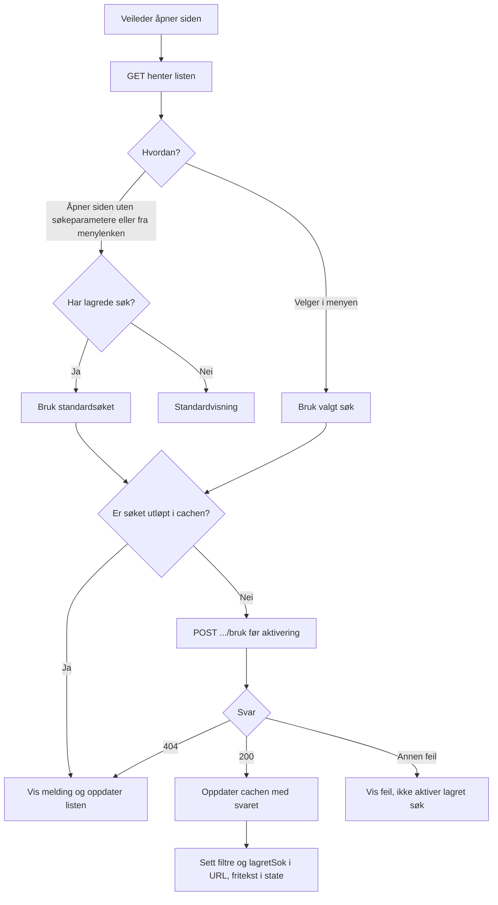
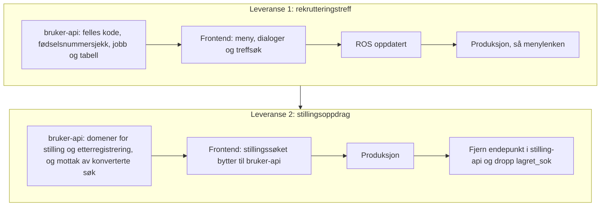

# Plan: Lagrede søk for stillingsoppdrag og rekrutteringstreff i bruker-api

**Status:** Leveranse 1 (rekrutteringstreff) er implementert i bruker-api og frontend, men ikke rullet ut. Et ROS-utkast ligger i [`ros-lagrede-sok.md`](ros-lagrede-sok.md) og må godkjennes før produksjon. Leveranse 2 (stilling og etterregistrering) er implementert i bruker-api, men frontend og konvertering fra stilling-api gjenstår.

## Kort fortalt

- Rekrutteringstreff får lagrede søk i `rekrutteringsbistand-bruker-api`. Hver veileder kan lagre opptil 10 søk per domene, gi dem navn, bruke dem og slette dem. Standardsøket brukes når siden åpnes. I rekrutteringstreff er «Vanlig søk» standard til veilederen selv velger et lagret søk.
- Standardsøk for stillingsoppdrag flyttes senere fra `rekrutteringsbistand-stilling-api` til samme API og får samme støtte for flere søk. Etterregistrering bruker i dag samme standardsøk som stillingsoppdrag, men får sitt eget domene. Konverteringen kopierer det gamle søket til begge domenene, og deretter endres kopiene hver for seg.
- Vi planlegger begge nå, men leverer én applikasjon av gangen helt til produksjon. Rekrutteringstreff kommer først.
- Alle domener lagres i én tabell, `lagrede_sok`, med kolonnen `domene`. De deler kode og opprydningsjobb.
- Hvert søk har en id (søkeident). Nav-identen er ikke lenger unik i tabellen.
- Navn bør være beskrivende, men trenger ikke være unike. Like navn gir ingen feilmelding. Alle valg og endringer bruker søkeidenten.
- Hvert søk har datoen `sistAktiv`. Lagring, bruk og «Gjør til standard» fornyer seksmånedersfristen. Ved bruk oppdateres datoen høyst én gang i døgnet.
- Navn og fritekst lagres bare i body og database, aldri i URL-en. Navn og søkeord med fødselsnummer stoppes i frontend og avvises av backend.
- Et søk uten aktivitet på seks måneder slettes helt. Etter fem måneder får det en merknad i menyen. Et søk i jevnlig bruk har ingen øvre grense for lagringstid.
- En veileder har høyst ett lagret standardsøk per domene. Uten et lagret standardsøk er «Vanlig søk» standard, også etter at veilederen har lagret søk. Veilederen velger et lagret søk som standard i «Administrer søk», og kan velge «Vanlig søk» igjen. Slettes eller utløper standardsøket, blir «Vanlig søk» standard. Regelen gjelder alle domener. For stilling og etterregistrering avgjør konverteringen i leveranse 2 om det overførte søket blir standard.
- Når siden åpnes med standardsøket, viser statuslinjen «Valgt søk» med navnet. Uten lagrede søk åpnes standardvisningen, den samme som «Fjern alle filtre» gir.

## Slik virker det i dag (stillingsoppdrag)

Menylenken «Stillingsoppdrag» og knappen «Bruk standardsøk» går til `/stilling?brukStandardsok=true`. Da henter `page.tsx` standardsøket fra stilling-api og bytter URL-en med `window.history.replaceState`. Diskettikonet sender query-strengen med `PUT /standardsok` og overskriver det gamle søket. Hver veileder har ett søk.

| Del | Innhold |
| --- | --- |
| Frontend | `app/stilling/_ui/standardsøk/` og `app/api/stilling/standardsok/` |
| API | `GET /standardsok` gir `200` eller `404`. `PUT /standardsok` med `{ søk }` gir `201`. Nav-identen kommer fra tokenet. |
| Tabell `lagret_sok` | `id`, `nav_ident`, `sok` (query-streng), `tidspunkt` (uten tidssone) |
| Lagres ikke | `utenOppdrag`, `visStillingId`, `brukStandardsok`, `finnKandidater`, `visKandidatId`, fritekst |

Svakheter vi ikke tar med oss:

- `lagret_sok` mangler unik-indeks på `nav_ident`, og repositoryet leser før det skriver. To samtidige lagringer kan gi to rader.
- Diskettikonet er deaktivert når søket er likt det lagrede, og sammenligningen er en strengsammenligning. Med flere søk dropper vi denne sammenligningen.
- Mens `brukStandardsok` står i URL-en, ignorerer `StillingsSøkContext` fritekst. Det må endres når fritekst skal lagres.

## Arkitektur

`rekrutteringsbistand-bruker-api` har allerede brukerinnstillinger per Nav-ident, `accessPolicy` for frontend og de rollene vi trenger. Vi trenger ingen ny auth eller ny tjeneste.



Controlleren håndterer auth, input-validering og HTTP-svar. Servicen samler reglene for eierskap, antallsgrense, standardvalg og utløp, og styrer transaksjonene. Repositoryet gjør databaseoppslagene, også for opprydningsjobben.

### API

«Lagrede søk» er alle søkene en veileder har lagret. «Standardsøk» er det ene søket som er valgt som standard. Koden følger samme skille: `LagretSøk`, `LagredeSøkService` og `/api/lagrede-sok`, men `erStandard` og `.../standard`. I servicen er standardvalget én funksjon, `velgStandard(domene, navIdent, id?)`, der `null` betyr vanlig søk.

Frontend kaller `/api/bruker/lagrede-sok/{domene}`, og proxyen sender videre til `/api/lagrede-sok/{domene}`. `domene` er `rekrutteringstreff`, `stilling` eller `etterregistrering`. Andre verdier gir `404`. `{id}` er søkeidenten.

| Metode | Sti | Bruk | Svar |
| --- | --- | --- | --- |
| `GET` | `/api/lagrede-sok/{domene}` | Henter alle veilederens søk. Brukes av menyen, lagre-dialogen og menylenken. | `200` med liste av `LagretSøkDto`. Standardsøket står først, resten er sortert på navn (norsk alfabet) og deretter id. Tom liste uten lagrede søk. |
| `POST` | `/api/lagrede-sok/{domene}` | «Lagre som nytt søk» | `201` med `LagretSøkDto`. `409` når veilederen allerede har 10 søk. Like navn tillates. |
| `PUT` | `/api/lagrede-sok/{domene}/{id}` | «Erstatt et lagret søk». Endrer ikke standardvalget. | `200` med `LagretSøkDto` |
| `PUT` | `/api/lagrede-sok/{domene}/{id}/standard` | «Gjør til standard» for et lagret søk. Flytter standardvalget til søket og fornyer fristen for det. Idempotent. | `204`. `404` når søket ikke finnes, ikke tilhører veilederen eller `id` ikke er en UUID. |
| `PUT` | `/api/lagrede-sok/{domene}/vanlig/standard` | «Gjør til standard» for «Vanlig søk». Fjerner merket fra det lagrede standardsøket og sletter ingen søk. Uten body. Idempotent. Registrert før `PUT .../{id}/standard`, ellers fanger den «vanlig» som id. En UUID kan aldri være «vanlig». | `204` |
| `DELETE` | `/api/lagrede-sok/{domene}/{id}` | «Slett» | `204` |
| `POST` | `/api/lagrede-sok/{domene}/{id}/bruk` | Kontrollerer og registrerer bruk før søket aktiveres. Ingen body. | `200` med gjeldende `LagretSøkDto` |

Alle kall med `{id}` gir `404` hvis søket ikke finnes, er utløpt eller tilhører en annen veileder. Svaret skiller ikke mellom disse tilfellene. Ugyldig body gir `400` med en fast feilmelding uten innhold fra input.

`POST .../bruk` er `POST` fordi kallet endrer data. En `GET` kan sendes på nytt av SWR, forhåndshenting eller proxyer og skal ikke fornye fristen. Svaret fra `.../bruk` oppdaterer SWR-cachen uten et ekstra `GET`-kall.

Alle domener er åpne for alle de fem rollene i bruker-api. Controlleren sjekker det med `verifiserHarEnRolle()` i `AutentisertNavBruker`, som også innstillinger, nyheter for veiledere og innsending av tilbakemeldinger bruker. Et token uten noen av rollene gir `403`. Frontend bestemmer fortsatt hvem som ser treffsøket og etterregistreringen.

Nav-identen kommer alltid fra tokenet, aldri fra body eller sti. Hver spørring med `{id}` har både `id` og `navIdent` i `WHERE`.

| DTO | Felt | Type | Regel |
| --- | --- | --- | --- |
| `LagreSøkDto` | `navn` | String | 1 til 25 tegn etter trimming. Kan ikke inneholde 11 sifre som kan være et fødselsnummer. Like navn tillates. |
| | `filter` | String | Query-streng uten `?`, maks 2 000 tegn, kan være tom. Backend validerer tillatte parametere og verdier per domene. |
| | `fritekst` | Liste av String | Maks 10 ord og 200 tegn totalt, kan være tom. Kan ikke inneholde 11 sifre som kan være et fødselsnummer. |
| `LagretSøkDto` | `id` | UUID | Søkeidenten |
| | `navn` | String | |
| | `erStandard` | Boolean | |
| | `filter` | String | |
| | `fritekst` | Liste av String | Trimmet, uten tomme ord |
| | `sistAktiv` | Dato | Siste lagring, bruk eller valg som standard |
| | `slettes` | Dato | Seks kalendermåneder etter `sistAktiv` |
| | `visSlettevarsel` | Boolean | Beregnes av backend. Sann fra fem kalendermåneder etter `sistAktiv` til søket utløper. |

Standardvalg inngår ikke i `LagreSøkDto`. Høyst ett lagret søk har `erStandard`. Har ingen det, er «Vanlig søk» standard. Bare `PUT .../{id}/standard` merker et søk, og `GET` skriver aldri. Regelen er lik for alle domener.

### Tabell: én for alle domener

Alle domener lagres i tabellen `lagrede_sok`, med kolonnen `domene`. `V9__standardsok.sql` opprettet én tabell per domene og ble rullet ut i dev. `V10__lagrede_sok.sql` sletter de to tabellene og oppretter `lagrede_sok`. Løsningen er ikke i produksjon, så dataene i dev beholdes ikke. Kolonnenavnene følger stilen i repoet (`navIdent`, som i `brukerinnstillinger`).

Databasen i bruker-api etter begge leveransene. Ingen tabeller har fremmednøkler. Den stiplede linjen viser at søkene og brukerinnstillingene bruker samme `navIdent`, uten at databasen håndhever koblingen. En veileder kan ha søk uten en rad i `brukerinnstillinger`. `text_array` er `text[]`, fordi Mermaid ikke tillater klammer i typenavn.



| Tabell | Status | Innhold |
| --- | --- | --- |
| `lagrede_sok` | Ny i V10 | Lagrede søk for rekrutteringstreff, stillingsoppdrag og etterregistrering. Søk for stillingsoppdrag flyttes fra stilling-api i leveranse 2. |
| `brukerinnstillinger` | Finnes fra før | Visningsvalg per veileder |
| `nyheter` | Finnes fra før | Nyheter i Rekrutteringsbistand |
| `tilbakemeldinger` | Finnes fra før | Tilbakemeldinger fra veiledere |

Kolonner:

| Kolonne | Type | Merknad |
| --- | --- | --- |
| `id` | `uuid` primærnøkkel | Søkeidenten, lages av backend |
| `domene` | `text not null` | `rekrutteringstreff`, `stilling` eller `etterregistrering`. Enumen `LagredeSøkDomene` i koden bestemmer gyldige verdier, og databasen har ingen sjekk. Et nytt domene krever da ingen migrering. Verdien er `stinavn` i enumen og kommer aldri fra input. |
| `navIdent` | `text not null` | Ikke unik. Indeks på `navIdent` og `domene` for oppslag per veileder. |
| `navn` | `text not null` | Maks 25 tegn etter trimming. Ikke unikt, heller ikke sammen med `navIdent`. |
| `erStandard` | `boolean not null default false` | Delvis unik indeks på `navIdent` og `domene` der `erStandard` er sann, så hver veileder har høyst ett standardsøk per domene |
| `filter` | `text not null` | |
| `fritekst` | `text[] not null default '{}'` | |
| `sistAktiv` | `date not null` | Settes ved lagring, bruk og valg som standard. Indeks på `domene` og `sistAktiv` for opprydningsjobben, som sletter rader med `sistAktiv` på eller før seneste utløpte dato. |

Regler i backend:

- Grensen på 10 aktive søk gjelder per domene, også ved samtidige opprettelser. Opprettelse, erstatting, bruk og standardbytte tar en advisory lock per domene og Nav-ident (`pg_advisory_xact_lock`), som gjelder på tvers av podene. Transaksjonen kjører med `READ COMMITTED`, så tellingen etter låsen ser det andre kall har committet. Under `REPEATABLE READ`, som er standard i bruker-api, ville tellingen vært utdatert, og to samtidige kall som oppdaterer samme rad, ville gitt serialiseringsfeil (`40001`) og `500`.
- Bytte av standardsøk fjerner merket fra det gamle, setter det på det nye og oppdaterer det nye søkets `sistAktiv` i én transaksjon. Datoen for det gamle søket endres ikke. Den delvise unike indeksen er et siste vern mot flere standardsøk.
- Sletter veilederen standardsøket, eller utløper det, blir «Vanlig søk» standard. Backend velger ikke et nytt standardsøk. Et utløpt søk som fortsatt er merket som standard, regnes ikke som standard før opprydningsjobben sletter det. Velger veilederen «Vanlig søk» da, telles det ikke som en endring.
- Hver spørring i `LagredeSøkRepository` har `domene` i `WHERE`, som en vanlig parameter. Et søk i ett domene kan derfor ikke leses, endres eller slettes gjennom et annet. Komponenttestene sjekker dette for alle domener.
- Søk slettes når veilederen sletter dem, eller etter seks måneder uten aktivitet. Se [Sletting etter seks måneder uten aktivitet](#sletting-etter-seks-måneder-uten-aktivitet).

| | Én tabell med `domene`-kolonne (valgt) | Én tabell per domene |
| --- | --- | --- |
| Nøkkel | `id`, indeks på `navIdent` + `domene` | `id`, indeks på `navIdent` |
| Unike regler | Høyst ett standardsøk per `navIdent` + `domene`. Like navn tillates. | Høyst ett standardsøk per `navIdent`. Like navn tillates. |
| Nytt domene | Ny verdi i enumen, ingen migrering | Ny tabell med kolonner og indekser |
| Ulik utvikling | Domenespesifikke kolonner blir `null` for de andre domenene | Hvert domene kan få egne kolonner uten å påvirke de andre |
| Fjerne et domene | `DELETE` og verdien fjernes fra enumen | `DROP TABLE` |
| SQL | Fast tabellnavn, `domene` er en parameter | Tabellnavnet settes inn i SQL-strengen fra koden |

Vi valgte først én tabell per domene, men byttet før produksjon. Domenene har like kolonner, og forskjellene ligger i filterreglene, som backend håndhever per domene. Med etterregistrering har vi tre domener, og en tabell per domene ville gitt tre like tabeller.

### Dato for siste aktivitet

Vi lagrer en dato og ikke et tidspunkt. Det holder for sletting etter seks måneder og for å vise «sist aktiv». Det sier også mindre om når den ansatte jobber. Backend regner datoen i tidssonen `Europe/Oslo`.

`sistAktiv` settes til i dag når veilederen lagrer søket som nytt, erstatter det, tar det i bruk eller velger «Gjør til standard». Å hente listen eller åpne menyen endrer den ikke.

`POST .../bruk` leser søket og oppdaterer bare når `sistAktiv` er eldre enn i dag. Det gir høyst én databaseskriving per søk i døgnet ved bruk, selv om frontend kaller hver gang. Ved lagring og standardbytte skriver backend de øvrige endringene som vanlig.

Slettefristen er seks kalendermåneder etter `sistAktiv`, og varselet starter etter fem. Finnes ikke dagen i målmåneden, brukes månedens siste dag. Søket er utløpt fra og med slettefristen. Backend bruker samme regel for svar, oppslag og opprydning, og beregner `visSlettevarsel` for frontend. Reglene testes ved månedsslutt og skuddår.

Én dato per søk erstatter egne datoer for navn og fritekst. Begge følger raden.

## Fritekst og navn

### Hvorfor bare i body

Fritekst ligger i React-state i begge søkene i dag, og ikke i URL-en. Det hindrer at den havner i nettleserhistorikk, tilgangslogger og Umami. Vi beholder det: fritekst og navn går bare i body på `POST` og `PUT` og i svarene fra API-et. Søkeidenten brukes i stien til API-kallene. På søkesiden står den i URL-en som `lagretSok`, så valgt søk overlever refresh. Id-en er en tilfeldig UUID og sier ingenting om innholdet. Når et søk brukes, legges fritekst i state og vises som chips.

Backend avviser ukjente filterparametere og ugyldige verdier. `filter` kan dermed ikke brukes til å lagre navn eller fritekst som senere legges i URL-en.

### Avvisning av fødselsnumre

Navn og søkeord med fødselsnummer blir ikke lagret. Frontend stopper lagringen og forteller veilederen hva som må endres. Backend avviser det samme med `400` som sikkerhetsnett. Vi renser ikke, så det lagrede søket er alltid det veilederen så. Søket mot treffene sjekkes ikke.



Teksten avvises når den har 11 sifre, der det kan stå ett skilletegn mellom to sifre: mellomrom, hardt mellomrom, tab, punktum, bindestrek eller skråstrek. Teksten normaliseres med NFKC først, så sifre i full bredde også fanges. Sjekken ser ikke på dato eller kontrollsiffer. Da fanger den D-nummer, H-nummer, syntetiske nummer og tastefeil, og nye regler fra Skatteetaten (som reglene fra 2032) krever ingen endring. Vi avviser heller for mye enn for lite. Tall med færre eller flere sifre, som organisasjonsnumre, godtas. Frontend (`components/lagrede-søk/fødselsnummer.ts`) og backend (`Fødselsnummersjekk`) har samme regel. Sjekken er et sikkerhetsnett mot uhell, ikke mot bevisst omgåelse.

### Sletting etter seks måneder uten aktivitet

Navn er også fritekst, så vi sletter hele søket og ikke bare søkeordene. Søket utløper seks kalendermåneder etter `sistAktiv`.

- `GET` returnerer aldri utløpte søk, selv om jobben ikke har kjørt.
- Kall med `{id}` mot et utløpt søk gir `404`. Eierskap og utløp kontrolleres før eventuell oppdatering, så et kall ikke kan vekke søket til live.
- Utløpte søk teller ikke mot grensen på 10. `POST` og `DELETE` sletter ikke utløpte søk.
- Bare opprydningsjobben sletter utløpte søk. Den sletter raden ved neste kjøring, innen en time. Skjuling ved fristen og ventetiden fram til sletting er beskrevet i ROS-en (LS-03).

Et søk som brukes, lagres eller velges som standard jevnlig, har ingen øvre grense for hvor lenge navn og søkeord blir liggende. Vi innfører ingen absolutt maksimal lagringstid, så tabellen trenger ingen opprettelsesdato (LS-02 i [ROS-en](ros-lagrede-sok.md)). Fødselsnummersjekken fanger ikke andre personopplysninger. Den restrisikoen er vurdert i LS-01 og må godkjennes før produksjon.

### Merknad før sletting

Vi markerer søk fra fem kalendermåneder etter `sistAktiv`. Merknaden lagres ikke. Backend beregner `slettes` og `visSlettevarsel`, som frontend bruker i visningen.

- Merknaden koster ingen ny kolonne, jobb eller varsling.
- Veilederen ser den i menyen og i «Administrer søk». Bruk, lagring eller «Gjør til standard» starter de seks månedene på nytt. Vi lager ingen egen knapp for å beholde søk.
- Uten merknad forsvinner søk uten forvarsel. Det er særlig ille for standardsøket, som brukes når siden åpnes.

Vi sender ikke varsel utenfor løsningen, for eksempel e-post. Det krever mer enn gevinsten forsvarer.

### Opprydningsjobb

- Kjører hver time i bruker-api. For hvert domene sletter den rader som har nådd slettefristen, så metrikkene kan telle per domene. Spørringen bruker indeksen på `domene` og `sistAktiv` og koster lite.
- Én felles jobb for alle domenene.
- Jobben er idempotent. Den kan derfor kjøre på alle podene uten leader election.
- Hvert domene ryddes i sin egen transaksjon med `READ COMMITTED`. Feiler ett domene, logges feilen uten innhold, og de andre domenene ryddes likevel. Kjøringen telles som vellykket bare når alle domenene lyktes.
- Jobben stopper når Javalin stopper. Gjentatte start- og stoppkall oppretter ikke flere jobber.
- Jobben logger og teller bare antall rader, aldri innhold.
- Feil og tidspunktet for siste vellykkede kjøring måles. Det varsles hvis jobben ikke har kjørt uten feil på seks timer. Etter en deploy varsles det bare hvis de to første kjøringene feiler.

## Når filtrene endres

Filtrene i søkene endrer seg over tid. Lagrede søk skal fortsatt virke uten migrering.

- **Bruker-api renser filteret i hvert svar** med `Filterregler.rens()`. Parametere som ikke finnes lenger, fjernes. I en liste fjernes ukjente verdier, og resten beholdes. Er ingen verdier gyldige, fjernes hele parameteren. Gyldige parametere beholdes tegn for tegn, så filteret er likt det frontend bygger. Databasen endres ikke før veilederen lagrer søket på nytt.
- **Frontend gir manglende parametere standardverdien.** Gamle søk uten et nytt filter får standardverdien, og serialiseringen utelater standardverdier.
- **Validering ved lagring er uendret.** `POST` og `PUT` avviser fortsatt ukjente parametere og verdier. Søkene får nytt navn med det rensede filteret fra svaret, så det går gjennom.

Regler når filtrene endres:

- Legg til nye parametere og verdier i bruker-api før frontend. Ellers avviser bruker-api søk med det nye filteret.
- Ta ut parametere og verdier fra bruker-api før eller samtidig med frontend.
- Gi nye filtre en standardverdi som ikke filtrerer bort noe. Gamle søk får standardverdien.
- Ikke endre standardverdien til et filter. Søk som er lagret uten parameteren, ville fått nye treff uten at veilederen ser det.
- Ikke gjenbruk et parameternavn eller en verdi med ny betydning.

## Frontend

Vi beholder plasseringen under søkefeltet. «Bruk standardsøk» blir en meny med de lagrede søkene, og diskettikonet blir stående ved siden av menyen. Skissene under er et utgangspunkt for designer, ikke et ferdig design. Alt bygges med Aksel-komponenter (`ActionMenu`, `Tooltip`, `Modal`, `RadioGroup`, `TextField`, `Select`, `Link`).

### Meny og statuslinje

Menyen erstatter knappen «Bruk standardsøk». Et klikk på et søk tar det i bruk og lukker menyen. Søkene er radiovalg (`ActionMenu.RadioItem`), så søket som er i bruk, er markert så lenge filtrene er uendret. Like navn er tillatt, men hvert menyelement bruker id-en til riktig søk. Standardsøket står øverst, og resten står i alfabetisk rekkefølge. Da står søkene på samme plass hver gang, også etter at veilederen har brukt et av dem.

```text
[ Lagrede søk ▾ ] [💾]
Valgt søk: Treff i Oslo

  ┌ Søk ──────────────────┐
  │ ( ) Vanlig søk        │
  │ ───────────────────── │
  │ (•) Treff i Oslo      │
  │     Standard          │
  │ ( ) Treff Vestland    │
  │ ( ) Mine utkast       │
  │     Slettes snart     │
  │ ───────────────────── │
  │ ⚙ Administrer søk     │
  └───────────────────────┘
```

- «Vanlig søk» står øverst, over en skillelinje, i samme radiogruppe som de lagrede søkene. Valget nullstiller filtre og søkeord, som «Fjern alle filtre». Det er markert når URL-en ikke har filtre og det ikke finnes søkeord, og har merknaden «Standard» når ingen lagrede søk er standard. Det teller ikke mot grensen på 10.
- Under navnet står en liten grå merknad: «Standard» for standardsøket og «Slettes snart» for søk med `visSlettevarsel`. Har søket begge, skilles de med « · ». Datoen står i «Administrer søk», fordi menyen er smal.
- Vi bruker ikke stjerne eller hake. Stjernen var ikke intuitiv, og Aksel fraråder hake i menyer fordi den ligner radiovalg.
- Disketten er en ikonknapp på samme rad som menyen. Sidepanelet er for smalt til en tekstknapp ved siden av menyen. Knappen har tooltip og tilgjengelig navn «Lagre søk», og er deaktivert uten filter eller søkeord.
- Statuslinjen viser navnet på søket som er i bruk, men bare så lenge filtrene og søkeordene er like det lagrede søket. Filtrene sammenlignes etter at begge er normalisert med domenets `normaliserFilter`, så rekkefølge, standardverdier og koding ikke gir forskjell. Det gjelder også søk som er lagret eller konvertert med en annen rekkefølge enn frontend bruker. Endrer veilederen noe, også med «Fjern alle filtre», forsvinner linjen og markeringen i menyen. Slik kan veilederen velge bort et søk uten en egen knapp. Linjen kommer tilbake hvis filtrene blir like søket igjen. Linjen er en `aria-live`-region.
- Uten lagrede søk viser menyen «Vanlig søk», og under skillelinjen «Du har ingen lagrede søk» og «Velg filtre og trykk på Lagre søk.». «Administrer søk» er deaktivert.
- Fokus går tilbake til knappen som åpnet dialogen, også når dialogen lukkes etter lagring eller med Esc.

### Når siden åpnes

- Siden åpnes med standardsøket når URL-en ikke har søkeparametere (`visning`, `statuser`, `publisertStatuser`, `fylker`, `kommuner`, `kontorer`, `sortering` eller `side`) og veilederen har valgt et lagret søk som standard. Ellers åpnes vanlig søk. Statuslinjen viser «Valgt søk» med navnet på standardsøket.
- Har URL-en søkeparametere, for eksempel etter refresh eller fra en delt lenke, går de foran standardsøket.
- Id-en til søket som er i bruk, står i URL-en som `lagretSok`. Ved refresh hentes søkeordene fra det lagrede søket når filtrene i URL-en er like søkets filtre. Statuslinjen viser da navnet, og søket er markert i menyen. Søket mot treffene venter til søkeordene er på plass.
- Endrer veilederen filtre, sortering eller søkeord, fjernes `lagretSok`. Det samme skjer når søket er slettet, utløpt eller tilhører en annen veileder.
- Menylenken legger på `?brukStandardsok=true`. Det trengs fordi siden ikke lastes på nytt når veilederen allerede står på treffsøket. Søkeordene ligger i state og overlever derfor klikket. `useLagredeSøk` tømmer dem én gang per klikk, før standardsøket brukes. Søkeord som veilederen skriver mens siden venter på standardsøket, beholdes.
- Uten et lagret standardsøk åpnes vanlig søk: «Publisert», «Alle treff» og «Sist oppdaterte», uten søkeord.

### Fjern alle filtre

Chipen «Fjern alle filtre» står først i chip-raden over treffene. Den vises når filtre, sortering eller søkeord avviker fra standardvisningen, også når ingen av endringene vises som chip. Et klikk setter alt tilbake til standardvisningen og fjerner parameterne fra URL-en. Statuslinjen forsvinner, fordi filtrene ikke lenger er like et lagret søk. Standardvisningen tilsvarer stillingssøket, som faller tilbake til `publisert=intern&statuser=publisert`.

### Smale skjermer

Under 1024 px er filterpanelet skjult. Knappen «Filtrer» ved pagineringen åpner panelet i et ark, med søkefelt, lagrede søk og filtre. Kandidatsøket bruker samme mønster.

Kjent feil: Esc i menyen eller en dialog inne i arket lukker hele arket. Feilen gjelder det felles arket (`Sidepanel.tsx`), der Radix og Aksel begge lytter etter Esc. Den rettes i en egen oppgave, fordi rettingen påvirker alle sidepaneler.

### Dialog: «Lagre søk»

Disketten åpner dialogen. Gjeldende filtre og søkeord lagres. Enter sender skjemaet.

```text
┌ Lagre søk ─────────────────────────────────────┐
│ (•) Lagre som nytt søk                         │
│ ( ) Erstatt et lagret søk                      │
│                                                │
│ Søk som skal erstattes                         │
│ Filtrene og søkeordene i søket byttes ut med   │
│ dem du har valgt nå.                           │
│ [ Velg søk            ▾ ]                      │
│                                                │
│ Navn på søket                                  │
│ Maks 25 tegn. Ikke skriv personopplysninger.   │
│ [_______________]                              │
│                                                │
│ Søk du ikke har brukt på seks måneder, slettes.│
│                                                │
│            [ Avbryt ]  [ Lagre | Erstatt søk ] │
└────────────────────────────────────────────────┘
```

- Uten lagrede søk vises ikke valgene. Dialogen sier i stedet at søket kan gjøres til standard i «Administrer søk».
- Med 10 søk er «Lagre som nytt søk» deaktivert, med teksten «Du har 10 lagrede søk. Erstatt et søk eller slett et i Administrer søk.»
- Dialogen starter på «Lagre som nytt søk», eller på «Erstatt et lagret søk» når veilederen har 10 søk. Vises «Valgt søk», er det søket forhåndsvalgt i listen over søk som kan erstattes, med navnet fylt inn. Filtrene og søkeordene er da like søket, så bare navnet kan endre seg. Ellers starter listen på «Velg søk», og veilederen må velge før lagring. Vi forhåndsvelger ikke et søk når filtrene er endret, så veilederen ikke overskriver et søk ved et uhell. Erstatter veilederen uten at navn, filtre eller søkeord er endret, lagres ingenting, og dialogen viser en melding. Første fokus går til det valgte alternativet i radiogruppen, eller til navnefeltet når veilederen ikke har lagrede søk.
- Navnet for nytt søk og navnet ved erstatting holdes hver for seg. Når veilederen velger søket som skal erstattes, fylles navnet inn og kan endres.
- Knappen heter «Erstatt søk» ved erstatting og «Lagre» ellers.
- Lagre-dialogen avviser lukking mens lagring pågår, både med lukkeknappen og med Esc. Ved feil blir dialogen stående med feilmeldingen og kan lukkes eller sendes på nytt. Dette løser ikke den kjente Esc-feilen i filterarket på smale skjermer.
- Frontend og backend validerer lengden. Vi ber om et beskrivende navn, men validerer ikke at navnet er unikt.
- Dialogen har ikke standardvalg. Standard velges i «Administrer søk».

### Dialog: «Administrer søk»

```text
Administrer søk (3 av 10)

Velg navnet på et søk for å bruke det. Standardsøket brukes når du åpner siden.
Vanlig søk viser siden uten filtrene du har valgt selv. Hvis du sletter
standardsøket, blir vanlig søk standard. Vi sletter søk du ikke har brukt på seks
måneder.
──────────────────────────────────────────────────────────────
Vanlig søk                                  [Gjør til standard]
──────────────────────────────────────────────────────────────

──────────────────────────────────────────────────────────────
Treff i Oslo                                            [Slett]
Sist brukt 20.10.2026 · Standard
──────────────────────────────────────────────────────────────
Treff Vestland                      [Gjør til standard] [Slett]
Sist brukt 12.10.2026
──────────────────────────────────────────────────────────────
Mine utkast                         [Gjør til standard] [Slett]
Sist brukt 01.05.2026 · Slettes 01.11.2026
──────────────────────────────────────────────────────────────
                                                         [Lukk]
```

- «Vanlig søk» står i en egen blokk over listen, så listen og antallet i overskriften bare gjelder lagrede søk. Raden har ingen dato og ingen «Slett». Når den er standard, står «Standard» under navnet i stedet for knappen. Knappen har tilgjengelig navn «Gjør til standard: Vanlig søk», og navnet «Bruk Vanlig søk».
- Søkene er en liste, ikke en tabell. På smale skjermer flytter knappene seg under navnet, så datoene ikke presses sammen.
- Navnet er en lenke som tar søket i bruk og lukker dialogen.
- Linjen under navnet viser «Sist brukt», «Standard» i halvfet skrift for standardsøket og «Slettes dd.mm.åååå» for søk med `visSlettevarsel`. Vi viser ikke slettedatoen for alle søk.
- Etter «Gjør til standard» leses kvitteringen ««Treff Vestland» er nå standardsøket.» eller «Vanlig søk er nå standard.» opp. Fokus går til «Slett» på samme rad, eller til «Vanlig søk».
- Slettes standardsøket, sier kvitteringen også at vanlig søk er standard.
- «Slett» bytter innholdet i dialogen til «Slett lagret søk» med spørsmålet «Vil du slette «Treff i Oslo»?» og knappene «Slett» og «Avbryt». Esc og lukkeknappen går tilbake til listen.
- Fokus flyttes til «Avbryt» i bekreftelsen, tilbake til radens «Slett» ved avbryt og til «Lukk» etter sletting. Kvitteringen leses opp.

«Gjør til standard» fornyer fristen for det valgte søket. Hvis standardsøket slettes eller utløper, blir «Vanlig søk» standard. Listen hentes på nytt etter sletting, så merket «Standard» flytter seg med en gang.

### Filer

| Hvor | Endring |
| --- | --- |
| `components/lagrede-søk/` (ny) | Felles meny, lagre-dialog og administrer-dialog. Domenet sender inn hvilke parametre som lagres og hvordan et søk tas i bruk. |
| `components/lagrede-søk/useLagredeSøk.ts` | Felles flyt for et søk med lagrede søk: id-en til søket som er i bruk (`lagretSok`), bruk av et lagret søk, standardsøket når siden åpnes og fra menylenken, og søkeordene etter refresh. Venter på søkelisten og starter høyst én bruk per inngang fra menylenken. Domenet sender inn sine søkeparametere, den kanoniske filterstrengen og funksjoner som setter filtre og søkeord. Valgfritt: `normaliserFilter` (standard: uendret) og `brukStandardsøkVedOppstart` (standard: `true`). Stillingssøket kan sette det siste til `false` og bare bruke standardsøket fra menylenken. |
| `components/lagrede-søk/harSammeInnhold.ts` | Sammenligner et lagret søk med filtrene og søkeordene på siden, med domenets `normaliserFilter`. |
| `components/lagrede-søk/lagredeSøkParametere.ts` | Navnene på URL-parameterne `brukStandardsok` og `lagretSok` |
| `app/rekrutteringstreff/_utils/lagredeSøkFilter.ts` | Bestemmer hvilke parametere treffsøket lagrer, og standardverdiene deres. Bygger og tolker filterstrengen med nuqs-parserne til treffsøket: standardverdier utelates, lister slås sammen med komma og nøklene sorteres. `normaliserLagretSøkFilter` tolker og bygger på nytt, og brukes som `normaliserFilter`. |
| `app/api/bruker/lagrede-sok/lagredeSøkTyper.ts` | Typer, Zod-skjema og grensene som frontend sjekker før lagring: 10 søk og 25 tegn i navnet. Grensen for søkeord sjekkes bare i backend, fordi treffsøket allerede avviser mer enn 10 søkeord eller 200 tegn. |
| `app/api/bruker/lagrede-sok/` (ny) | Proxy-rute, SWR-hook per domene, mutasjoner med én `velgStandard(domene, id | null)` for standardvalget, der `null` kaller `PUT .../vanlig/standard` og en id kaller `PUT .../{id}/standard`, Zod-skjema og MSW-mock. Mocken lagrer søkene per bruker og domene, som backend. Den har egne kopier av backendens regler, så Playwright fanger det backend ville avvist: ukjent domene gir `404`, og filterregler, filterlengde, navn, søkeord og fødselsnummer gir `400`. Reglene er ikke hentet fra frontendens parsere. |
| Treffsøket | Meny og diskett under søkefeltet, og «Filtrer» for smale skjermer. `RekrutteringstreffSøkContext` eier filtrene og søkeordene og bruker `useLagredeSøk`. Ved `brukStandardsok` venter søket mot `/sok` på at standardsøket er kontrollert, eller at frontend har vist en feil og gått videre med vanlig søk. |
| `AppSidebar.tsx` | `?brukStandardsok=true` på menylenken til rekrutteringstreff. Lenken til stillingssøket er uendret. |
| `components/filter/ValgteFiltre.tsx` og `TømFiltre.tsx` | Valgfrie props for å vise «Fjern alle filtre» uten chips og nullstille med domenets egen funksjon. Andre søk beholder dagens oppførsel. |
| Stillingssøket (leveranse 2) | Bytter til bruker-api og de felles komponentene. Setter fritekst fra søket i `StillingsSøkContext` og fjerner blokkeringen av fritekst under `brukStandardsok`. Lagre er mulig når filteret er tomt, men fritekst finnes. Reglene for kandidat (`visKandidatnr`) og portefølje beholdes. `app/api/stilling/standardsok/` slettes. |

Slik tas et søk i bruk:



Frontend kaller alltid `POST .../bruk` før et søk aktiveres, også når søket er brukt i dag. Søket kan være slettet eller endret i en annen fane, og svaret gir gjeldende innhold eller `404`. Oppstartsflyten venter også til listen er hentet på nytt, så den ikke velger standardsøk fra en utdatert cache.

Ved utløpt søk eller `404` fjernes søket fra cachen, listen hentes på nytt og veilederen får en melding om at søket er slettet eller utløpt. Filtre og fritekst fra det gamle søket aktiveres ikke. Ved andre feil vises en feilmelding med mulighet til å prøve igjen. Vanlig søk er fortsatt tilgjengelig. En feil ved henting av listen vises som en feil, ikke som en tom liste.

Detaljer for treffsøket:

- Lagres: `visning`, `kontorer`, `statuser`, `publisertStatuser`, `fylker`, `kommuner`, `sortering`. Lagres ikke: `side`, `visRekrutteringstreffId`, `brukStandardsok`, `lagretSok`.
- Lagret `visning=mine` blir `alle` for veiledere uten arbeidsgiverrettet rolle. `UTKAST` filtreres allerede bort for dem.
- `visning=mitt_kontor` følger veilederens aktive kontor.
- Diskettikonet er aktivt når søket har minst ett filter eller søkeord.
- Svaret fra `.../bruk` oppdaterer SWR-cachen, så merknaden forsvinner uten et ekstra `GET`-kall. Etter standardbytte hentes listen på nytt, siden også det gamle standardmerket er endret.
- Listen oppdateres ved nytt døgn og når siden får fokus igjen, slik at utløpsvarsler og slettede søk ikke blir liggende i en gammel visning.

## Leveranser

Hver leveranse går helt til produksjon før neste starter.



**Leveranse 1** kan ikke gå til produksjon før [ROS-en](ros-lagrede-sok.md) er godkjent og beslutningene der er tatt.

Bruker-api deployes før frontend. Svarformatet er uendret, og frontend viser «Vanlig søk» som standard når ingen søk har `erStandard`. Rulles bruker-api tilbake til en versjon fra før «Vanlig søk», velger den igjen det sist brukte søket som standard når listen hentes og ingen søk er merket. Et bevisst valg av «Vanlig søk» kan da bli overstyrt. Ingen søk slettes eller endres ellers.

**Leveranse 2** konverterer data fra `lagret_sok` i stilling-api for stilling og etterregistrering i én omgang. Rekrutteringstreff trenger ingen konvertering, fordi lagrede søk for treff bare finnes i dev.

Stilling-api sender søkene til bruker-api med `POST` og maskintoken (Azure AD client credentials). Vi valgte push fra stilling-api framfor at bruker-api henter med `GET`:

- Et `GET`-endepunkt i stilling-api ville gitt ut Nav-identer og søk for alle veiledere i ett kall. `POST`-endepunktet i bruker-api tar bare imot data og gir ingen ut.
- Bruker-api validerer søkene med de samme `Filterregler` og den samme fødselsnummersjekken som API-et for veiledere.
- Ulempen er at endepunktet kan skrive søk for hvilken som helst Nav-ident. Kravene under begrenser det.

Krav til mottaket i bruker-api:

- Endepunktet krever maskintoken. Bruker-api sjekker at `azp` er stilling-api, mot `AZURE_APP_PRE_AUTHORIZED_APPS`. Tokens fra veiledere avvises.
- `accessPolicy` i bruker-api slipper inn stilling-api, og `accessPolicy` i stilling-api får utgående regel til bruker-api.
- Endepunktet tar ikke imot domene. Stilling-api sender hvert søk én gang, og mottaket lagrer det i både `stilling` og `etterregistrering`. Endepunktet kan derfor ikke skrive søk for rekrutteringstreff.
- Mottaket er idempotent per domene. En veileder som allerede har søk i et domene, hoppes over i det domenet, så en ny kjøring ikke lager duplikater eller overskriver søk lagret etter konverteringen.
- Mottaket svarer `202 Accepted` med en gang og lagrer søkene i en egen tråd. Da venter ikke stilling-api på lagringen, og kallet går ikke ut på tid ved mange veiledere. Stilling-api ser derfor ikke resultatet i svaret. Det står i loggen og metrikkene i bruker-api.
- Bruker-api kjører høyst én konvertering om gangen per pod. Et nytt kall mens en konvertering pågår, gir `409`. Lagringen tar den samme låsen per domene og Nav-ident som API-et for veiledere, så kall til flere poder gir heller ikke duplikater.
- Tråden stopper når Javalin stopper, som opprydningsjobben. Et søk som ikke er lagret når tråden stopper, lagres ved neste kjøring, fordi mottaket er idempotent.
- Ugyldige søk hoppes over og telles. Én feil stopper ikke resten av konverteringen.
- Ingen logging av Nav-ident, navn eller filter. Loggen og metrikkene har bare antall lagrede, hoppet over og avviste søk per domene.
- Endepunktet og `accessPolicy`-reglene fjernes når konverteringen er ferdig.

Regler for konverteringen:

- Vi tar den nyeste raden per `nav_ident`, siden `lagret_sok` kan ha duplikater.
- Hver veileder får ett søk med navnet «Standardsøk» i hvert av domenene `stilling` og `etterregistrering`. Begge kopiene lages fra den samme raden og endres hver for seg etterpå. `sok` blir `filter`, og `fritekst` blir tom.
- Konverteringen avgjør standardvalget. Med `erStandard` satt gir menylenken det lagrede søket, som i dag. Uten blir «Vanlig søk» standard, og søket ligger i menyen. API-et har ingen egen regel for stilling.
- `sistAktiv` settes til konverteringsdatoen. Stilling-api registrerer ikke bruk, og `tidspunkt` er bare når søket sist ble lagret. Med `tidspunkt` ville søk som brukes daglig, men ble lagret for lenge siden, blitt slettet med en gang.
- Konverteringen må kjøre før frontend bytter. Kjører den etter, hopper mottaket over veiledere som allerede har søk i bruker-api.
- Lagringer under overgangen og tidspunktet for siste synkronisering avklares før leveranse 2.
- Nav-identer skal ikke ligge i kode eller konfigurasjon i git.
- I dag deler stillingssøket og etterregistreringen kode og data i den gamle løsningen. `lagret_sok` har én rad per veileder, og lagring fra etterregistreringen overskriver standardsøket for stilling. Dataene sier ikke hvilken side søket ble lagret fra. Derfor kopierer konverteringen søket til begge domenene. Den gamle løsningen endres ikke.
- `sok` renses med `Filterregler` for hvert domene før lagring, med samme regler som API-et bruker. Ukjente parametere og ugyldige verdier fjernes, og resten beholdes. Eksisterende rader kan ha parametere som ikke skal lagres (`brukStandardsok`) og eldre statusverdier (`publisert`, `utløpt`, `stoppet`). Uten rensing havner de i URL-en når søket brukes, og søket kan ikke erstattes uten at veilederen endrer det. Etterregistreringen har færre filtre enn stillingssøket, så kopien der kan miste filtre. Er filteret tomt etter rensing, lagres ikke søket i det domenet, fordi det er det samme som «Vanlig søk». Det telles som hoppet over.

**Backend i leveranse 2 (implementert).** Controller, service, repository, tabell, låsing, utløp, opprydningsjobb, metrikker og fødselsnummersjekk er felles for alle domener. Det som er særskilt for hvert domene, ligger i én fil i pakken `domene`. Pakkene under `lagredesok`:

| Pakke | Innhold |
| --- | --- |
| `lagredesok` | `LagretSøk`, controller, service, feil og metrikker |
| `domene` | Enumen `LagredeSøkDomene` (`stinavn`, `filterregler`) med `fraStinavn`, og én fil per domene med filterparameterne: `RekrutteringstreffFilterparameter`, `StillingFilterparameter` og `EtterregistreringFilterparameter` |
| `filter` | `Filterregler` med `erGyldig` og `rens`, interfacene `Filterparameter` og `Filterregel`, `filterreglerFor<P>()`, felles verdiregler (`enAv`, `liste`, fylkes-, kommune- og kontornumre) og `Fødselsnummersjekk` |
| `database` | `LagredeSøkRepository` og `Låsing.kt` |
| `utlop` | `Utløpsregler` og opprydningsjobben |

- Alle domener ligger i tabellen `lagrede_sok` fra `V10__lagrede_sok.sql`.
- Et nytt domene er en ny verdi i `LagredeSøkDomene` og en enum som implementerer `Filterparameter`. Det krever ingen migrering.
- Komponenttestene ligger i den abstrakte `LagredeSøkKomponenttest`. `RekrutteringstreffLagredeSøkTest`, `StillingLagredeSøkTest` og `EtterregistreringLagredeSøkTest` kjører dem med egne filtre. De felles testene sjekker også at alle fem rollene har tilgang, at et token uten rolle gir `403`, at søk i andre domener ikke kan leses eller endres, og at grensen på 10, standardvalget og sletting av utløpte søk gjelder per domene. De felles testene sjekker også at et søk med et filter som er tatt ut, kan hentes, brukes og få nytt navn. `FilterreglerTest` tester validering og rensing med egne testparametere, og `RekrutteringstreffFilterTest`, `StillingFilterTest` og `EtterregistreringFilterTest` tester reglene for hvert domene.

Gjenstår i backend: mottaket av konverterte søk i bruker-api og sendingen fra stilling-api. Mottaket skal rense `sok` med `Filterregler.rens()` for hvert domene, som API-et allerede bruker i svarene.

**Frontend i leveranse 2 (ikke startet).** Stillingssøket bruker fortsatt standardsøket i stilling-api, uendret fra `main`. Leveranse 1 har gjort treff-koden klar til gjenbruk: `useLagredeSøk` med `normaliserFilter` og `brukStandardsøkVedOppstart`, de felles komponentene, parameternavnene og MSW-mocken per domene er felles. Stilling skal ikke ha kode i frontend før konverteringen er klar.

Dette må håndteres når stilling bytter:

- `side`, `publisert` og `utenOppdrag` står i URL-en til stillingssøket, men er ikke tillatt i `StillingDomene`. `statuser` kan inneholde `Slettet` og `Ukjent status` fra `VisningsStatus`. Filterstrengen må bare ta med tillatte parametere og verdier, ellers svarer bruker-api `400`.
- `brukStandardsok` brukes i dag av `app/stilling/page.tsx`, som henter det gamle standardsøket og skriver om URL-en, og av `StillingsSøkContext`, som ignorerer fritekst så lenge parameteren står i URL-en. Begge må fjernes samtidig som stilling tar i bruk `useLagredeSøk`, ellers reagerer to løsninger på samme lenke.
- Treffsøket bruker standardsøket når siden åpnes uten søkeparametere. Stillingssøket gjør det bare fra menylenken. Vil vi beholde det, setter stilling `brukStandardsøkVedOppstart: false`.
- Konverterte søk har filteret fra `sok` i den gamle rekkefølgen. Stilling må sende inn en `normaliserFilter` som gir samme streng som stillingens egen serialisering, ellers vises ikke «Valgt søk».
- MSW-mocken trenger filterregler for `stilling` og `etterregistrering`, som backendens `StillingFilterparameter` og `EtterregistreringFilterparameter`.

Sjekkliste for aktivering:

- [ ] Konverteringen fra `lagret_sok` er kjørt.
- [ ] Legg til `STILLING` i `LagredeSøkDomene` i frontend.
- [ ] Lag filtermapping for stilling, med `normaliserFilter`, og bruk `useLagredeSøk` i `StillingsSøkContext`. Koble `LagredeSøk` inn i `StillingsSøkLayout`.
- [ ] Fjern `MittStandardsøk`, `LagreStandardsøk`, `standardSokUtils`, `app/api/stilling/standardsok/` og MSW-handleren for den gamle løsningen.
- [ ] Fjern `brukStandardsok`-effekten i `app/stilling/page.tsx` og fritekstblokkeringen i `StillingsSøkContext`.
- [ ] Pek knappen «Standardsøk» i `StillingsSøkFilter` til ny flyt. Menylenken i `AppSidebar` kan beholde `?brukStandardsok=true`.
- [ ] Legg til `ETTERREGISTRERING` i `LagredeSøkDomene` i frontend, og bytt `MittStandardsøk` i `EtterregistreringSøkLayout` til de felles komponentene. I dag lagrer og bruker etterregistreringen det samme gamle standardsøket som stillingssøket, og «Bruk standardsøk» åpner `/stilling`.
- [ ] Egne Umami-hendelser for stilling.
- [ ] Playwright-tester for stilling. Hjelpefunksjonene i `tests/rekrutteringstreff/lagrede-sok.spec.ts` flyttes til en felles fil.

**Filterregler for stilling.** Parameterne og verdiene følger stillingssøket i frontend (`StillingsSøkQueryparam` og enumene som hører til):

| Parameter | Regel |
| --- | --- |
| `portefolje` | `intern`, `visMine`, `mittKontor` eller `arbeidsplassen` |
| `sortering` | `publiseringsdato`, `utløpsdato` eller `mestRelevant` |
| `statuser` | Liste av statusene i statusfilteret (`VisningsStatus`): «Åpen for søkere», «Stengt for søkere», «Utløpt - Stengt for søkere», «Fullført» og «Ikke publisert» |
| `stillingskategori` | Liste av verdiene i `Stillingskategori` |
| `inkludering`, `inkluderingUnderkategori` | Liste av verdiene i `Hovedtag` og `Subtag` |
| `fylker`, `kommuner` | Liste av fylkesnumre (2 sifre) og kommunenumre (4 sifre), som i rekrutteringstreff |

Disse lagres ikke og avvises: `fritekst`, `side`, `brukStandardsok`, `brukKriterierFraKandidat`, `modal`, `utenOppdrag`, `visStillingId`, `finnKandidater` og `visKandidatId`. `publisert` og `felter` er heller ikke med, fordi ingen del av stillingssøket setter dem i dag. Verdisettene står i bruker-api, så en ny filterverdi i stillingssøket krever en endring i `StillingFilterparameter`. Ellers avvises lagringen med `400`.

**Filterregler for etterregistrering.** Etterregistreringen bruker stillingssøket (`StillingsSøkProvider` med `formidlinger`), men viser bare søkefelt, sortering, geografi og inkludering. Bare disse filtrene lagres. Verdiene er de samme som for stilling, og `EtterregistreringFilterparameter` henter reglene fra `StillingFilterparameter`.

| Parameter | Regel |
| --- | --- |
| `sortering` | Som stilling |
| `inkludering`, `inkluderingUnderkategori` | Som stilling |
| `fylker`, `kommuner` | Som stilling |

`portefolje`, `statuser` og `stillingskategori` avvises, fordi etterregistreringen ikke har disse filtrene. Ellers avvises de samme parameterne som for stilling.

Rollback i leveranse 2, før stilling-api ryddes: frontend peker tilbake til stilling-api. Søk lagret i bruker-api i mellomtiden beholdes der, men er ikke tilgjengelige i den gamle løsningen. Flere søk kan ikke tilbakeføres direkte til dagens ene standardsøk. Rollback-vindu og håndtering av disse endringene avklares i leveranse 2 før det gamle endepunktet og tabellen fjernes.

## Tester

| Nivå | Hva |
| --- | --- |
| Enhetstest, bruker-api | Fødselsnummersjekken: tall med 11 sifre (uavhengig av dato og kontrollsiffer), med ett skilletegn mellom sifrene, sifre i full bredde, tall med 10 eller 12 sifre, datoer, telefonnumre, organisasjonsnumre og vanlige ord. Testene bruker åpenbart falske tall. |
| Komponenttest, bruker-api | Fødselsnummer i navn eller søkeord gir `400` uten innholdet i svaret, ved både opprettelse og erstatting. Ingen rad opprettes, og et søk som skulle erstattes, er uendret. |
| Komponenttest, bruker-api | Tom liste uten lagrede søk. Opprett, erstatt og slett. Like navn tillates, og endring eller sletting av ett søk påvirker ikke et annet med samme navn. Det ellevte aktive søket gir `409`, også ved samtidige opprettelser. |
| Komponenttest, bruker-api | Erstatting endrer ikke standardvalget. Bytte av standard fjerner det gamle merket og fornyer bare det valgte søkets dato. Samtidige standardvalg gir høyst ett standardsøk. Sletting av et annet søk beholder standardvalget. Det første søket blir ikke standard. «Vanlig søk» kan velges som standard og velges bort igjen, er idempotent og sletter ingen søk. Sletting, utløp og opprydningsjobben gir vanlig søk, og `GET` skriver ikke. Endepunktet krever token og rolle, endrer ikke en annen veileders valg eller standardsøket i et annet domene, og samtidige valg av vanlig søk og lagrede søk gir høyst ett standardsøk. Samtidig bruk av samme søk gir `200` på alle kallene og fornyer fristen. Samtidig erstatting og sletting av samme søk gir ingen serverfeil. Metrikken telles bare ved faktisk endring, og ikke når veilederen velger vanlig søk mens et utløpt søk fortsatt er merket som standard. Testene kjøres for alle domener. |
| Komponenttest, bruker-api | En veileder får `404` på `PUT`, `DELETE`, `PUT .../{id}/standard` og `.../bruk` mot en annen veileders søk, og listen viser bare egne søk. Ukjent domene gir `404`. Manglende rolle gir `403`. Navn på 25 tegn godtas, mens 26 tegn etter trimming gir `400` ved både opprettelse og erstatting. For lang input, ugyldige filterparametere eller verdier og ugyldig JSON gir `400` uten innholdet i svaret. |
| Komponenttest, bruker-api | Lagring, bruk og standardvalg setter `sistAktiv`. `GET` endrer den ikke. `.../bruk` skriver bare når datoen er eldre enn i dag og returnerer gjeldende søk. Jobben sletter utløpte søk. Før jobben har kjørt, skjuler `GET` slike søk, kall med id gir `404`, og de teller ikke mot grensen på 10. `POST` og `DELETE` sletter dem ikke. |
| Enhetstest, bruker-api | Kalenderregler for varsel etter fem måneder og utløp fra seks måneder. Test månedsslutt, skuddår og dato i `Europe/Oslo`. |
| Enhetstest, bruker-api | Opprydningsjobben bruker én tilkobling per domene og kjøring. Feil i ett domene stopper ikke de andre, og kjøringen telles som feilet. |
| Frontend | Vi har ingen egne enhetstester. Serialiseringen av filtre testes i Playwright uten nettleser. Resten dekkes av Playwright med MSW: hvilke parametere som lagres, om `.../bruk` kalles, at utløpt søk eller `404` ikke aktiverer gamle filtre eller søkeord, og at svaret ved bruk oppdaterer cachen. |
| Playwright med MSW | Valg i menyen setter filtre og chips. Fritekst og navn står ikke i URL-en. Lagre som nytt og erstatt, også med like navn. Lagre-dialogen har ikke standardvalg. «Lagre som nytt» er deaktivert ved 10 søk. Sletting med bekreftelse. Varsel etter fem måneder forsvinner ved aktivitet. Siden åpnes med vanlig søk når ingen lagrede søk er standard, også etter første lagring. Siden åpnes med et valgt standardsøk og viser «Valgt søk». «Vanlig søk» står øverst i menyen og nullstiller filtre og søkeord. «Vanlig søk» i «Administrer søk» står utenfor listen, kan tas i bruk og velges som standard igjen. Søkeparametere i URL-en går foran standardsøket. Valgt søk og søkeord beholdes ved refresh, men ikke etter endrede filtre. Uten lagrede søk åpnes standardvisningen. Sletting av standardsøket gjør vanlig søk til standard. «Fjern alle filtre» gir standardvisningen. Feil i bruker-api blokkerer ikke vanlig søk. Menylenken tømmer søkeord når veilederen ikke har standardsøk. Et lagret filter med en annen rekkefølge og standardverdier regnes som samme søk, også etter refresh. Mocken avviser ugyldige filtre, for mange søkeord og ukjent domene. |

## Personvern og sikkerhet

- Tabellen har Nav-ident om ansatte og filtre uten opplysninger om jobbsøkere. Navn og fritekst kan inneholde personopplysninger. Navn og søkeord med 11 sifre blir ikke lagret: frontend stopper lagringen, og backend avviser den. Hele søket slettes etter seks måneder uten aktivitet. Andre personopplysninger kan bli liggende så lenge søket holdes aktivt. Lagre-dialogen viser derfor søkeordene som lagres, og ber veilederen om å ikke skrive opplysninger om personer i navnet eller søkeordene. Se LS-01 i [ROS-en](ros-lagrede-sok.md).
- Datoer i stedet for tidspunkt gir mindre informasjon om når den ansatte jobber.
- Søkeidenten er en tilfeldig UUID. Eierskapet sjekkes likevel i hver spørring, og et fremmed søk gir samme `404` som et søk som ikke finnes.
- Bruker-api logger meldingen fra `IllegalArgumentException` og returnerer meldingen fra alle unntak. Valideringsfeil må derfor ha faste tekster uten innhold fra body. Jackson legger verdier inn i feilmeldinger ved ugyldig JSON, så controlleren må fange parsefeil og kaste en fast feil uten årsakens melding.
- Ingen logging av `navn`, `filter` eller `fritekst`, heller ikke på debug-nivå.

🔴 Rød sone: fødselsnummersjekken, validering av filterparametere, Nav-ident fra tokenet, eierskap, transaksjoner for antallsgrense og standardvalg, feilhåndtering uten innhold i logg og svar, og utløpsreglene i API, cache og opprydningsjobb. Utvikleren bør skrive og forstå disse selv. Resten er grønn sone.

## Observerbarhet

- Tellere i bruker-api: opprettede, erstattede og slettede søk, og rader jobben slettet. Alle med `domene` som label.
- `lagrede.sok.standard.valgt` med `domene` og `valg` (`lagret_sok` eller `vanlig_sok`). Telles bare når standarden faktisk endres.
- Opprydningsjobben har feilteller og tidspunkt for siste vellykkede kjøring, med varsling ved uteblitt kjøring. Ingen målinger har Nav-ident, søkeident, navn eller søkeord som label.
- Umami i frontend: søk brukt fra menyen, fra «Administrer søk» og som standardsøk når siden åpnes, lagret som nytt, erstattet, slettet og satt som standard, per domene. «Vanlig søk» har egne hendelser for bruk fra menyen og fra «Administrer søk», og for valg som standard.

## Åpne spørsmål

1. Tekster og plassering avklares med designer. Skissene er et utgangspunkt.
