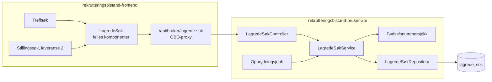
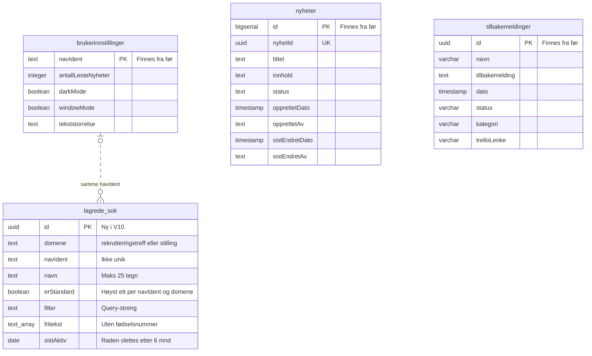
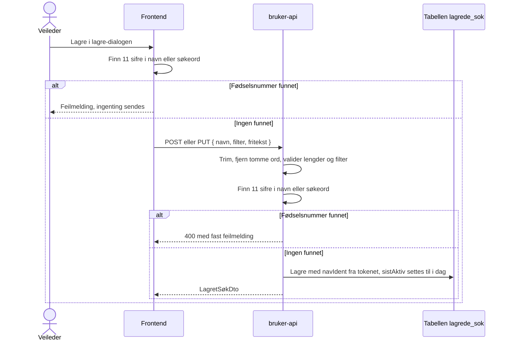
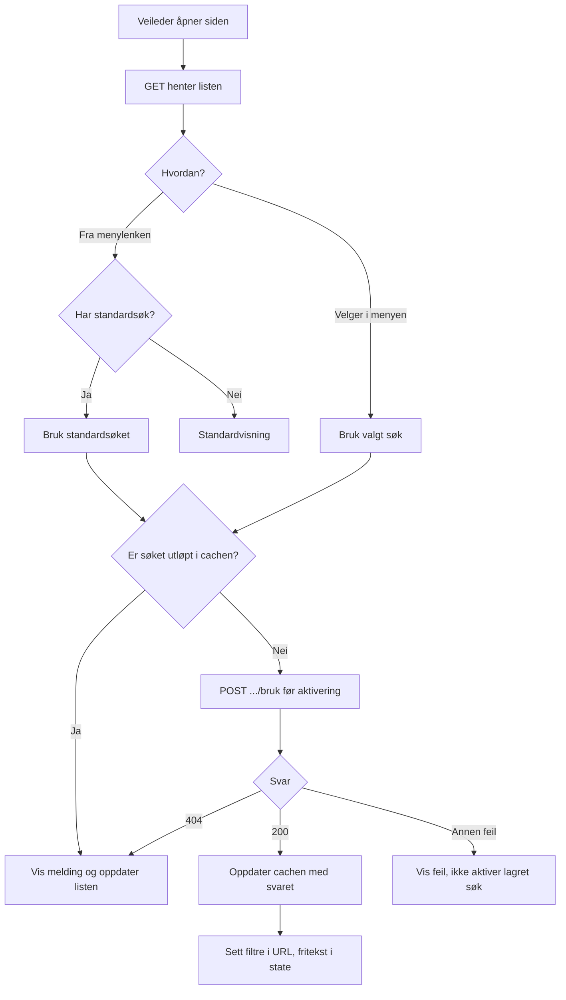
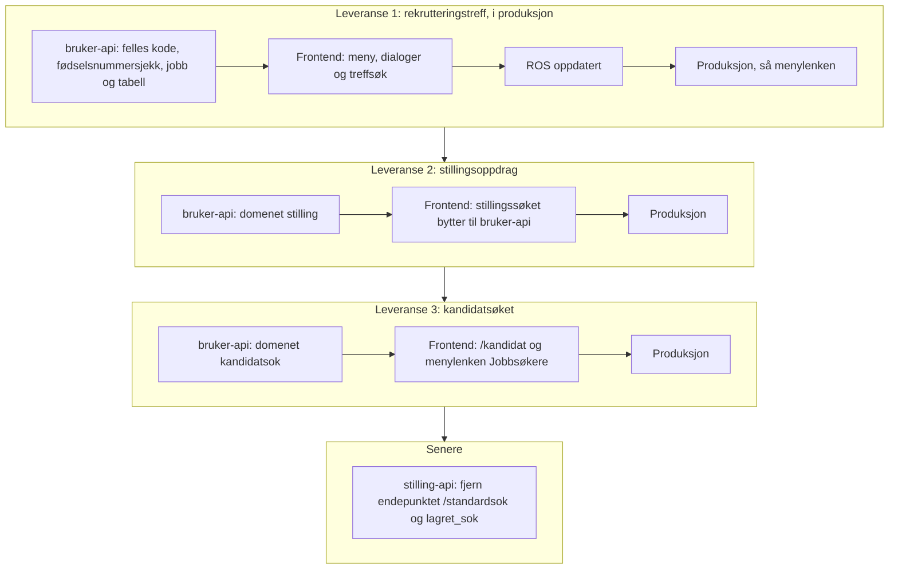

# Plan: Lagrede søk for rekrutteringstreff, stillingsoppdrag og kandidatsøket i bruker-api

**Status:** Leveranse 1 (rekrutteringstreff) er i produksjon. Leveranse 2 (stillingssøket) er implementert i bruker-api og frontend, men ikke rullet ut. Vi konverterer ikke de gamle standardsøkene, se [Hvorfor vi ikke konverterer](#hvorfor-vi-ikke-konverterer). Etterregistreringen får ikke lagrede søk i leveranse 2. Leveranse 3 (kandidatsøket) er planlagt og starter når leveranse 2 er i produksjon, se [Leveranse 3: kandidatsøket](#leveranse-3-kandidatsøket).

## Kort fortalt

- Rekrutteringstreff får lagrede søk i `rekrutteringsbistand-bruker-api`. Hver veileder kan lagre opptil 10 søk per domene, gi dem navn, bruke dem og slette dem. Standardsøket brukes når veilederen åpner søket fra menylenken. I rekrutteringstreff er «Vanlig søk» standard til veilederen selv velger et lagret søk.
- Stillingssøket får de samme lagrede søkene i leveranse 2. De gamle standardsøkene i stilling-api blir ikke med. Veilederne starter med «Vanlig søk» og lagrer søkene de vil ha på nytt.
- Etterregistreringen brukte det samme gamle standardsøket som stillingssøket. Den mister lagret søk i leveranse 2 og får ikke eget domene. Vi legger det til senere hvis veilederne trenger det.
- Kandidatsøket (fanen «Jobbsøkere», `/kandidat`) får lagrede søk i leveranse 3. «Finn jobbsøkere» for en stilling eller et treff har de samme lagrede søkene. Stillingen fyller ut sted og yrke selv, så standardsøket brukes bare når veilederen åpner «Finn jobbsøkere» fra et treff.
- Vi leverer én applikasjon av gangen helt til produksjon. Rekrutteringstreff kom først.
- Alle domener lagres i én tabell, `lagrede_sok`, med kolonnen `domene`. De deler kode og opprydningsjobb.
- Hvert søk har en id (søkeident). Nav-identen er ikke lenger unik i tabellen.
- Navn bør være beskrivende, men trenger ikke være unike. Like navn gir ingen feilmelding. Alle valg og endringer bruker søkeidenten.
- Statuslinjen «Lagret søk» viser navnet på det lagrede søket som har de samme filtrene og søkeordene som siden, uansett om veilederen valgte søket i menyen eller valgte filtrene selv. Derfor heter den ikke «Valgt søk». Frontend lagrer ikke et søk som finnes fra før. Backend sjekker det ikke.
- Hvert søk har datoen `sistAktiv`. Lagring, bruk og «Gjør til standard» fornyer seksmånedersfristen. Ved bruk oppdateres datoen høyst én gang i døgnet.
- Navn og fritekst lagres bare i body og database, aldri i URL-en. Navn og søkeord med fødselsnummer stoppes i frontend og avvises av backend.
- Søkeord som ikke er lagret, huskes bare i minnet, så søket er uendret når veilederen går tilbake fra et treff, en stilling eller en jobbsøker. Etter refresh står filtrene, men ikke søkeordene.
- Et søk uten aktivitet på seks måneder slettes helt. Etter fem måneder får det en merknad i menyen. Et søk i jevnlig bruk har ingen øvre grense for lagringstid.
- En veileder har høyst ett lagret standardsøk per domene. Uten et lagret standardsøk er «Vanlig søk» standard, også etter at veilederen har lagret søk. Veilederen velger et lagret søk som standard i «Administrer søk», og kan velge «Vanlig søk» igjen. Slettes eller utløper standardsøket, blir «Vanlig søk» standard. Regelen gjelder alle domener.
- Når menylenken bruker standardsøket, viser statuslinjen «Lagret søk» med navnet. Uten standardsøk gir menylenken standardvisningen, den samme som «Fjern alle filtre» gir.

## Den gamle løsningen i stillingssøket

Slik virket standardsøket før leveranse 2. Frontend bruker ikke endepunktet og tabellen i stilling-api lenger, og vi fjerner dem i en senere opprydning.

Menylenken «Stillingsoppdrag» og knappen «Bruk standardsøk» går til `/stilling?brukStandardsok=true`. Da henter `page.tsx` standardsøket fra stilling-api og bytter URL-en med `window.history.replaceState`. Diskettikonet sender query-strengen med `PUT /standardsok` og overskriver det gamle søket. Hver veileder har ett søk.

| Del                 | Innhold                                                                                                               |
| ------------------- | --------------------------------------------------------------------------------------------------------------------- |
| Frontend            | `app/stilling/_ui/standardsøk/` og `app/api/stilling/standardsok/`                                                    |
| API                 | `GET /standardsok` gir `200` eller `404`. `PUT /standardsok` med `{ søk }` gir `201`. Nav-identen kommer fra tokenet. |
| Tabell `lagret_sok` | `id`, `nav_ident`, `sok` (query-streng), `tidspunkt` (uten tidssone)                                                  |
| Lagres ikke         | `utenOppdrag`, `visStillingId`, `brukStandardsok`, `finnKandidater`, `visKandidatId`, fritekst                        |

Svakheter vi ikke tar med oss:

- `lagret_sok` mangler unik-indeks på `nav_ident`, og repositoryet leser før det skriver. To samtidige lagringer kan gi to rader.
- Diskettikonet er deaktivert når søket er likt det lagrede, og sammenligningen er en strengsammenligning. I den nye løsningen normaliserer vi filtrene før vi sammenligner, og sammenligner med alle de lagrede søkene.
- Mens `brukStandardsok` sto i URL-en, ignorerte `StillingsSøkContext` fritekst. Blokkeringen er fjernet i leveranse 2.

## Arkitektur

`rekrutteringsbistand-bruker-api` har allerede brukerinnstillinger per Nav-ident, `accessPolicy` for frontend og de rollene vi trenger. Vi trenger ingen ny auth eller ny tjeneste.



Controlleren håndterer auth, input-validering og HTTP-svar. Servicen samler reglene for eierskap, antallsgrense, standardvalg og utløp, og styrer transaksjonene. Repositoryet gjør databaseoppslagene, også for opprydningsjobben.

### API

«Lagrede søk» er alle søkene en veileder har lagret. «Standardsøk» er det ene søket som er valgt som standard. Koden følger samme skille: `LagretSøk`, `LagredeSøkService` og `/api/lagrede-sok`, men `erStandard` og `.../standard`. I servicen er standardvalget én funksjon, `velgStandard(domene, navIdent, id?)`, der `null` betyr vanlig søk.

Frontend kaller `/api/bruker/lagrede-sok/{domene}`, og proxyen sender videre til `/api/lagrede-sok/{domene}`. `domene` er `rekrutteringstreff` eller `stilling`. Andre verdier gir `404`. `{id}` er søkeidenten.

| Metode   | Sti                                         | Bruk                                                                                                                                                                                                                                        | Svar                                                                                                                                               |
| -------- | ------------------------------------------- | ------------------------------------------------------------------------------------------------------------------------------------------------------------------------------------------------------------------------------------------- | -------------------------------------------------------------------------------------------------------------------------------------------------- |
| `GET`    | `/api/lagrede-sok/{domene}`                 | Henter alle veilederens søk. Brukes av menyen, lagre-dialogen og menylenken.                                                                                                                                                                | `200` med liste av `LagretSøkDto`. Standardsøket står først, resten er sortert på navn (norsk alfabet) og deretter id. Tom liste uten lagrede søk. |
| `POST`   | `/api/lagrede-sok/{domene}`                 | «Lagre som nytt søk»                                                                                                                                                                                                                        | `201` med `LagretSøkDto`. `409` når veilederen allerede har 10 søk. Like navn og like søk tillates.                                                |
| `PUT`    | `/api/lagrede-sok/{domene}/{id}`            | «Erstatt et lagret søk». Endrer ikke standardvalget.                                                                                                                                                                                        | `200` med `LagretSøkDto`.                                                                                                                          |
| `PUT`    | `/api/lagrede-sok/{domene}/{id}/navn`       | «Endre navn» i «Administrer søk». Body `NyttNavnDto`. Endrer bare navnet og fornyer fristen. Filter, søkeord og standardvalg står urørt.                                                                                                    |
| `PUT`    | `/api/lagrede-sok/{domene}/{id}/standard`   | «Gjør til standard» for et lagret søk. Flytter standardvalget til søket og fornyer fristen for det. Idempotent.                                                                                                                             | `204`. `404` når søket ikke finnes, ikke tilhører veilederen eller `id` ikke er en UUID.                                                           |
| `PUT`    | `/api/lagrede-sok/{domene}/vanlig/standard` | «Gjør til standard» for «Vanlig søk». Fjerner merket fra det lagrede standardsøket og sletter ingen søk. Uten body. Idempotent. Registrert før `PUT .../{id}/standard`, ellers fanger den «vanlig» som id. En UUID kan aldri være «vanlig». | `204`                                                                                                                                              |
| `DELETE` | `/api/lagrede-sok/{domene}/{id}`            | «Slett»                                                                                                                                                                                                                                     | `204`                                                                                                                                              |
| `POST`   | `/api/lagrede-sok/{domene}/{id}/bruk`       | Kontrollerer og registrerer bruk før søket aktiveres. Ingen body.                                                                                                                                                                           | `200` med gjeldende `LagretSøkDto`                                                                                                                 |

Alle kall med `{id}` gir `404` hvis søket ikke finnes, er utløpt eller tilhører en annen veileder. Svaret skiller ikke mellom disse tilfellene. Ugyldig body gir `400` med en fast feilmelding uten innhold fra input.

`POST .../bruk` er `POST` fordi kallet endrer data. En `GET` kan sendes på nytt av SWR, forhåndshenting eller proxyer og skal ikke fornye fristen. Svaret fra `.../bruk` oppdaterer SWR-cachen uten et ekstra `GET`-kall.

Alle domener er åpne for alle de fem rollene i bruker-api. Controlleren sjekker det med `verifiserHarEnRolle()` i `AutentisertNavBruker`, som også innstillinger, nyheter for veiledere og innsending av tilbakemeldinger bruker. Et token uten noen av rollene gir `403`. Frontend bestemmer fortsatt hvem som ser treffsøket og stillingssøket.

Nav-identen kommer alltid fra tokenet, aldri fra body eller sti. Hver spørring med `{id}` har både `id` og `navIdent` i `WHERE`.

| DTO            | Felt              | Type            | Regel                                                                                                              |
| -------------- | ----------------- | --------------- | ------------------------------------------------------------------------------------------------------------------ |
| `LagreSøkDto`  | `navn`            | String          | 1 til 25 tegn etter trimming. Kan ikke inneholde 11 sifre som kan være et fødselsnummer. Like navn tillates.       |
|                | `filter`          | String          | Query-streng uten `?`, maks 2 000 tegn, kan være tom. Backend validerer tillatte parametere og verdier per domene. |
|                | `fritekst`        | Liste av String | Maks 20 ord og 400 tegn totalt, kan være tom. Kan ikke inneholde 11 sifre som kan være et fødselsnummer.           |
| `NyttNavnDto`  | `navn`            | String          | Samme regel som `navn` i `LagreSøkDto`.                                                                            |
| `LagretSøkDto` | `id`              | UUID            | Søkeidenten                                                                                                        |
|                | `navn`            | String          |                                                                                                                    |
|                | `erStandard`      | Boolean         |                                                                                                                    |
|                | `filter`          | String          |                                                                                                                    |
|                | `fritekst`        | Liste av String | Trimmet, uten tomme ord                                                                                            |
|                | `sistAktiv`       | Dato            | Siste lagring, bruk eller valg som standard                                                                        |
|                | `slettes`         | Dato            | Seks kalendermåneder etter `sistAktiv`                                                                             |
|                | `visSlettevarsel` | Boolean         | Beregnes av backend. Sann fra fem kalendermåneder etter `sistAktiv` til søket utløper.                             |

Standardvalg inngår ikke i `LagreSøkDto`. Høyst ett lagret søk har `erStandard`. Har ingen det, er «Vanlig søk» standard. Bare `PUT .../{id}/standard` merker et søk, og `GET` skriver aldri. Regelen er lik for alle domener.

### Tabell: én for alle domener

Alle domener lagres i tabellen `lagrede_sok`, med kolonnen `domene`. `V9__standardsok.sql` opprettet én tabell per domene og ble rullet ut i dev. `V10__lagrede_sok.sql` sletter de to tabellene og oppretter `lagrede_sok`. Løsningen er ikke i produksjon, så dataene i dev beholdes ikke. Kolonnenavnene følger stilen i repoet (`navIdent`, som i `brukerinnstillinger`).

Databasen i bruker-api etter begge leveransene. Ingen tabeller har fremmednøkler. Den stiplede linjen viser at søkene og brukerinnstillingene bruker samme `navIdent`, uten at databasen håndhever koblingen. En veileder kan ha søk uten en rad i `brukerinnstillinger`. `text_array` er `text[]`, fordi Mermaid ikke tillater klammer i typenavn.



| Tabell                | Status         | Innhold                                                                                                          |
| --------------------- | -------------- | ---------------------------------------------------------------------------------------------------------------- |
| `lagrede_sok`         | Ny i V10       | Lagrede søk for rekrutteringstreff og stillingsoppdrag. De gamle standardsøkene i stilling-api konverteres ikke. |
| `brukerinnstillinger` | Finnes fra før | Visningsvalg per veileder                                                                                        |
| `nyheter`             | Finnes fra før | Nyheter i Rekrutteringsbistand                                                                                   |
| `tilbakemeldinger`    | Finnes fra før | Tilbakemeldinger fra veiledere                                                                                   |

Kolonner:

| Kolonne      | Type                             | Merknad                                                                                                                                                                                                                              |
| ------------ | -------------------------------- | ------------------------------------------------------------------------------------------------------------------------------------------------------------------------------------------------------------------------------------ |
| `id`         | `uuid` primærnøkkel              | Søkeidenten, lages av backend                                                                                                                                                                                                        |
| `domene`     | `text not null`                  | `rekrutteringstreff` eller `stilling`. Enumen `LagredeSøkDomene` i koden bestemmer gyldige verdier, og databasen har ingen sjekk. Et nytt domene krever da ingen migrering. Verdien er `stinavn` i enumen og kommer aldri fra input. |
| `navIdent`   | `text not null`                  | Ikke unik. Indeks på `navIdent` og `domene` for oppslag per veileder.                                                                                                                                                                |
| `navn`       | `text not null`                  | Maks 25 tegn etter trimming. Ikke unikt, heller ikke sammen med `navIdent`.                                                                                                                                                          |
| `erStandard` | `boolean not null default false` | Delvis unik indeks på `navIdent` og `domene` der `erStandard` er sann, så hver veileder har høyst ett standardsøk per domene                                                                                                         |
| `filter`     | `text not null`                  | Query-strengen slik frontend bygger den. Se [Filteret lagres som query-streng](#filteret-lagres-som-query-streng).                                                                                                                   |
| `fritekst`   | `text[] not null default '{}'`   |                                                                                                                                                                                                                                      |
| `sistAktiv`  | `date not null`                  | Settes ved lagring, bruk og valg som standard. Indeks på `domene` og `sistAktiv` for opprydningsjobben, som sletter rader med `sistAktiv` på eller før seneste utløpte dato.                                                         |

Regler i backend:

- Grensen på 10 aktive søk gjelder per domene, også ved samtidige opprettelser. Opprettelse, erstatting, bruk og standardbytte tar en advisory lock per domene og Nav-ident (`pg_advisory_xact_lock`), som gjelder på tvers av podene. Transaksjonen kjører med `READ COMMITTED`, så tellingen etter låsen ser det andre kall har committet. Under `REPEATABLE READ`, som er standard i bruker-api, ville tellingen vært utdatert, og to samtidige kall som oppdaterer samme rad, ville gitt serialiseringsfeil (`40001`) og `500`.
- Bytte av standardsøk fjerner merket fra det gamle, setter det på det nye og oppdaterer det nye søkets `sistAktiv` i én transaksjon. Datoen for det gamle søket endres ikke. Den delvise unike indeksen er et siste vern mot flere standardsøk.
- Sletter veilederen standardsøket, eller utløper det, blir «Vanlig søk» standard. Backend velger ikke et nytt standardsøk. Et utløpt søk som fortsatt er merket som standard, regnes ikke som standard før opprydningsjobben sletter det. Velger veilederen «Vanlig søk» da, telles det ikke som en endring.
- Hver spørring i `LagredeSøkRepository` har `domene` i `WHERE`, som en vanlig parameter. Et søk i ett domene kan derfor ikke leses, endres eller slettes gjennom et annet. Komponenttestene sjekker dette for alle domener.
- Søk slettes når veilederen sletter dem, eller etter seks måneder uten aktivitet. Se [Sletting etter seks måneder uten aktivitet](#sletting-etter-seks-måneder-uten-aktivitet).

|                  | Én tabell med `domene`-kolonne (valgt)                               | Én tabell per domene                                      |
| ---------------- | -------------------------------------------------------------------- | --------------------------------------------------------- |
| Nøkkel           | `id`, indeks på `navIdent` + `domene`                                | `id`, indeks på `navIdent`                                |
| Unike regler     | Høyst ett standardsøk per `navIdent` + `domene`. Like navn tillates. | Høyst ett standardsøk per `navIdent`. Like navn tillates. |
| Nytt domene      | Ny verdi i enumen, ingen migrering                                   | Ny tabell med kolonner og indekser                        |
| Ulik utvikling   | Domenespesifikke kolonner blir `null` for de andre domenene          | Hvert domene kan få egne kolonner uten å påvirke de andre |
| Fjerne et domene | `DELETE` og verdien fjernes fra enumen                               | `DROP TABLE`                                              |
| SQL              | Fast tabellnavn, `domene` er en parameter                            | Tabellnavnet settes inn i SQL-strengen fra koden          |

Vi valgte først én tabell per domene, men byttet før produksjon. Domenene har like kolonner, og forskjellene ligger i filterreglene, som backend håndhever per domene. Vi planla også et domene for etterregistreringen, og da ville en tabell per domene gitt tre like tabeller.

Domenet `etterregistrering` fantes en periode i bruker-api i dev og er fjernet fra enumen. Frontend tok det aldri i bruk, så tabellen har ingen rader med domenet.

### Filteret lagres som query-streng

`filter` er query-strengen slik frontend bygger den, med URL-kodingen fra nuqs, for eksempel `statuser=PUBLISERT%2CFULLF%C3%98RT`. Vi lagrer den i en `text`-kolonne, ikke som JSON i en `jsonb`-kolonne. Bruker-api er laget for innstillingene i denne frontenden, og et lagret søk er filtrene slik frontenden har dem.

Vurdert 5. november 2026, da kandidatsøket fikk frie verdier:

- Fordeler: samme streng brukes i URL-en, i sammenligningen for statuslinjen, som nøkkel for søkeordene i minnet, i API-et og i databasen. Filteret fra databasen kan limes rett inn i URL-en ved feilsøking. Nye filtre krever bare en ny regel i bruker-api.
- Ulemper: filteret er tungt å lese i databasen (`Truckf%C3%B8rerbevis`). Bruker-api må kjenne kodingen nuqs bruker for komma i en verdi (`%2C`) for å sjekke frie verdier i kandidatsøket.
- Lagringsformatet kan endres senere uten å endre API-et, for eksempel til `jsonb` eller en annen koding. Radene som finnes, må da konverteres med en migrering i Kotlin, fordi Postgres ikke kan URL-dekode.

### Dato for siste aktivitet

Vi lagrer en dato og ikke et tidspunkt. Det holder for sletting etter seks måneder og for å vise «sist aktiv». Det sier også mindre om når den ansatte jobber. Backend regner datoen i tidssonen `Europe/Oslo`.

`sistAktiv` settes til i dag når veilederen lagrer søket som nytt, erstatter det, tar det i bruk eller velger «Gjør til standard». Å hente listen eller åpne menyen endrer den ikke.

`POST .../bruk` leser søket og oppdaterer bare når `sistAktiv` er eldre enn i dag. Det gir høyst én databaseskriving per søk i døgnet ved bruk, selv om frontend kaller hver gang. Ved lagring og standardbytte skriver backend de øvrige endringene som vanlig.

Slettefristen er seks kalendermåneder etter `sistAktiv`, og varselet starter etter fem. Finnes ikke dagen i målmåneden, brukes månedens siste dag. Søket er utløpt fra og med slettefristen. Backend bruker samme regel for svar, oppslag og opprydning, og beregner `visSlettevarsel` for frontend. Reglene testes ved månedsslutt og skuddår.

Én dato per søk erstatter egne datoer for navn og fritekst. Begge følger raden.

## Fritekst og navn

### Hvorfor bare i body

Fritekst ligger i React-state i begge søkene i dag, og ikke i URL-en. Det hindrer at den havner i nettleserhistorikk, tilgangslogger og Umami. Vi beholder det: fritekst og navn går bare i body på `POST` og `PUT` og i svarene fra API-et. Søkeidenten brukes bare i stien til API-kallene, ikke i URL-en på søkesiden. Id-en er en tilfeldig UUID og sier ingenting om innholdet. Når et søk brukes, legges fritekst i state og vises som chips.

Backend avviser ukjente filterparametere og ugyldige verdier. `filter` kan dermed ikke brukes til å lagre navn eller fritekst som senere legges i URL-en. Kandidatsøket er et unntak: `kompetanse` og `arbeidserfaring` godtar tekst veilederen skriver selv, se [Filterregler for kandidatsøket](#filterregler-for-kandidatsøket).

### Avvisning av fødselsnumre

Navn og søkeord med fødselsnummer blir ikke lagret. Frontend stopper lagringen og forteller veilederen hva som må endres. Backend avviser det samme med `400` som sikkerhetsnett. Vi renser ikke, så det lagrede søket er alltid det veilederen så. Søket mot treffene sjekkes ikke.



Teksten avvises når den har 11 sifre, der det kan stå mellomrom mellom to sifre. Flere mellomrom på rad regnes som ett, så `123456  78901` fanges. Teksten normaliseres med NFKC først, så sifre i full bredde og hardt mellomrom også fanges. Andre tegn mellom sifrene, som komma, punktum, bindestrek, skråstrek eller tab, regnes ikke som skilletegn. Et nummer delt over to filterverdier eller to søkeord, som `123456 ` og `78901`, fanges også. Sjekken ser ikke på dato eller kontrollsiffer. Da fanger den D-nummer, H-nummer, syntetiske nummer og tastefeil, og nye regler fra Skatteetaten (som reglene fra 2032) krever ingen endring. Vi avviser heller for mye enn for lite. Tall med færre eller flere sifre, som organisasjonsnumre, godtas. Frontend (`components/lagrede-søk/fødselsnummer.ts`) og backend (`Fødselsnummersjekk`) har samme regel. Sjekken er et sikkerhetsnett mot uhell, ikke mot bevisst omgåelse.

### Sletting etter seks måneder uten aktivitet

Navn er også fritekst, så vi sletter hele søket og ikke bare søkeordene. Søket utløper seks kalendermåneder etter `sistAktiv`.

- `GET` returnerer aldri utløpte søk, selv om jobben ikke har kjørt.
- Kall med `{id}` mot et utløpt søk gir `404`. Eierskap og utløp kontrolleres før eventuell oppdatering, så et kall ikke kan vekke søket til live.
- Utløpte søk teller ikke mot grensen på 10. `POST` og `DELETE` sletter ikke utløpte søk.
- Bare opprydningsjobben sletter utløpte søk. Den sletter raden ved neste kjøring, innen en time. Skjuling ved fristen og ventetiden fram til sletting er beskrevet i ROS-en.

Et søk som brukes, lagres eller velges som standard jevnlig, har ingen øvre grense for hvor lenge navn og søkeord blir liggende. Vi innfører ingen absolutt maksimal lagringstid, så tabellen trenger ingen opprettelsesdato. Fødselsnummersjekken fanger ikke andre personopplysninger. Begge deler er vurdert i ROS-en.

### Merknad før sletting

Vi markerer søk fra fem kalendermåneder etter `sistAktiv`. Merknaden lagres ikke. Backend beregner `slettes` og `visSlettevarsel`, som frontend bruker i visningen.

- Merknaden koster ingen ny kolonne, jobb eller varsling.
- Veilederen ser den i menyen og i «Administrer søk». Bruk, lagring eller «Gjør til standard» starter de seks månedene på nytt. Vi lager ingen egen knapp for å beholde søk.
- Uten merknad forsvinner søk uten forvarsel. Det er særlig ille for standardsøket, som brukes fra menylenken.

Vi sender ikke varsel utenfor løsningen, for eksempel e-post. Det krever mer enn gevinsten forsvarer.

### Opprydningsjobb

- Kjører hver time i bruker-api. For hvert domene sletter den rader som har nådd slettefristen, så metrikkene kan telle per domene. Spørringen bruker indeksen på `domene` og `sistAktiv` og koster lite.
- Én felles jobb for alle domenene.
- Jobben er idempotent. Den kan derfor kjøre på alle podene uten leader election.
- Hvert domene ryddes i sin egen transaksjon med `READ COMMITTED`. Feiler ett domene, logges feilen uten innhold, og de andre domenene ryddes likevel. Kjøringen telles som vellykket bare når alle domenene lyktes.
- Jobben stopper når Javalin stopper. Gjentatte start- og stoppkall oppretter ikke flere jobber.
- Jobben logger og teller bare antall rader, aldri innhold.
- Feil og tidspunktet for siste vellykkede kjøring måles. Det varsles hvis jobben ikke har kjørt uten feil på seks timer. Etter en deploy varsles det bare hvis de to første kjøringene feiler.

## Når filtrene endres

Filtrene i søkene endrer seg over tid. Lagrede søk skal fortsatt virke uten migrering.

- **Bruker-api renser filteret i hvert svar** med `Filterregler.rens()`. Parametere som ikke finnes lenger, fjernes. I en liste fjernes ukjente verdier, og resten beholdes. Er ingen verdier gyldige, fjernes hele parameteren. Gyldige parametere beholdes tegn for tegn, så filteret er likt det frontend bygger. Databasen endres ikke før veilederen lagrer søket på nytt.
- **Frontend gir manglende parametere standardverdien.** Gamle søk uten et nytt filter får standardverdien, og serialiseringen utelater standardverdier.
- **Validering ved lagring er uendret.** `POST` og `PUT` avviser fortsatt ukjente parametere og verdier. Frontend erstatter søk med det rensede filteret fra svaret, så det går gjennom. Nytt navn sender ikke filteret, og raden beholder det gamle filteret.

Regler når filtrene endres:

- Legg til nye parametere og verdier i bruker-api før frontend. Ellers avviser bruker-api søk med det nye filteret.
- Ta ut parametere og verdier fra bruker-api før eller samtidig med frontend.
- Gi nye filtre en standardverdi som ikke filtrerer bort noe. Gamle søk får standardverdien.
- Ikke endre standardverdien til et filter. Søk som er lagret uten parameteren, ville fått nye treff uten at veilederen ser det.
- Ikke gjenbruk et parameternavn eller en verdi med ny betydning.

Sjekkliste når et søk får en ny parameter eller verdi som skal lagres:

1. Bruker-api: legg verdien til i domenets `*Filterparameter` i pakken `domene`, og i domenets `*FilterTest`. Deploy.
2. Frontend: legg verdien til i domenets `lagredeSøkFilter.ts` eller i enumen den bruker. De faste verdiene som lagres, hentes fra enumene med `Object.values`, og enumene ligger i moduler uten React (`_types/constants.ts`, `stillingssøk-typer.ts` og `kandidatsøk-typer.ts`).
3. Frontend: legg verdien til i reglene for domenet i `lagredeSøkApi.msw.ts`. Mocken har egne kopier av reglene i bruker-api.
4. Frontend: oppdater kontrakttesten i `tests/<domene>/lagrede-sok.spec.ts`, så den bygger filteret med den nye verdien og bruker samme streng som `*FilterTest`.
5. Frontend: avhenger filteret av et annet, som kommune av fylke, må setteren rydde begge i samme handling (se [Når siden åpnes](#når-siden-åpnes)).

## Frontend

Vi beholder plasseringen under søkefeltet. «Bruk standardsøk» blir en meny med de lagrede søkene, og diskettikonet blir stående ved siden av menyen. Skissene under er et utgangspunkt for designer, ikke et ferdig design. Alt bygges med Aksel-komponenter (`ActionMenu`, `Tooltip`, `Modal`, `RadioGroup`, `TextField`, `Select`, `Link`).

### Meny og statuslinje

Menyen erstatter knappen «Bruk standardsøk». Et klikk på et søk tar det i bruk og lukker menyen. Søkene er radiovalg (`ActionMenu.RadioItem`), så søket som er i bruk, er markert så lenge filtrene er uendret. Like navn er tillatt, men hvert menyelement bruker id-en til riktig søk. Standardsøket står øverst, og resten står i alfabetisk rekkefølge. Da står søkene på samme plass hver gang, også etter at veilederen har brukt et av dem.

```text
[ Lagrede søk ▾ ] [💾]
Lagret søk: Treff i Oslo

  ┌ Søk ──────────────────┐
  │ ( ) Vanlig søk        │
  │ ───────────────────── │
  │ (•) Treff i Oslo      │
  │     Standard          │
  │ ( ) Treff Vestland    │
  │ ( ) Mine utkast       │
  │     Slettes snart     │
  │ ───────────────────── │
  │ ⚙ Administrer søk     │
  └───────────────────────┘
```

- «Vanlig søk» står øverst, over en skillelinje, i samme radiogruppe som de lagrede søkene. Valget nullstiller filtre og søkeord, som «Fjern alle filtre». Det er markert når URL-en ikke har filtre og det ikke finnes søkeord, og har merknaden «Standard» når ingen lagrede søk er standard. Det teller ikke mot grensen på 10.
- Under navnet står en liten grå merknad: «Standard» for standardsøket og «Slettes snart» for søk med `visSlettevarsel`. Har søket begge, skilles de med « · ». Datoen står i «Administrer søk», fordi menyen er smal.
- Vi bruker ikke stjerne eller hake. Stjernen var ikke intuitiv, og Aksel fraråder hake i menyer fordi den ligner radiovalg.
- Disketten er en ikonknapp på samme rad som menyen. Sidepanelet er for smalt til en tekstknapp ved siden av menyen. Knappen har tooltip og tilgjengelig navn «Lagre søk», og er deaktivert uten filter eller søkeord.
- Statuslinjen viser navnet på det lagrede søket som har de samme filtrene og søkeordene som siden. `useLagredeSøk` regner det ut fra listen over søk ved hver endring (`finnLiktSøk`), og lagrer ikke hvilket søk som er valgt. Endrer veilederen noe, også med «Fjern alle filtre», forsvinner linjen og markeringen i menyen. Setter veilederen filtrene og søkeordene tilbake, kommer linjen tilbake, også uten å velge søket i menyen. Linjen er en `aria-live`-region.
- Slik sammenlignes søkene:
  - Filtrene sammenlignes etter at begge er normalisert med domenets `normaliserFilter`, så rekkefølgen på parameterne og verdiene, standardverdier og koding ikke gir forskjell. Det gjelder også søk som er lagret med en annen rekkefølge enn frontend bruker nå.
  - Sorteringen er en del av søket, fordi den lagres med søket.
  - Rekkefølgen på søkeordene teller ikke, og et søkeord som står to ganger, teller én gang. Søkeordene lagres og vises likevel i rekkefølgen veilederen la dem inn. Et søkeord som allerede er med, legges ikke til igjen.

- Uten lagrede søk viser menyen «Vanlig søk», og under skillelinjen «Du har ingen lagrede søk» og «Velg filtre og trykk på Lagre søk.». «Administrer søk» er deaktivert.
- Fokus går tilbake til knappen som åpnet dialogen, også når dialogen lukkes etter lagring eller med Esc.

### Like søk

Frontend lagrer ikke et søk med de samme filtrene og søkeordene som et annet. Backend sjekker det ikke, fordi det er frontend som vet når to søk er like (nuqs-parsing, standardverdier og sortering).

- Lagreknappen er deaktivert når søket er likt et lagret søk, fordi statuslinjen da viser søket.
- Lagre-dialogen sjekker listen før den lagrer. Er søket likt et annet, viser den «Du har allerede lagret dette søket som «_navn_».» og lagrer ingenting.
- Like søk kan likevel oppstå: når to faner lagrer det samme søket samtidig, eller når et filter tas ut av søket eller får nytt navn. Ingenting feiler. Statuslinjen viser det øverste av dem i listen, også når veilederen valgte et annet. Standardsøket står først i listen, så det vinner. Filtrene og søkeordene er de samme, så treffene er de samme. Vi husker ikke hvilket søk veilederen valgte, for å holde koden enkel.
- «Administrer søk» viser «Likt søket «_navn_»» i merknaden til hvert av de like søkene, så veilederen kan slette det ene.

### Når siden åpnes

- Standardsøket brukes bare fra menylenken (`?brukStandardsok=true`), som i stillingssøket. Statuslinjen viser da «Lagret søk» med navnet på standardsøket.
- Åpnes siden uten `brukStandardsok`, for eksempel fra et bokmerke, en delt lenke, etter refresh eller med tilbakeknappen, viser den filtrene i URL-en. Uten filtre i URL-en er det vanlig søk. Velger veilederen «Vanlig søk», står valget seg derfor ved refresh og når veilederen går tilbake fra et treff. Refresh etter standardsøket fra menylenken gir filtrene fra standardsøket uten søkeordene, siden `brukStandardsok` fjernes fra URL-en etter bruk.
- Søkeordene står ikke i URL-en. `useLagredeSøk` husker dem bare i minnet per domene, med det normaliserte filteret som nøkkel (`søkeordIMinnet.ts`). Når siden åpnes, hentes søkeordene for filtrene i URL-en derfra. Kortene i de tre søkene åpner treffet, stillingen eller jobbsøkeren med Next-routeren (`WindowAnker` med `klientnavigering`), så siden ikke lastes på nytt og minnet står. Søket er derfor uendret når veilederen åpner et kort og går tilbake. Refresh tømmer minnet: filtrene i URL-en står, søkeordene er borte, og statuslinjen vises bare hvis et lagret søk uten søkeord passer. Det er som før lagrede søk. Er filtrene og søkeordene like et lagret søk, viser statuslinjen navnet, og søket er markert i menyen. Søket mot treffene venter til søkeordene er på plass.
  - Søkeordene lagres bare etter handlinger fra veilederen: endrede filtre eller søkeord, valg i menyen og menylenken. Når siden setter tilbake et søk, lagres ingenting. Next og nuqs viser filtrene fra historikken før `popstate` når fram til oss, så en lagring ved hver render ville lagt de gamle søkeordene under de nye filtrene.
  - Minnet tømmes ved refresh og når fanen lukkes. Vi beholder de 20 siste filtrene. Tomme søkeord fjerner oppføringen.
  - Søkeord med 11 sifre huskes ikke, med samme regel som når søket lagres (`inneholderFødselsnummer`). Chipen står og søket virker mens siden er åpen, men søkeordet er borte etter tilbakeknappen.
  - En tidligere versjon husket søkeordene i `sessionStorage` (`lagrede-sok:<domene>:sokeord`). `søkeordIMinnet.ts` sletter disse nøklene når siden åpnes. Slettingen kan fjernes når alle faner med den gamle versjonen er lukket.
  - Filtre som avhenger av hverandre, ryddes i samme handling som endringen. Fjerner veilederen et fylke, fjerner `setFylker` kommunene i fylket samtidig. I stillingssøket fjerner `setInkludering` underkategoriene på samme måte. Søkeordene huskes for filteret i renderen etter `søkEndret()`, så en opprydding i en senere effekt ville gitt feil nøkkel og mistet søkeordene etter tilbakeknappen. Effektene som rydder, står igjen for URL-er og lagrede søk med ugyldige kombinasjoner.
  - Scrollposisjonen i resultatlisten huskes i `sessionStorage` med filtrene som nøkkel (`SideScroll`). Har søket fritekst, huskes den bare i minnet (`huskBareIMinnet`), så fritekst ikke havner i nøklene. Posisjonen står da etter tilbakeknappen, men ikke etter refresh.
- Tilbake- og framknappen gir filtrene fra historikken. `useLagredeSøk` lytter på `popstate`, venter til filtrene er oppdatert og henter søkeordene fra minnet, som når siden åpnes. Etter menylenken og så tilbakeknappen vises derfor søket veilederen hadde før, med søkeordene, ikke søkeordene fra standardsøket. Valg inne i treffsøket lager ikke egne steg i historikken.
- Et søk som er slettet eller utløpt, er ikke i listen og vises derfor ikke som valgt.
- Menylenken legger på `?brukStandardsok=true`. Det trengs fordi siden ikke lastes på nytt når veilederen allerede står på treffsøket. Søkeordene ligger i state og overlever derfor klikket. `useLagredeSøk` tømmer dem én gang per klikk, før standardsøket brukes. Søkeord som veilederen skriver mens siden venter på standardsøket, beholdes.
- Uten et lagret standardsøk gir menylenken vanlig søk: «Publisert», «Alle treff» og «Sist oppdaterte», uten søkeord.

### Fjern alle filtre

Chipen «Fjern alle filtre» står først i chip-raden over treffene. Den vises når filtre, sortering eller søkeord avviker fra standardvisningen, også når ingen av endringene vises som chip. Et klikk setter alt tilbake til standardvisningen og fjerner parameterne fra URL-en. Statuslinjen forsvinner, fordi filtrene ikke lenger er like et lagret søk.

I stillingssøket er «Vanlig søk» porteføljen «Alle», statusen «Åpen for søkere» og sorteringen «Publiseringsdato», uten søkeord. «Fjern alle filtre» virker som før leveranse 2: den beholder porteføljen, fjerner søkeordene og alle filtrene, også statusfilteret, så stillinger med alle statuser vises (`statuser=` i URL-en). «Med oppdrag» slås på igjen. Den er derfor ikke det samme som «Vanlig søk».

### Smale skjermer

Under 1024 px er filterpanelet skjult. Knappen «Filtrer» ved pagineringen åpner panelet i et ark, med søkefelt, lagrede søk og filtre. Kandidatsøket bruker samme mønster.

Kjent feil: Esc i menyen eller en dialog inne i arket lukker hele arket. Feilen gjelder det felles arket (`Sidepanel.tsx`), der Radix og Aksel begge lytter etter Esc. Den rettes i en egen oppgave, fordi rettingen påvirker alle sidepaneler.

### Dialog: «Lagre søk»

Disketten åpner dialogen. Gjeldende filtre og søkeord lagres. Enter sender skjemaet.

```text
┌ Lagre søk ─────────────────────────────────────┐
│ (•) Lagre som nytt søk                         │
│ ( ) Erstatt et lagret søk                      │
│                                                │
│ Søk som skal erstattes                         │
│ Filtrene og søkeordene i søket byttes ut med   │
│ dem du har valgt nå.                           │
│ [ Velg søk            ▾ ]                      │
│                                                │
│ Navn på søket                                  │
│ Maks 25 tegn. Ikke skriv personopplysninger.   │
│ [_______________]                              │
│                                                │
│ Søk du ikke har brukt på seks måneder, slettes.│
│                                                │
│            [ Avbryt ]  [ Lagre | Erstatt søk ] │
└────────────────────────────────────────────────┘
```

- Uten lagrede søk vises ikke valgene. Dialogen sier i stedet at søket kan gjøres til standard i «Administrer søk».
- Med 10 søk er «Lagre som nytt søk» deaktivert, med teksten «Du har 10 lagrede søk. Erstatt et søk, eller slett et først.» Under valgene står lenken «Slett søk i Administrer søk». Den lukker «Lagre søk» og åpner «Administrer søk». Når veilederen lukker «Administrer søk», går fokus til disketten, så veilederen kan lagre med en gang. Disketten åpner alltid «Lagre søk», så den gjør det samme hver gang.
- Dialogen starter på «Lagre som nytt søk», eller på «Erstatt et lagret søk» når veilederen har 10 søk. Ved erstatting er søket statuslinjen sist viste, forhåndsvalgt, også når filtrene er endret etterpå, og også etter tilbakeknappen. Har veilederen valgt «Vanlig søk» etter det, eller er søket slettet, starter listen på «Velg søk», og veilederen må velge før lagring. Er filtrene og søkeordene like et lagret søk, lagres ingenting, og dialogen viser en melding. Er det søket som erstattes, står det «Søket er likt det du erstatter.», ellers navnet på søket som er likt. Første fokus går til det valgte alternativet i radiogruppen, eller til navnefeltet når veilederen ikke har lagrede søk.
- Ved erstatting vises «Navn på søket» når et søk er valgt, med navnet på søket fylt inn. Veilederen kan beholde det eller skrive et nytt i samme operasjon, og navnet valideres som for nytt søk. Navnet for nytt søk og navnet ved erstatting holdes hver for seg.
- Knappen heter «Erstatt søk» ved erstatting og «Lagre» ellers.
- Lagre-dialogen avviser lukking mens lagring pågår, både med lukkeknappen og med Esc. Ved feil blir dialogen stående med feilmeldingen og kan lukkes eller sendes på nytt. Dette løser ikke den kjente Esc-feilen i filterarket på smale skjermer.
- Frontend og backend validerer lengden. Vi ber om et beskrivende navn, men validerer ikke at navnet er unikt.
- Dialogen har ikke standardvalg. Standard velges i «Administrer søk».

### Dialog: «Administrer søk»

```text
Administrer søk (3 av 10)

Velg navnet på et søk for å bruke det. Standardsøket brukes når du åpner siden.
Vanlig søk viser siden uten filtrene du har valgt selv. Hvis du sletter
standardsøket, blir vanlig søk standard. Vi sletter søk du ikke har brukt på seks
måneder.
──────────────────────────────────────────────────────────────
Vanlig søk                                  [Gjør til standard]
──────────────────────────────────────────────────────────────

──────────────────────────────────────────────────────────────
Treff i Oslo                                            [Slett]
Sist brukt 20.10.2026 · Standard
──────────────────────────────────────────────────────────────
Treff Vestland                      [Gjør til standard] [Slett]
Sist brukt 12.10.2026
──────────────────────────────────────────────────────────────
Mine utkast                         [Gjør til standard] [Slett]
Sist brukt 01.05.2026 · Slettes 01.11.2026
──────────────────────────────────────────────────────────────
                                                         [Lukk]
```

- «Vanlig søk» står i en egen blokk over listen, så listen og antallet i overskriften bare gjelder lagrede søk. Raden har ingen dato og ingen «Slett». Når den er standard, står «Standard» under navnet i stedet for knappen. Knappen har tilgjengelig navn «Gjør til standard: Vanlig søk», og navnet «Bruk Vanlig søk».
- Søkene er en liste, ikke en tabell. På smale skjermer flytter knappene seg under navnet, så datoene ikke presses sammen.
- Navnet er en lenke som tar søket i bruk og lukker dialogen.
- Linjen under navnet viser «Sist brukt», «Standard» i halvfet skrift for standardsøket og «Slettes dd.mm.åååå» for søk med `visSlettevarsel`. Vi viser ikke slettedatoen for alle søk.
- Etter «Gjør til standard» leses kvitteringen ««Treff Vestland» er nå standardsøket.» eller «Vanlig søk er nå standard.» opp. Fokus går til «Slett» på samme rad, eller til «Vanlig søk».
- Slettes standardsøket, sier kvitteringen også at vanlig søk er standard.
- «Slett» bytter innholdet i dialogen til «Slett lagret søk» med spørsmålet «Vil du slette «Treff i Oslo»?» og knappene «Slett» og «Avbryt». Esc og lukkeknappen går tilbake til listen.
- Fokus flyttes til «Avbryt» i bekreftelsen, tilbake til radens «Slett» ved avbryt og til «Lukk» etter sletting. Kvitteringen leses opp.
- «Endre navn» kaller `PUT .../{id}/navn` med bare navnet. Filter og søkeord sendes ikke, så navneendringen skriver ikke tilbake innhold som er erstattet i en annen fane.

«Gjør til standard» fornyer fristen for det valgte søket. Hvis standardsøket slettes eller utløper, blir «Vanlig søk» standard. Listen hentes på nytt etter sletting, så merket «Standard» flytter seg med en gang.

### Filer

| Hvor                                                         | Endring                                                                                                                                                                                                                                                                                                                                                                                                                                                                                                                                                                                                                                                                                 |
| ------------------------------------------------------------ | --------------------------------------------------------------------------------------------------------------------------------------------------------------------------------------------------------------------------------------------------------------------------------------------------------------------------------------------------------------------------------------------------------------------------------------------------------------------------------------------------------------------------------------------------------------------------------------------------------------------------------------------------------------------------------------- |
| `components/lagrede-søk/` (ny)                               | Felles meny, lagre-dialog og administrer-dialog. Menyen `<LagredeSøk lagredeSøk={…} />` får alt den trenger fra `useLagredeSøk`, og vises ikke uten. Domenet sender inn hvilke parametre som lagres og hvordan et søk tas i bruk.                                                                                                                                                                                                                                                                                                                                                                                                                                                       |
| `components/lagrede-søk/useLagredeSøk.ts`                    | Felles flyt for et søk med lagrede søk: hvilket søk som er valgt (`valgtSøk`, regnet ut fra innholdet), bruk av et lagret søk, standardsøket fra menylenken og søkeordene i minnet. Venter på søkelisten og starter høyst én bruk per inngang fra menylenken. Domenet sender inn den kanoniske filterstrengen og funksjoner som setter filtre og søkeord. Valgfritt: `normaliserFilter` (standard: uendret) og `frieFilterverdier` til lagre-dialogen. Hooken gir menyen listen, filteret og søkeordene på siden og `brukVanligSøk`. Contexten må kalle `søkEndret()` ved hver endring av filtre eller søkeord, ellers markerer menyen feil søk. Kalles bare der søket har lagrede søk. |
| `components/lagrede-søk/harSammeInnhold.ts`                  | Sammenligner et lagret søk med filtrene og søkeordene på siden, med domenets `normaliserFilter`. `finnLiktSøk` finner søket som er likt.                                                                                                                                                                                                                                                                                                                                                                                                                                                                                                                                                |
| `components/lagrede-søk/filterverdier.ts`                    | Hjelpere for filterfilene i domenene: sorterer og fjerner duplikater, og tar bare med kjente verdier eller tall med riktig antall sifre. `sortertFilter` sorterer nøklene i query-strengen.                                                                                                                                                                                                                                                                                                                                                                                                                                                                                             |
| `components/lagrede-søk/lagredeSøkParametere.ts`             | Navnet på URL-parameteren `brukStandardsok`                                                                                                                                                                                                                                                                                                                                                                                                                                                                                                                                                                                                                                             |
| `app/rekrutteringstreff/_utils/lagredeSøkFilter.ts`          | Bestemmer hvilke parametere treffsøket lagrer, og standardverdiene deres. Bygger og tolker filterstrengen med nuqs-parserne til treffsøket: standardverdier utelates, lister slås sammen med komma og nøklene sorteres. Fylker, kommuner og kontorer som ikke er nummer, tas ikke med. `normaliserLagretSøkFilter` tolker og bygger på nytt, og brukes som `normaliserFilter`.                                                                                                                                                                                                                                                                                                          |
| `app/api/bruker/lagrede-sok/lagredeSøkTyper.ts`              | Typer, Zod-skjema og grensene som frontend sjekker før lagring: 10 søk, 25 tegn i navnet og 20 søkeord med til sammen 400 tegn. `overstigerSøkeordgrensen` teller på samme måte som bruker-api. Stillingssøket har ingen grense for søkeord, så lagre-dialogen viser en feilmelding i stedet for å sende søket. Søkefeltet i treffsøket bruker samme funksjon med grensen til `/sok`.                                                                                                                                                                                                                                                                                                   |
| `app/api/bruker/lagrede-sok/` (ny)                           | Proxy-rute, SWR-hook per domene, mutasjoner med én `velgStandard(domene, id \| null)` for standardvalget, der `null` kaller `PUT .../vanlig/standard` og en id kaller `PUT .../{id}/standard`, Zod-skjema og MSW-mock. Mocken lagrer søkene per bruker og domene, som backend. Den har egne kopier av backendens regler, så Playwright fanger det backend ville avvist: ukjent domene gir `404`, og filterregler, filterlengde, navn, søkeord og fødselsnummer gir `400`. Reglene er ikke hentet fra frontendens parsere.                                                                                                                                                               |
| Treffsøket                                                   | Meny og diskett under søkefeltet, og «Filtrer» for smale skjermer. `RekrutteringstreffSøkContext` eier filtrene og søkeordene og bruker `useLagredeSøk`. «Fjern alle filtre» bruker `brukVanligSøk` fra hooken. Ved `brukStandardsok` venter søket mot `/sok` på at standardsøket er kontrollert, eller at frontend har vist en feil og gått videre med vanlig søk.                                                                                                                                                                                                                                                                                                                     |
| `AppSidebar.tsx`                                             | `?brukStandardsok=true` på menylenkene «Rekrutteringstreff» og «Stillingsoppdrag».                                                                                                                                                                                                                                                                                                                                                                                                                                                                                                                                                                                                      |
| `components/filter/ValgteFiltre.tsx` og `TømFiltre.tsx`      | Valgfrie props for å vise «Fjern alle filtre» uten chips og nullstille med domenets egen funksjon. Andre søk beholder dagens oppførsel.                                                                                                                                                                                                                                                                                                                                                                                                                                                                                                                                                 |
| `components/brødsmuler/Brødsmuler.tsx`                       | Den første brødsmulen i et treff, en stilling og hos en jobbsøker peker til søket med `?brukStandardsok=true`, som menylenken.                                                                                                                                                                                                                                                                                                                                                                                                                                                                                                                                                          |
| `app/stilling/_util/lagredeSøkFilter.ts` (ny, leveranse 2)   | Parameterne stillingssøket lagrer, og standardverdiene deres. Bygger, tolker og normaliserer filterstrengen som i treffsøket, og tar bare med verdier bruker-api godtar.                                                                                                                                                                                                                                                                                                                                                                                                                                                                                                                |
| `app/stilling/StillingsSøkContext.tsx` (leveranse 2)         | Den påkrevde `brukerLagredeSøk` er sann i `app/stilling/page.tsx` og i jobbsøkerens stillingssøk. Etterregistreringen setter den eksplisitt til usann. Provideren velger da `MedLagredeSøk` eller `UtenLagredeSøk`. Bare `MedLagredeSøk` kaller `useLagredeSøk`. Begge bruker de samme filtrene og setterne. Filtersetterne kaller `søkEndret()`. «Vanlig søk» i menyen bruker `brukVanligSøk` fra `useLagredeSøk`, og `fjernAlleFiltre` beholder oppførselen fra før. Fritekstblokkeringen under `brukStandardsok` er fjernet. Veiledere uten arbeidsgiverrettet rolle ser bare «Åpen for søkere», også når et lagret søk har andre statuser.                                          |
| `app/stilling/_ui/StillingsLagredeSøk.tsx` (ny, leveranse 2) | Meny og diskett i `StillingsSøkLayout`, der `MittStandardsøk` sto. Vises ikke når contexten er uten lagrede søk.                                                                                                                                                                                                                                                                                                                                                                                                                                                                                                                                                                        |
| Slettet i leveranse 2                                        | `app/stilling/_ui/standardsøk/`, `app/api/stilling/standardsok/`, MSW-handleren for den gamle løsningen, `brukStandardsok`-effekten i `app/stilling/page.tsx`, nedtrekkslisten i `StillingsSøkFilter`, `MittStandardsøk` i `EtterregistreringSøkLayout` og `StillingsSøkQueryparam.BrukStandardsøk`.                                                                                                                                                                                                                                                                                                                                                                                    |

Slik tas et søk i bruk:



Frontend kaller alltid `POST .../bruk` før et søk aktiveres, også når søket er brukt i dag. Søket kan være slettet eller endret i en annen fane, og svaret gir gjeldende innhold eller `404`. Menylenken venter også til listen er hentet på nytt, så den ikke velger standardsøk fra en utdatert cache.

Svaret brukes bare hvis ingenting annet har skjedd mens vi ventet: et nytt valg, en endring fra veilederen, tilbake og fram eller at veilederen har gått til en annen side. Et sent svar kan ellers skrive filtrene fra ett domene inn i URL-en til et annet.

Ved utløpt søk eller `404` fjernes søket fra cachen, listen hentes på nytt og veilederen får en melding om at søket er slettet eller utløpt. Filtre og fritekst fra det gamle søket aktiveres ikke. Ved andre feil vises en feilmelding med mulighet til å prøve igjen. Vanlig søk er fortsatt tilgjengelig. En feil ved henting av listen vises som en feil, ikke som en tom liste.

Detaljer for treffsøket:

- Lagres: `visning`, `kontorer`, `statuser`, `publisertStatuser`, `fylker`, `kommuner`, `sortering`. Lagres ikke: `side`, `visRekrutteringstreffId`, `brukStandardsok`.
- Lagret `visning=mine` blir `alle` for veiledere uten arbeidsgiverrettet rolle. `UTKAST` filtreres allerede bort for dem.
- `visning=mitt_kontor` følger veilederens aktive kontor.
- Diskettikonet er aktivt når søket har minst ett filter eller søkeord.
- Svaret fra `.../bruk` oppdaterer SWR-cachen, så merknaden forsvinner uten et ekstra `GET`-kall. Etter standardbytte hentes listen på nytt, siden også det gamle standardmerket er endret.
- Listen oppdateres ved nytt døgn og når siden får fokus igjen, slik at utløpsvarsler og slettede søk ikke blir liggende i en gammel visning.

## Leveranser

Hver leveranse går helt til produksjon før neste starter.



**Leveranse 1** er i produksjon. Bruker-api deployes før frontend. Svarformatet er uendret, og frontend viser «Vanlig søk» som standard når ingen søk har `erStandard`. Rulles bruker-api tilbake til en versjon fra før «Vanlig søk», velger den igjen det sist brukte søket som standard når listen hentes og ingen søk er merket. Et bevisst valg av «Vanlig søk» kan da bli overstyrt. Ingen søk slettes eller endres ellers.

**Leveranse 2** gir stillingssøket lagrede søk. Rekrutteringstreff trenger ingen konvertering, fordi lagrede søk for treff bare fantes i dev. Etterregistreringen mister lagret søk og får ikke eget domene. Opprydningen i stilling-api venter til en senere leveranse.

### Hvorfor vi ikke konverterer

De gamle standardsøkene i `lagret_sok` blir ikke med til bruker-api. Veilederne starter med «Vanlig søk» i stillingssøket.

- De fleste standardsøk er enkle å lage på nytt: velg filtrene, trykk disketten og gi søket et navn.
- Det var lett å trykke disketten i den gamle løsningen, men vanskelig å bli kvitt standardsøket etterpå. Mange har trolig et standardsøk de ikke ønsket. Den nye løsningen er enklere å administrere, men det er bedre å ikke starte med søk veilederen ikke vil ha.

Vi planla en konvertering, men droppet den før utrulling. Stilling-api skulle sende den nyeste raden per veileder i batcher på 200 til et eget endepunkt i bruker-api, med maskintoken og en ubeskyttet utløser i stilling-api. Bruker-api skulle rense filteret, hoppe over veiledere som hadde søk fra før, og lagre søket som «Standardsøk», merket som standard. Push fra stilling-api var valgt fordi et `GET`-endepunkt i stilling-api ville gitt ut Nav-identer og søk for alle veiledere. Uten konvertering slipper vi også et maskinendepunkt som kan skrive søk for hvilken som helst Nav-ident.

### Utrulling av leveranse 2

Gjør det samme i dev før prod.

1. Deploy bruker-api. Det fjerner domenet `etterregistrering` og godtar `utenOppdrag=true` i stillingsfiltrene.
2. Deploy frontend.

### Backend i leveranse 2

Controller, service, repository, tabell, låsing, utløp, opprydningsjobb, metrikker og fødselsnummersjekk er felles for alle domener. Det som er særskilt for hvert domene, ligger i én fil i pakken `domene`. Pakkene under `lagredesok`:

| Pakke        | Innhold                                                                                                                                                                                                         |
| ------------ | --------------------------------------------------------------------------------------------------------------------------------------------------------------------------------------------------------------- |
| `lagredesok` | `LagretSøk`, controller, service, feil og metrikker                                                                                                                                                             |
| `domene`     | Enumen `LagredeSøkDomene` (`stinavn`, `filterregler`) med `fraStinavn`, og én fil per domene med filterparameterne: `RekrutteringstreffFilterparameter` og `StillingFilterparameter`                            |
| `filter`     | `Filterregler` med `erGyldig` og `rens`, interfacene `Filterparameter` og `Filterregel`, `filterreglerFor<P>()`, felles verdiregler (`enAv`, `liste`, fylkes-, kommune- og kontornumre) og `Fødselsnummersjekk` |
| `database`   | `LagredeSøkRepository` og `Låsing.kt`                                                                                                                                                                           |
| `utlop`      | `Utløpsregler` og opprydningsjobben                                                                                                                                                                             |

- Alle domener ligger i tabellen `lagrede_sok` fra `V10__lagrede_sok.sql`.
- Et nytt domene, for eksempel kandidatsøket, krever ingen migrering. Koden har ingen `if` på domenet. Alt som skiller domenene, står i én oppføring per domene:
  - I bruker-api: en verdi i `LagredeSøkDomene` med `stinavn` og `filterregler`, og en enum som implementerer `Filterparameter`. Lag en subklasse av `LagredeSøkKomponenttest` og en filtertest.
  - I frontend: en verdi i `LagredeSøkDomene` i `lagredeSøkTyper.ts`, og en oppføring i `mockDomener` i `lagredeSøkApi.msw.ts` med eksempelsøk og filterregler. Typen på `mockDomener` gir feil til oppføringen finnes. Søket trenger også en fil med `bygg`, `tolk` og `normaliser` for filteret (som `app/stilling/_util/lagredeSøkFilter.ts`), `useLagredeSøk` i søkets context og Umami-hendelser for domenet.
- Komponenttestene ligger i den abstrakte `LagredeSøkKomponenttest`. JUnit kjører hver test én gang per underklasse: `RekrutteringstreffLagredeSøkKomponenttest`, `StillingLagredeSøkKomponenttest` og `KandidatLagredeSøkKomponenttest`. Underklassen gir domenet og to gyldige filtre (`gyldigFilter` og `annetGyldigFilter`), og har tester som bare gjelder domenet. De felles testene sjekker også at alle fem rollene har tilgang, at et token uten rolle gir `403`, at søk i andre domener ikke kan leses eller endres, og at grensen på 10, standardvalget og sletting av utløpte søk gjelder per domene. De felles testene sjekker også at et søk med et filter som er tatt ut, kan hentes, brukes og få nytt navn. `FilterreglerTest` tester validering og rensing med egne testparametere, og `RekrutteringstreffFilterTest` og `StillingFilterTest` tester reglene for hvert domene.

**Filterregler for stilling.** Parameterne og verdiene følger stillingssøket i frontend (`StillingsSøkQueryparam` og enumene som hører til):

| Parameter                                 | Regel                                                                                                                                                                       |
| ----------------------------------------- | --------------------------------------------------------------------------------------------------------------------------------------------------------------------------- |
| `portefolje`                              | `intern`, `visMine`, `mittKontor` eller `arbeidsplassen`                                                                                                                    |
| `sortering`                               | `publiseringsdato`, `utløpsdato` eller `mestRelevant`                                                                                                                       |
| `statuser`                                | Liste av statusene i statusfilteret (`VisningsStatus`): «Åpen for søkere», «Stengt for søkere», «Utløpt - Stengt for søkere», «Fullført» og «Ikke publisert»                |
| `stillingskategori`                       | Liste av verdiene i `Stillingskategori`                                                                                                                                     |
| `inkludering`, `inkluderingUnderkategori` | Liste av verdiene i `Hovedtag` og `Subtag`                                                                                                                                  |
| `omfang`                                  | Liste av `heltid` og `deltid` (`StillingsSøkOmfang`)                                                                                                                        |
| `ansettelsesform`                         | Liste av verdiene i `StillingsAnsettelsesform`, de samme som i stillingsskjemaet, for eksempel «Fast» og «Selvstendig næringsdrivende»                                      |
| `fylker`, `kommuner`                      | Liste av fylkesnumre (2 sifre) og kommunenumre (4 sifre), som i rekrutteringstreff                                                                                          |
| `utenOppdrag`                             | Bare `true`: «Med oppdrag» er slått av på fanen arbeidsplassen.no. Frontend sender parameteren bare med `portefolje=arbeidsplassen`, og backend sjekker ikke kombinasjonen. |

Disse lagres ikke og avvises: `fritekst`, `side`, `brukStandardsok`, `brukKriterierFraKandidat`, `modal`, `visStillingId`, `finnKandidater` og `visKandidatId`. `publisert` og `felter` er heller ikke med, fordi ingen del av stillingssøket setter dem i dag. Verdisettene står i bruker-api, så en ny filterverdi i stillingssøket krever en endring i `StillingFilterparameter`. Ellers avvises lagringen med `400`.

### Frontend i leveranse 2

Stillingssøket (`/stilling`) og jobbsøkerens stillingssøk (`/kandidat/{nr}/finn-stilling`) bruker `useLagredeSøk` med domenet `stilling` og de felles komponentene. Etterregistreringen bruker samme context, men uten lagrede søk.

**Jobbsøkerens stillingssøk:** Jobbønskene og stedet til jobbsøkeren er standarden, som stillingens filtre i «Finn jobbsøkere».

- `JobbsøkerensStillingsSøkProvider` henter jobbønskene (`kandidat-stillingssok`) og viser en laster til de er hentet. Deretter får `StillingsSøkProvider` et `forhåndsutfyltSøk` fra `jobbsøkerensStillingsfilter`: fylker og kommuner blir filtre, og yrkestitlene blir søkeord. Uten geografiske jobbønsker brukes kommunen jobbsøkeren bor i. Den tidligere `useStillingForKandidat` er fjernet.
- Når URL-en ikke har parametere, starter siden fra jobbønskene. Det gjelder både kortet «Finn jobb» i løsningen og inngangen fra aktivitetsplanen (`/personbruker`), fordi begge åpner siden uten parametere. Filtre i en lenke beholdes.
- Øverst i menyen står «Fra jobbsøkeren» (merket «Jobbønsker og sted · Standard»), som setter jobbønskene og søkeordene igjen. Veilederens standardsøk merkes «Standard i Stillingsoppdrag» og brukes ikke automatisk, men kan velges i menyen. Valget vises ikke når jobbsøkeren mangler jobbønsker og sted, eller når de ikke kan hentes. Da viser siden vanlig søk.
- Søkeordene i minnet har egen nøkkel per jobbsøker (`stilling:kandidat:{nr}`), så søkeord fra stillingssøket følger ikke med inn. Søkeordene fra jobbønskene huskes, så de står når veilederen går tilbake fra en stilling.
- Standardstatusen er «Åpen for søkere», som i stillingssøket. Før leveranse 2 valgte statusfilteret den samme statusen når siden ble åpnet uten statuser.
- Et søk fra «Fra jobbsøkeren» kan lagres som andre søk. Det lagrede søket får jobbønskene som søkeord og stedet som filtre, ikke hvem jobbsøkeren er.

- Lagres: `portefolje`, `sortering`, `statuser`, `stillingskategori`, `inkludering`, `inkluderingUnderkategori`, `omfang`, `ansettelsesform`, `fylker`, `kommuner`, `utenOppdrag` på arbeidsplassen.no og søkeordene. Lagres ikke: `side`, `publisert`, `visStillingId`, `brukKriterierFraKandidat`, `modal` og `brukStandardsok`. `publisert` står fortsatt i contexten og som chip, men påvirker ikke søket mot stillingene. Filterstrengen tar bare med verdier bruker-api godtar, så `Slettet` og `Ukjent status` blir ikke med.
- «Med oppdrag» lagres som `utenOppdrag=true` når knappen er slått av. Knappen finnes bare på fanen arbeidsplassen.no og påvirker bare søket der, så parameteren tas ikke med på de andre fanene. «Fjern alle filtre» og «Vanlig søk» slår på «Med oppdrag» igjen, som før.
- «Åpen for søkere» er standardverdien for `statuser`, og vanlig søk har derfor et tomt filter. Effekten i statusfilteret som valgte «Åpen for søkere» når siden åpnes, kjører ikke med lagrede søk. Ellers kunne den overskrive standardsøket.
- Veiledere uten arbeidsgiverrettet rolle ser bare «Åpen for søkere», også når et lagret søk har andre statuser. Søk de lagrer, får ikke statusfilter. Har et lagret søk fanen «Mine», får veiledere som ikke ser fanen, standardporteføljen, som i treffsøket.
- Lagre-dialogen stopper søk med flere enn 20 søkeord eller mer enn 400 tegn til sammen, og viser en feilmelding. Søkefeltet i stillingssøket har ingen grense.
- Listene over sorteringer og inkluderingsverdier i `lagredeSøkFilter.ts` hentes fra enumene i `stillingssøk-typer.ts`. Contexten bruker standardverdiene for portefølje og sortering fra samme fil. Ellers har contexten egne URL-parsere, fordi URL-en kan ha statuser som ikke kan lagres, og etterregistreringen har andre standardstatuser.
- Kontrakttesten i `tests/stilling/lagrede-sok.spec.ts` bygger filtre med alle verdiene frontend kan lagre, og `StillingFilterTest` i bruker-api godtar de samme strengene. Får frontend en ny verdi, feiler frontend-testen til strengene er oppdatert begge steder. Legg verdien til i bruker-api først.
- `normaliserLagretSøkFilter` gir samme streng som stillingens egen serialisering, så et søk med en annen rekkefølge på parameterne vises som «Lagret søk».
- Når siden åpnes fra menylenken eller brødsmulen, venter søket mot stillingene til standardsøket er kontrollert. Resultatlisten viser skeletonen så lenge, og antallene i filtrene viser «-», ikke 0.
- Umami-hendelsene under `Stilling` er de samme som for treff.
- `tests/stilling/lagrede-sok.spec.ts` tester serialiseringen og kontrakten med bruker-api, lagring, bruk, «Med oppdrag», standardsøket fra menylenken og brødsmulen, «Fjern alle filtre», søkeordgrensen, tilbake- og framknappen, smal skjerm, veiledere med jobbsøkerrettet rolle, at etterregistreringen ikke har lagrede søk, og jobbsøkerens stillingssøk: at det starter fra jobbønskene, ikke bruker standardsøket, lar veilederen velge et lagret søk og gå tilbake til «Fra jobbsøkeren», og at kortet «Finn jobb» ikke tar med søkeord fra stillingssøket. `tests/kandidat/finn-stilling.spec.ts` tester at jobbønskene settes ved direkte åpning, som fra aktivitetsplanen, og står etter en stilling og tilbakeknappen. Hjelpefunksjonene i `tests/lagrede-sok/lagredeSøkHjelpere.ts` brukes av testene for begge domenene og tar domenet som parameter.

Sjekkliste:

- [x] `STILLING` i `LagredeSøkDomene` i frontend, med filterregler i MSW-mocken.
- [x] Filtermapping med `normaliserFilter`, `useLagredeSøk` i `StillingsSøkContext` og `LagredeSøk` i `StillingsSøkLayout`.
- [x] Den gamle løsningen er fjernet fra frontend, også fra etterregistreringen.
- [x] Menylenken «Stillingsoppdrag» og brødsmulen bruker `?brukStandardsok=true`.
- [x] Umami-hendelser og Playwright-tester for stilling.
- [ ] Visuelle snapshots for stillingssøket er oppdatert i CI.
- [ ] Senere: fjern endepunktet `/standardsok` og tabellen `lagret_sok` i stilling-api.

Rollback i leveranse 2, før stilling-api ryddes: frontend rulles tilbake og bruker det gamle standardsøket i stilling-api igjen. Det er uendret, fordi vi ikke konverterer. Søk lagret i bruker-api i mellomtiden blir liggende der, men vises ikke i den gamle løsningen.

## Leveranse 3: kandidatsøket

**Status:** Implementert på branchene `kandidat-lagretsok` i bruker-api og frontend, ikke deployet. Fritekst venter på godkjenning (se [Åpne spørsmål](#åpne-spørsmål)). Kandidatsok-api endres ikke.

Kandidatsøket er fanen «Jobbsøkere» (`/kandidat`). `KandidatSøkProvider` i `app/kandidat/KandidaSokFilterContext.tsx` eier filtrene. Samme provider og filterpanel brukes i «Finn kandidater» for en stilling (`/stilling/{id}/finn-kandidater`) og et treff (`/rekrutteringstreff/{id}/finn-kandidater`). Alle tre stedene har menyen og disketten, med de samme lagrede søkene og det samme standardsøket. Se [Finn jobbsøkere for stilling og treff](#finn-jobbsøkere-for-stilling-og-treff).

Kandidatsøket har ikke hatt standardsøk, så det er ingenting å konvertere.

### Finn jobbsøkere for stilling og treff

«Finn jobbsøkere» bruker samme provider og filterpanel som `/kandidat`, og har de samme lagrede søkene og det samme standardsøket.

- **Stilling** (`/stilling/{id}/finn-kandidater`): stillingen fyller ut sted og yrke når URL-en ikke har parametere. Det gjør `useLagredeSøk` ved oppstart med `forhåndsutfyltSøk`, og søket venter til filtrene står i URL-en, så det ikke først søkes uten filtre. Et lagret søk, en kandidat i sidepanelet eller filtre i en lenke beholdes. Stillingens filtre er standarden her. Øverst i menyen står «Fra stillingen» (merket «Standard»), som setter stillingens sted og yrke igjen og fjerner søkeordene. Veilederens eget standardsøk merkes «Standard i Jobbsøkere» og brukes ikke automatisk, men kan velges i menyen. Da erstatter søket stillingens filtre. «Vanlig søk» og «Fjern alle filtre» fjerner også stillingens filtre. Valget vises ikke når stillingen mangler sted og yrke, fordi det da er det samme som vanlig søk. Både oppstarten og menyen bruker `forhåndsutfyltSøk` fra `KandidatSøkProvider` (`stillingensKandidatfilter`). Den tidligere `useFinnKandidatForStilling` er fjernet.
- **Treff** (`/rekrutteringstreff/{id}/finn-kandidater`): treffet fyller ikke ut filtre. Lenkekortet «Finn og foreslå jobbsøkere» og menyvalget «Finn jobbsøker» i treffet går derfor til `?brukStandardsok=true` (`medStandardsøk`). Uten standardsøk blir det vanlig søk.
- Søkeord som ikke er lagret, huskes i minnet med nøkkelen `kandidatsok:stilling:{id}` eller `kandidatsok:rekrutteringstreff:{id}`. Søkeord fra `/kandidat` følger dermed ikke med inn i en stilling eller et treff, og søkeord fra én stilling følger ikke med til en annen.

### Fritekst

Søkefeltet heter «Søk etter jobbsøker (fnr/navn/CV-innhold)». Fritekst er en liste med søkeord i React-state, som i treff og stilling. Hvert søk blir en egen chip, og kandidatsok-api får søkeordene samlet i én streng skilt med mellomrom. Kandidatsok-api søker bare på fødselsnummer, aktørId og kandidatnummer når strengen er nettopp dette. Et slikt søk står derfor alene: det erstatter de andre chipene, og et vanlig søkeord erstatter det. Veilederen søker ofte på navn, så et lagret søk kan inneholde navnet på en jobbsøker.

Planen lagrer fritekst som i de andre domenene, med fødselsnummersjekk og advarselen i lagre-dialogen. Det er ikke godkjent ennå (se [Åpne spørsmål](#åpne-spørsmål)). Blir det ikke godkjent, endrer vi dette før produksjon:

- Lagre-dialogen stopper lagring når søkefeltet har tekst, med meldingen «Fjern søkeordet før du lagrer. Søkeord lagres ikke i jobbsøkersøket.»
- Statuslinjen regner fortsatt fritekst som en del av søket, så et lagret søk uten fritekst vises ikke som valgt når veilederen har skrevet noe.

Fritekst som ikke er lagret, huskes bare i minnet, som søkeordene i de andre domenene. Se [Når siden åpnes](#når-siden-åpnes). Fritekst står etter en jobbsøker og tilbakeknappen, men forsvinner ved refresh. Fritekst med 11 sifre huskes ikke. Før dette forsvant fritekst også ved tilbakeknappen, fordi kortlenken ga full sidelasting.

Et lagret søk setter søkeordene som de er lagret. Grensen på 20 søkeord og 400 tegn gjelder.

### Filterregler for kandidatsøket

Parameterne følger `KandidatSøkQueryparam`. Faste verdier sjekkes mot en liste. `yrke`, `sted` og `sprak` får verdiene fra forslag, og `kompetanse` og `arbeidserfaring` godtar egen tekst. `sted` har alltid formatet «Navn (Kommune)» eller «Navn (Fylke)» og får regelen `stedsnavn`. De andre kan ikke sjekkes mot en liste og får regelen `friVerdi`: 1 til 100 tegn, uten tekst som ligner et fødselsnummer (`Fødselsnummersjekk`). Nuqs koder et komma i en listeverdi som `%2C`, og det står igjen etter at filteret er dekodet. `friVerdi` bytter `%2C` tilbake til komma og sjekker verdien slik veilederen ser den. Andre kodede tegn, som `%20` eller `%2B` inne i en verdi, lager ikke frontend. De kommer bare fra en forespørsel laget for hånd, så vi dekoder ikke videre. Fødselsnummersjekken skal hindre uhell, ikke bevisst omgåelse. Fødselsnummersjekken ser også på alle verdiene i listen satt sammen, så et nummer delt over to verdier stoppes.

| Parameter                                        | Regel                                                                                                                                                            |
| ------------------------------------------------ | ---------------------------------------------------------------------------------------------------------------------------------------------------------------- |
| `portefolje`                                     | `minebrukere`, `valgtekontorer`, `minekontorer`, `mittkontor` eller `alle`                                                                                       |
| `kontor`                                         | Liste av kontornumre (4 sifre). Frontend sender den bare med `portefolje=valgtekontorer`. Bruker-api sjekker hver parameter for seg og håndhever ikke koblingen. |
| `innsatsgruppe`                                  | Liste av de seks kodene i `app/kandidat/_ui/innsatsgrupper.ts`                                                                                                   |
| `hovedmal`                                       | Liste av `SKAFFE_ARBEID`, `BEHOLDE_ARBEID` og `OKE_DELTAKELSE`                                                                                                   |
| `utdanning`                                      | Liste av `videregaende`, `fagskole`, `bachelor`, `master` og `doktorgrad`                                                                                        |
| `malgruppe`                                      | Liste av `unge`, `senior` og `hullICv`                                                                                                                           |
| `omfang`                                         | Liste av `HELTID` og `DELTID`. `HELTID_OG_DELTID` er tatt ut, og rensingen fjerner den fra eldre søk.                                                            |
| `forerkort`                                      | Liste av de 16 klassene i `Førerkortklasse` i `kandidatsøk-typer.ts`, for eksempel «B - Personbil»                                                               |
| `sted`                                           | Liste av `stedsnavn`                                                                                                                                             |
| `yrke`, `sprak`, `kompetanse`, `arbeidserfaring` | Liste av `friVerdi`                                                                                                                                              |
| `borDer`                                         | Bare `ja`. Frontend sender parameteren bare når `sted` har verdier.                                                                                              |

Disse lagres ikke og avvises: `fritekst`, `side`, `sortering`, `ferskhet`, `orgenhet`, `visKandidatId`, `kandidatFane` og `brukStandardsok`. `orgenhet` og det valgte Nav-kontoret hentes når søket brukes. `sortering` har ingen velger i UI, og `ferskhet` står ikke i URL-en.

Et komma i en verdi, for eksempel et yrke med komma i navnet, er trygt. `createSerializer` i nuqs gjør kommaet i verdien om til `%2C` før listen settes sammen, så filteret får `%252C`. Bruker-api dekoder filteret én gang og deler listen på komma. Da står `%2C` igjen inne i verdien, og listen deles riktig. Kontrakttesten har en slik verdi.

### Backend i leveranse 3

- `KANDIDATSOK` i `LagredeSøkDomene` med `stinavn = "kandidatsok"` og `filterreglerFor<KandidatFilterparameter>()`.
- `KandidatFilterparameter` i pakken `domene`, og `friVerdi` i `Filterverdier.kt`.
- `KandidatFilterTest` med strengene frontend sender, også `+` for mellomrom, `%252C`, parenteser i stedsnavn og førerkortklasser med bindestrek. Negative tester for ukjente parametere, `fritekst`, `side`, `sortering`, `orgenhet`, for lange verdier og 11 sifre i en fri verdi. 11 sifre testes også med mellomrom (`+` og `%20`), med to mellomrom og delt over to verdier (`%2C` og `+%2C`). Komma (`%252C`) og bindestrek inne i en verdi godtas. Testene sjekker at `400`-svaret ikke inneholder verdien.
- `KandidatLagredeSøkKomponenttest` som underklasse av `LagredeSøkKomponenttest`. Testen «like navn er lov» i `LagredeSøkKomponenttest` bruker nå filtrene til underklassen i stedet for et fast `fylker`-filter, så den virker for alle domenene.
- Ingen migrering, ny controller, ny jobb eller nye metrikker. Opprydningsjobben og metrikkene går over alle domenene.

### Frontend i leveranse 3

- `KANDIDATSOK` i `LagredeSøkDomene` i `lagredeSøkTyper.ts`, og en oppføring i `mockDomener` med oppdiktede eksempelsøk som «Kokk i Bergen».
- `app/kandidat/_util/lagredeSøkFilter.ts` med `filterParsere`, `bygg`, `tolk` og `normaliser`, som i treffsøket. Søket bruker de samme parserne med `useQueryStates`, så parameternavn og faste verdier finnes bare ett sted. Ukjente faste verdier i URL-en ignoreres. Porteføljen har ingen standardverdi i parserne, fordi standarden avhenger av rollene. Enumene ligger i `app/kandidat/_util/kandidatsøk-typer.ts`, uten React, så filtrene og lagringen kan bruke dem uten sirkulære importer.
- `KandidatSøkProvider` kaller alltid `useLagredeSøk`. «Finn jobbsøkere» for stilling og treff sender en egen `minnenøkkel`, se [Finn jobbsøkere for stilling og treff](#finn-jobbsøkere-for-stilling-og-treff).
- Filtersetterne og `setFritekst` kaller `søkEndret()`.
- `settFiltre` setter alle filterparameterne med ett kall til setteren fra `useQueryStates`. Den setter `side` tilbake til 1, lar `visKandidatId` stå og går ikke gjennom setterne som sporer i Umami.
- `wrapWithPageReset` sender i dag de valgte verdiene til Umami. For `kompetanse` og `arbeidserfaring` sender vi bare antallet, fordi feltene godtar egen tekst.
- Umami-skriptet i `app/layout.tsx` får `data-exclude-search="true"`, så query-strengen ikke følger med sidevisningene. Det gjelder hele appen og avklares med teamet. Kompetanse og arbeidserfaring står i URL-en allerede i dag, men lagrede søk legger dem tilbake hver gang søket brukes.
- Menyen og disketten står under søkefeltet i `KandidatSøkFilter`. Panelet åpnes som ark med «Filtrer» på smal skjerm, som i dag.
- Menylenken «Jobbsøkere» i `AppSidebar.tsx` og brødsmulen «Jobbsøkere» hos en jobbsøker går til `/kandidat?brukStandardsok=true`.
- Søkefeltet tømmes etter søk, både med Enter og søkeknappen, og et tomt felt sender ikke noe søk. Friteksten vises som chip og fjernes der. Slik kan ikke et lagret søk få gammel tekst i feltet sendt på nytt.
- Mens standardsøket kontrolleres, venter søket mot kandidatsok-api. Resultatlisten viser skeletonen så lenge.
- «Vanlig søk» er standardporteføljen for rollen (`alle` for arbeidsgiverrettet, ellers `minebrukere`), uten filtre og fritekst. «Fjern alle filtre» virker som før: den beholder porteføljen og fjerner filtrene og fritekst.
- Porteføljen i et lagret søk brukes bare når veilederen ser fanen. Ellers får veilederen standardporteføljen. «Alle» og «Velg kontor» krever arbeidsgiverrettet rolle. «Mitt kontor» krever et valgt Nav-kontor, og «Mine kontorer» krever flere enn ett. Det valgte Nav-kontoret settes etter første render, men alltid når veilederen har en enhet. Frontend ser derfor på enhetene, så et lagret søk med «Mitt kontor» ikke mister porteføljen mens kontoret lastes. Kandidatsok-api sjekker uansett rollen per portefølje, så et lagret søk gir ikke tilgang.
- Et lagret sted som ikke finnes i pam-geografi lenger, for eksempel etter en kommunesammenslåing, vises som chip, men filtrerer ikke. `useKandidatsøk` hopper over steder den ikke finner, også i dag. Vi godtar det.
- Lagre-dialogen viser de frie filterverdiene sammen med søkeordene under «Dette lagres», med samme advarsel mot opplysninger om personer.
- Kompetanse og arbeidserfaring tar ikke imot verdier som ligner et fødselsnummer (`FriVerdiCombobox`). Feltet viser «Kompetanse kan ikke inneholde fødselsnummer.», og verdien legges ikke til. Feilen vises mens veilederen skriver, fordi Aksel-comboboxen ikke sender en avvist verdi på nytt ved Enter. Sjekken gjelder også et nummer delt over to verdier. Teksten sendes ikke til forslagene når den inneholder 11 sifre. Kommer slike verdier fra en gammel eller delt lenke, bruker ikke søket dem, og de fjernes fra URL-en (`utenFødselsnummer`). Det fjerner ikke lenken fra nettleserhistorikken.
- Lagre-dialogen sjekker ikke de frie filterverdiene for fødselsnummer, siden feltene og URL-en allerede stopper dem. Bruker-api avviser dem uansett. `MedLagredeSøk` sender de frie filterverdiene til `useLagredeSøk` i den valgfrie `frieFilterverdier`, så dialogen kan vise dem og stoppe verdier over 100 tegn.
- Lagre-dialogen stopper også en fri filterverdi over 100 tegn: «En verdi i Kompetanse er for lang. Den kan ha opptil 100 tegn. Fjern den før du lagrer.» `byggLagretSøkFilter` tar med lange verdier, så filteret alltid er likt søket på siden og ingenting forsvinner i det stille.
- Fritekst havner ikke i nøklene til scrollposisjonen i `sessionStorage`. Se [Når siden åpnes](#når-siden-åpnes).
- Umami-hendelsene under `Kandidat` er de samme som for treff og stilling.
- `tests/kandidat/lagrede-sok.spec.ts` tester serialiseringen og kontrakten med `KandidatFilterTest`, lagring og bruk med fritekst, menylenken og brødsmulen med og uten standardsøk, at søkeknappen tømmer feltet, porteføljen for en jobbsøkerrettet veileder, at 11 sifre ikke kan legges til i kompetanse og arbeidserfaring, heller ikke delt over to verdier, at de ikke sendes til forslagene og fjernes fra en lenke, over 100 tegn i kompetanse, at fritekst ikke står i URL-en eller `sessionStorage`, heller ikke etter refresh, at fritekst står etter en jobbsøker og tilbakeknappen, men ikke etter refresh, at et søk på kandidatnummer står alene, at et fødselsnummer delt over to søkeord verken huskes eller lagres, smal skjerm, at bruk av et lagret søk ikke sender Umami-hendelser med filterverdier, og «Finn jobbsøkere»: at stillingen beholder sine egne filtre, lar veilederen velge et lagret søk og gå tilbake til «Fra stillingen», at lenken fra treffet bruker standardsøket, og at søkeord fra `/kandidat` ikke følger med inn. Snapshotene av filterpanelet i `tests/kandidat/kandidatsøk.spec.ts` oppdateres i CI.

### Utrulling av leveranse 3

Gjør det samme i dev før prod.

1. Deploy bruker-api med domenet `kandidatsok`. Ingen bruker det før frontend er ute.
2. Deploy frontend.

Rollback: frontend rulles tilbake, og kandidatsøket er som før. Søk lagret i bruker-api blir liggende og slettes etter seks måneder uten aktivitet. Skal de bort med en gang, sletter vi radene med `domene = 'kandidatsok'`.

Ingen endring i Nais, `accessPolicy` eller CI. Bruker-api har allerede `accessPolicy` for frontend og alle rollene.

### Sjekkliste for leveranse 3

- [ ] Fritekst i lagrede søk er godkjent, eller lagre-dialogen stopper søk med fritekst.
- [x] `KANDIDATSOK`, `KandidatFilterparameter`, `friVerdi` og testene i bruker-api.
- [x] Domenet, MSW-mocken og `lagredeSøkFilter.ts` for kandidatsøket i frontend.
- [x] `brukerLagredeSøk` og menyen i `/kandidat`.
- [x] Menylenken «Jobbsøkere» bruker `?brukStandardsok=true`.
- [x] Umami-hendelser, Playwright-tester og akseptansetester for kandidatsøket.
- [x] `kompetanse` og `arbeidserfaring` sender bare antall til Umami.
- [ ] `data-exclude-search` på Umami-skriptet er avklart med teamet. Den står i koden og gjelder hele appen.
- [ ] Rød sone: utvikleren har gått gjennom `KandidatFilterparameter`, `friVerdi`, `stedsnavn` og `friListe` i bruker-api.
- [ ] Visuelle snapshots for kandidatsøket er oppdatert i CI.

### Review av planen

Gjennomgått 5. november 2026. Sikkerhet er vurdert av security champion-agenten. Endringene under er tatt inn i planen over.

| Perspektiv        | Vurdering | Funn                                                                                                                                                                                                                                                                                                                                                                                                                                                                                                                                                |
| ----------------- | --------- | --------------------------------------------------------------------------------------------------------------------------------------------------------------------------------------------------------------------------------------------------------------------------------------------------------------------------------------------------------------------------------------------------------------------------------------------------------------------------------------------------------------------------------------------------- |
| Sikkerhet         | ⚠️        | Fritekst er ofte et navn, og sammen med innsatsgruppe kan raden bli en sensitiv opplysning om en navngitt person. Står som åpent spørsmål. `kompetanse` og `arbeidserfaring` lar navn havne i `filter` og URL-en. Umami får filterverdier fra setterne og query-strengen fra sidevisningene. Fødselsnummersjekken bommet på kodede skilletegn. Etter implementeringen dekker vi bare kommaet nuqs koder. Annen koding kommer bare fra forespørsler laget for hånd, og dem stopper ikke sjekken uansett. Feilteksten fra domenet kunne gjenta input. |
| Plattform         | ✅        | Ingen nye ressurser, endepunkter eller endringer i Nais. Ett ekstra `GET` mot bruker-api når `/kandidat` åpnes. Metrikker og opprydningsjobb virker for domenet uten endring.                                                                                                                                                                                                                                                                                                                                                                       |
| Arkitektur        | ✅        | Gjenbruker de felles komponentene og mønsteret fra stilling. Provideren har lagrede søk på alle tre stedene, med egen `minnenøkkel` for søkeordene i «Finn jobbsøkere». `settFiltre` må skrive URL-en uten de sporende setterne og sette `side` tilbake.                                                                                                                                                                                                                                                                                            |
| Endringssikkerhet | ✅        | Kontrakttest i begge repoene. Ingen migrering, og rollback er å rulle tilbake frontend. Snapshotene av filterpanelet endres. Steder som forsvinner fra pam-geografi, filtrerer ikke, som i dag.                                                                                                                                                                                                                                                                                                                                                     |

Utenfor planen: `mittkontor` i kandidatsok-api bruker `orgenhet` fra body uten å sjekke den mot enhetene til veilederen (`MittKontorFilter.kt`). Lagrede søk gjør det ikke verre, fordi `orgenhet` ikke lagres. Meldes som egen sak.

Konklusjon: godkjent med endringene over. Fritekst må avklares før produksjon.

## Tester

| Nivå                         | Hva                                                                                                                                                                                                                                                                                                                                                                                                                                                                                                                                                                                                                                                                                                                                                                                                                                                                                                                                                                                                                                                                                                                                                                                                                                                                                                                                                                                                                                                                                                                                                                                                                                                                                                                                                                                                                                                                                                                                                                                                                                                                                                                                                                                                                                                                                                                                                                                                                                                                                                                                                                                                                      |
| ---------------------------- | ------------------------------------------------------------------------------------------------------------------------------------------------------------------------------------------------------------------------------------------------------------------------------------------------------------------------------------------------------------------------------------------------------------------------------------------------------------------------------------------------------------------------------------------------------------------------------------------------------------------------------------------------------------------------------------------------------------------------------------------------------------------------------------------------------------------------------------------------------------------------------------------------------------------------------------------------------------------------------------------------------------------------------------------------------------------------------------------------------------------------------------------------------------------------------------------------------------------------------------------------------------------------------------------------------------------------------------------------------------------------------------------------------------------------------------------------------------------------------------------------------------------------------------------------------------------------------------------------------------------------------------------------------------------------------------------------------------------------------------------------------------------------------------------------------------------------------------------------------------------------------------------------------------------------------------------------------------------------------------------------------------------------------------------------------------------------------------------------------------------------------------------------------------------------------------------------------------------------------------------------------------------------------------------------------------------------------------------------------------------------------------------------------------------------------------------------------------------------------------------------------------------------------------------------------------------------------------------------------------------------ |
| Enhetstest, bruker-api       | Fødselsnummersjekken: tall med 11 sifre (uavhengig av dato og kontrollsiffer), med ett skilletegn mellom sifrene, med flere mellomrom på rad, sifre i full bredde, tall med 10 eller 12 sifre, datoer, telefonnumre, organisasjonsnumre og vanlige ord. Testene bruker åpenbart falske tall.                                                                                                                                                                                                                                                                                                                                                                                                                                                                                                                                                                                                                                                                                                                                                                                                                                                                                                                                                                                                                                                                                                                                                                                                                                                                                                                                                                                                                                                                                                                                                                                                                                                                                                                                                                                                                                                                                                                                                                                                                                                                                                                                                                                                                                                                                                                             |
| Komponenttest, bruker-api    | Fødselsnummer i navn eller søkeord gir `400` uten innholdet i svaret, ved opprettelse, erstatting og nytt navn. Ingen rad opprettes, og et søk som skulle endres, er uendret.                                                                                                                                                                                                                                                                                                                                                                                                                                                                                                                                                                                                                                                                                                                                                                                                                                                                                                                                                                                                                                                                                                                                                                                                                                                                                                                                                                                                                                                                                                                                                                                                                                                                                                                                                                                                                                                                                                                                                                                                                                                                                                                                                                                                                                                                                                                                                                                                                                            |
| Komponenttest, bruker-api    | Tom liste uten lagrede søk. Opprett, erstatt, gi nytt navn og slett. Nytt navn endrer ikke filter, søkeord eller standardvalg, også etter erstatting i en annen fane, og telles for seg i metrikken. Like navn tillates, og endring eller sletting av ett søk påvirker ikke et annet med samme navn. Det ellevte aktive søket gir `409`, også ved samtidige opprettelser.                                                                                                                                                                                                                                                                                                                                                                                                                                                                                                                                                                                                                                                                                                                                                                                                                                                                                                                                                                                                                                                                                                                                                                                                                                                                                                                                                                                                                                                                                                                                                                                                                                                                                                                                                                                                                                                                                                                                                                                                                                                                                                                                                                                                                                                |
| Komponenttest, bruker-api    | Erstatting endrer ikke standardvalget. Bytte av standard fjerner det gamle merket og fornyer bare det valgte søkets dato. Samtidige standardvalg gir høyst ett standardsøk. Sletting av et annet søk beholder standardvalget. Det første søket blir ikke standard. «Vanlig søk» kan velges som standard og velges bort igjen, er idempotent og sletter ingen søk. Sletting, utløp og opprydningsjobben gir vanlig søk, og `GET` skriver ikke. Endepunktet krever token og rolle, endrer ikke en annen veileders valg eller standardsøket i et annet domene, og samtidige valg av vanlig søk og lagrede søk gir høyst ett standardsøk. Samtidig bruk av samme søk gir `200` på alle kallene og fornyer fristen. Samtidig erstatting og sletting av samme søk gir ingen serverfeil. Erstatting med samme filter og søkeord telles som nytt navn. Metrikken telles bare ved faktisk endring, og ikke når veilederen velger vanlig søk mens et utløpt søk fortsatt er merket som standard. Testene kjøres for alle domener.                                                                                                                                                                                                                                                                                                                                                                                                                                                                                                                                                                                                                                                                                                                                                                                                                                                                                                                                                                                                                                                                                                                                                                                                                                                                                                                                                                                                                                                                                                                                                                                                  |
| Komponenttest, bruker-api    | En veileder får `404` på `PUT`, `DELETE`, `PUT .../{id}/standard` og `.../bruk` mot en annen veileders søk, og listen viser bare egne søk. Ukjent domene gir `404`. Manglende rolle gir `403`. Navn på 25 tegn godtas, mens 26 tegn etter trimming gir `400` ved både opprettelse og erstatting. For lang input, ugyldige filterparametere eller verdier og ugyldig JSON gir `400` uten innholdet i svaret.                                                                                                                                                                                                                                                                                                                                                                                                                                                                                                                                                                                                                                                                                                                                                                                                                                                                                                                                                                                                                                                                                                                                                                                                                                                                                                                                                                                                                                                                                                                                                                                                                                                                                                                                                                                                                                                                                                                                                                                                                                                                                                                                                                                                              |
| Komponenttest, bruker-api    | Lagring, bruk og standardvalg setter `sistAktiv`. `GET` endrer den ikke. `.../bruk` skriver bare når datoen er eldre enn i dag og returnerer gjeldende søk. Jobben sletter utløpte søk. Før jobben har kjørt, skjuler `GET` slike søk, kall med id gir `404`, og de teller ikke mot grensen på 10. `POST` og `DELETE` sletter dem ikke.                                                                                                                                                                                                                                                                                                                                                                                                                                                                                                                                                                                                                                                                                                                                                                                                                                                                                                                                                                                                                                                                                                                                                                                                                                                                                                                                                                                                                                                                                                                                                                                                                                                                                                                                                                                                                                                                                                                                                                                                                                                                                                                                                                                                                                                                                  |
| Enhetstest, bruker-api       | Kalenderregler for varsel etter fem måneder og utløp fra seks måneder. Test månedsslutt, skuddår og dato i `Europe/Oslo`.                                                                                                                                                                                                                                                                                                                                                                                                                                                                                                                                                                                                                                                                                                                                                                                                                                                                                                                                                                                                                                                                                                                                                                                                                                                                                                                                                                                                                                                                                                                                                                                                                                                                                                                                                                                                                                                                                                                                                                                                                                                                                                                                                                                                                                                                                                                                                                                                                                                                                                |
| Enhetstest, bruker-api       | Opprydningsjobben bruker én tilkobling per domene og kjøring. Feil i ett domene stopper ikke de andre, og kjøringen telles som feilet.                                                                                                                                                                                                                                                                                                                                                                                                                                                                                                                                                                                                                                                                                                                                                                                                                                                                                                                                                                                                                                                                                                                                                                                                                                                                                                                                                                                                                                                                                                                                                                                                                                                                                                                                                                                                                                                                                                                                                                                                                                                                                                                                                                                                                                                                                                                                                                                                                                                                                   |
| Frontend                     | Vi har ingen egne enhetstester. Serialiseringen av filtre testes i Playwright uten nettleser. Resten dekkes av Playwright med MSW: hvilke parametere som lagres, om `.../bruk` kalles, at utløpt søk eller `404` ikke aktiverer gamle filtre eller søkeord, og at svaret ved bruk oppdaterer cachen.                                                                                                                                                                                                                                                                                                                                                                                                                                                                                                                                                                                                                                                                                                                                                                                                                                                                                                                                                                                                                                                                                                                                                                                                                                                                                                                                                                                                                                                                                                                                                                                                                                                                                                                                                                                                                                                                                                                                                                                                                                                                                                                                                                                                                                                                                                                     |
| Playwright med MSW           | Valg i menyen setter filtre og chips. Fritekst og navn står ikke i URL-en. Lagre som nytt og erstatt, også med like navn. Nytt navn sender bare navnet og beholder innhold som er erstattet i en annen fane. Like søk: det øverste vises som valgt, og «Administrer søk» viser «Likt søket». Lagre-dialogen har ikke standardvalg. «Lagre som nytt» er deaktivert ved 10 søk. Sletting med bekreftelse. Varsel etter fem måneder forsvinner ved aktivitet. Menylenken gir vanlig søk når ingen lagrede søk er standard. Menylenken bruker et valgt standardsøk og viser «Lagret søk». Siden åpnes uten standardsøket når menylenken ikke er brukt, og «Vanlig søk» står seg ved refresh. «Vanlig søk» står øverst i menyen og nullstiller filtre og søkeord. «Vanlig søk» i «Administrer søk» står utenfor listen, kan tas i bruk og velges som standard igjen. Statuslinjen og søkeordene står etter et treff og tilbakeknappen, også søkeord etter endrede filtre. Refresh etter standardsøket gir filtrene uten søkeordene, og menylenken gir hele standardsøket igjen. Søkeord som ikke er lagret, er uendret etter et treff og tilbakeknappen, og følger filtrene i URL-en. Refresh beholder bare filtrene. Ingen søkeord havner i `sessionStorage`, og gamle nøkler slettes. Søkeord med 11 sifre er borte etter tilbakeknappen. Uten lagrede søk åpnes standardvisningen. Sletting av standardsøket gjør vanlig søk til standard. «Fjern alle filtre» gir standardvisningen. Feil i bruker-api blokkerer ikke vanlig søk. Menylenken tømmer søkeord når veilederen ikke har standardsøk. Tilbakeknappen etter menylenken gir filtrene og søkeordene fra før uten søkeordene fra standardsøket, og viser det lagrede søket fra før med søkeord. Framknappen viser standardsøket igjen. Et lagret filter med en annen rekkefølge og standardverdier regnes som samme søk, også etter refresh når søket ikke har søkeord. «Lagret søk» kommer tilbake når filtrene og søkeordene settes tilbake, også med søkeordene i en annen rekkefølge. Erstatt foreslår søket statuslinjen viste, også når det ikke er valgt i menyen. Et søk som er slettet i en annen fane, gir feilmelding ved erstatting og varsel ved bruk fra menyen, og listen oppdateres. Mocken avviser ugyldige filtre, for mange søkeord og ukjent domene. Søkefeltet i treffsøket stopper søkeord over grensen til `/sok` og sender ikke søket. Et svar på `.../bruk` som kommer etter at veilederen har gått til kandidatsøket, endrer ikke filtrene der. Søkeordene står etter et treff og tilbakeknappen når et fylke med valgt kommune fjernes. |
| Playwright med MSW, stilling | Serialiseringen av stillingsfiltrene, også et filter i en annen rekkefølge. Kontrakttesten bygger filtre med alle verdiene frontend kan lagre, og sammenligner dem med strengene i `StillingFilterTest`. MSW-mocken godtar de samme strengene. Lagring tar med filtre og søkeord, men ikke `side` og `publisert`. `utenOppdrag` lagres bare på arbeidsplassen.no. Et lagret søk og «Vanlig søk» setter filtrene, søkeordene og «Med oppdrag». Menylenken og brødsmulen «Stillingsoppdrag» bruker standardsøket. Siden bruker det ikke uten dem, og heller ikke når `brukStandardsok` har en annen verdi enn `true`. Et standardsøk med `statuser=` gir ingen valgte statuser. «Fjern alle filtre» beholder porteføljen og slår på «Med oppdrag». Lagre-dialogen stopper søk over grensen for søkeord. Tilbake- og framknappen mellom et lagret søk og standardsøket fra menylenken. Søkeordene står etter en stilling og tilbakeknappen, men ikke etter refresh, også når et fylke med valgt kommune fjernes. Søkeordene og scrollposisjonen for et søk med søkeord havner ikke i `sessionStorage`. Lagrede søk på smal skjerm. Et lagret søk med fanen «Mine» gir standardporteføljen for en jobbsøkerrettet veileder. Etterregistreringen har ikke lagrede søk og spør ikke bruker-api. Jobbsøkerens stillingssøk starter fra jobbønskene, og menyen bytter mellom dem og et lagret søk. Treffsøket og stillingssøket har menyen og disketten på samme plass.                                                                                                                                                                                                                                                                                                                                                                                                                                                                                                                                                                                                                                                                                                                                                                                                                                                                                                                                                                                                                                                                                                                                                          |

## Personvern og sikkerhet

- Tabellen har Nav-ident om ansatte og filtre uten opplysninger om jobbsøkere. Navn og fritekst kan inneholde personopplysninger. Navn og søkeord med 11 sifre blir ikke lagret: frontend stopper lagringen, og backend avviser den. Hele søket slettes etter seks måneder uten aktivitet. Andre personopplysninger kan bli liggende så lenge søket holdes aktivt. Lagre-dialogen viser derfor søkeordene som lagres, og ber veilederen om å ikke skrive opplysninger om personer i navnet eller søkeordene. Restrisikoen er vurdert i ROS-en.
- Søkeord og fritekst som ikke er lagret, huskes bare i minnet i fanen til refresh, utlogging med ny sidelasting eller til fanen lukkes, for opptil 20 filtre per domene. De skrives ikke til nettleserlagring, sendes ikke til bruker-api og står ikke i URL-en eller loggene. Søkeord med 11 sifre huskes ikke, heller ikke når nummeret er delt over to søkeord. Et søk på fødselsnummer gir høyst én jobbsøker, så det er lite å tape på at det er borte etter tilbakeknappen. Den som har tilgang til en ulåst PC, kan se søket med tilbakeknappen. Nav-PC-er er personlige, så vi godtar det.
- Scrollposisjonen i stillingssøket og kandidatsøket lagres med filtrene som nøkkel. Har søket fritekst, holdes posisjonen bare i minnet, så søkeord aldri havner i `sessionStorage`.
- Datoer i stedet for tidspunkt gir mindre informasjon om når den ansatte jobber.
- Søkeidenten er en tilfeldig UUID. Eierskapet sjekkes likevel i hver spørring, og et fremmed søk gir samme `404` som et søk som ikke finnes.
- Bruker-api logger meldingen fra `IllegalArgumentException` og returnerer meldingen fra alle unntak. Valideringsfeil må derfor ha faste tekster uten innhold fra body. Jackson legger verdier inn i feilmeldinger ved ugyldig JSON, så controlleren må fange parsefeil og kaste en fast feil uten årsakens melding.
- Ingen logging av `navn`, `filter` eller `fritekst`, heller ikke på debug-nivå.
- Kandidatsøket (leveranse 3): fritekst er ofte navnet på en jobbsøker, og `kompetanse` og `arbeidserfaring` godtar egen tekst. Et lagret søk med navn og for eksempel innsatsgruppe kan bli en opplysning om en navngitt person. Punktet over om filtre uten opplysninger om jobbsøkere gjelder derfor ikke fullt ut for dette domenet.

🔴 Rød sone: fødselsnummersjekken, validering av filterparametere, Nav-ident fra tokenet, eierskap, transaksjoner for antallsgrense og standardvalg, feilhåndtering uten innhold i logg og svar, og utløpsreglene i API, cache og opprydningsjobb. Utvikleren bør skrive og forstå disse selv. Resten er grønn sone.

## Observerbarhet

- Tellere i bruker-api: opprettede, erstattede og slettede søk, og rader jobben slettet. Alle med `domene` som label.
- `lagrede.sok.lagret` har `type` `opprettet`, `erstattet` eller `nytt_navn`. Hvert endepunkt teller sin type: `POST`, `PUT .../{id}` og `PUT .../{id}/navn`.
- `lagrede.sok.standard.valgt` med `domene` og `valg` (`lagret_sok` eller `vanlig_sok`). Telles bare når standarden faktisk endres.
- Opprydningsjobben har feilteller og tidspunkt for siste vellykkede kjøring, med varsling ved uteblitt kjøring. Ingen målinger har Nav-ident, søkeident, navn eller søkeord som label.
- Umami i frontend: søk brukt fra menyen, fra «Administrer søk» og som standardsøk fra menylenken, lagret som nytt, erstattet, fikk nytt navn, slettet og satt som standard, per domene. «Vanlig søk» har egne hendelser for bruk fra menyen og fra «Administrer søk», og for valg som standard.

## Åpne spørsmål

1. Tekster og plassering avklares med designer. Skissene er et utgangspunkt.
2. Kan fritekst lagres i kandidatsøket? Søkefeltet brukes til navn på jobbsøkere. Planen antar ja. Blir svaret nei, stopper lagre-dialogen søk med fritekst før leveranse 3 går i produksjon (se [Fritekst](#fritekst)). Reviewen anbefaler å starte med varianten som stopper, og at et søk med fritekst ikke kan gjøres til standardsøk hvis fritekst godkjennes. Et standardsøk fornyes ved hvert klikk på menylenken og har derfor ingen øvre lagringstid.
