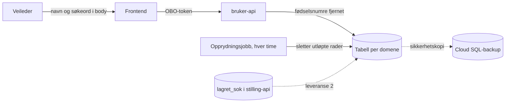

# ROS for lagrede søk i bruker-api

Dette dokumentet beskriver risikoer ved lagrede søk for rekrutteringstreff, og
for stillingsoppdrag når de flyttes til `rekrutteringsbistand-bruker-api`.
Løsningen er beskrevet i [`standardsok.md`](standardsok.md).

ROS-en tar med risikoer som består etter vanlig sikker utvikling,
kodegjennomgang og testing. Sannsynlighet (S) og konsekvens (K) er forslag på
en skala fra 1 til 4. Risikoeier må godkjenne dem. Status gjelder koden
20.10.26.

## Sammendrag

- Veiledere kan lagre opptil 10 søk med navn, filtre og søkeord. Navn og
  søkeord er fritekst og kan inneholde personopplysninger, selv om løsningen
  ber veilederen la være.
- Backend fjerner gyldige fødselsnumre før lagring. Andre personopplysninger,
  som navn på personer eller helseopplysninger, fanges ikke opp.
- Et søk slettes helt seks måneder etter siste bruk. Et søk som brukes
  jevnlig, har ingen øvre grense for hvor lenge det lagres. Ledelsen må
  akseptere dette eller be om en absolutt maksimal lagringstid (LS-02).
- Navn og søkeord ligger ikke i URL-en, logger, metrikker eller
  analyseverktøy. Bare veilederen selv kan se sine søk.
- Fire beslutninger ligger hos behandlingsansvarlig eller produkteier. Se
  [Beslutninger utenfor utviklingsteamet](#beslutninger-utenfor-utviklingsteamet).

## Omfang

| Med | Ikke med |
| --- | --- |
| Lagring, bruk, endring og sletting av lagrede søk i bruker-api | Selve søket mot rekrutteringstreff eller stillinger. Søkeord sendes dit uansett, og det dekkes av ROS-en for søket. |
| Tabellene `standardsok_rekrutteringstreff` og `standardsok_stilling` | Brukerinnstillinger, nyheter og tilbakemeldinger i samme database |
| Opprydningsjobben og sletting etter seks måneder | |
| Flytting av standardsøk fra stilling-api (leveranse 2) | |

## Dataflyt

| Opplysning | Hvor | Personopplysning |
| --- | --- | --- |
| `navIdent` | Database | Ja, om den ansatte |
| `sistAktiv` | Database | Ja, sier noe om når den ansatte har brukt søket. Lagres som dato, ikke tidspunkt. |
| `navn` (maks 25 tegn) | Database og svar til frontend | Kan inneholde personopplysninger om andre |
| `fritekst` (maks 10 ord, 200 tegn) | Database og svar til frontend | Kan inneholde personopplysninger om andre |
| `filter` | Database og URL | Nei. Backend godtar bare kjente parametere og verdier. |

## Risikovurdering

| ID | Risiko | S | K | Viktigste tiltak | Status |
| --- | --- | --: | --: | --- | --- |
| LS-01 | Navn eller søkeord inneholder personopplysninger om brukere | 2 | 3 | Hjelpetekst, fjerning av fødselsnumre, bare egen tilgang, sletting etter seks måneder | Delvis |
| LS-02 | Et søk som brukes jevnlig, blir liggende uten øvre grense | 2 | 2 | Beslutning om absolutt maksimal lagringstid | Avventer beslutning |
| LS-03 | Ubrukte søk blir ikke slettet som planlagt | 2 | 2 | Skjuling ved fristen, jobb hver time, varsling, sletting i stilling-api etter flytting | Delvis |
| LS-04 | Navn eller søkeord lekker via URL, logger, metrikker eller analyse | 1 | 3 | Bare i body, ingen logging av innhold, metrikker uten identer | På plass |
| LS-05 | Opplysninger om den ansatte brukes til kontroll | 1 | 2 | Dato i stedet for tidspunkt, ingen rapporter per ansatt | På plass |

## LS-01 – personopplysninger i navn eller søkeord

**Risiko:** Veilederen skriver navn, fødselsnummer, helseopplysninger eller
andre opplysninger om en bruker i navnet på søket eller i søkeordene. Søket
lagres og blir liggende i opptil seks måneder etter siste bruk, eller lenger
hvis det brukes jevnlig (se LS-02).

Treffsøket søker i treff, ikke i personer, så behovet for slike søkeord er
lite. I stillingssøket er risikoen noe høyere, fordi veiledere kan søke etter
en arbeidsgiver eller kontaktperson.

**Tiltak:**

- Lagre-dialogen sier «Ikke skriv personopplysninger i navnet».
- Backend fjerner gyldige fødselsnumre, D-nummer og H-nummer fra navn og
  søkeord før lagring, og forteller veilederen at noe ble fjernet.
- Navnet er maks 25 tegn, og søkeordene er maks 10 ord med 200 tegn til
  sammen.
- Bare veilederen selv kan lese, endre og slette sine søk. Nav-identen hentes
  fra tokenet.
- Hele søket slettes seks måneder etter siste bruk (se LS-03).
- **Foreslått:** Vis søkeordene som lagres i lagre-dialogen, med teksten «Ikke
  lagre søkeord med personopplysninger». I dag ser veilederen ikke at
  søkeordene lagres når hun lagrer et nytt søk.
- **Foreslått:** Ta temaet med i opplæring og brukerveiledning.

**Status 20.10.26:** Hjelpetekst for navnet, fjerning av fødselsnumre,
lengdegrenser, tilgangskontroll og sletting er på plass. Visning av søkeordene
i dialogen er et nytt forslag fra ROS-arbeidet og står ikke i planen.

Kjent begrensning: Skatteetaten endrer reglene for fødselsnummer fra 2032.
Filteret kjenner bare dagens regler og fjerner ikke nummer etter de nye
reglene. Filteret må oppdateres før 2032.

**Restrisiko:** Andre personopplysninger enn fødselsnumre kan ikke fjernes
automatisk med rimelig sikkerhet. Restrisikoen må aksepteres av
produkteier, eller så må lagring av søkeord fjernes.

**Ansvar:** Produkteier og Team Toi.
**Ny vurdering:** Før leveranse 2, når stillingssøket får lagrede søkeord.

## LS-02 – søk i jevnlig bruk har ingen øvre lagringstid

**Risiko:** Fristen på seks måneder starter på nytt hver gang veilederen
lagrer, bruker eller gjør søket til standard. Standardsøket brukes hver gang
veilederen åpner siden. Slettes det, blir søket veilederen brukte sist,
standard. Et søk med personopplysninger kan derfor bli liggende så lenge
veilederen jobber med rekrutteringstreff.

**Tiltak:**

- Å hente listen eller åpne menyen fornyer ikke fristen. Bare handlinger
  veilederen gjør med søket, teller.
- Veilederen kan når som helst slette søk i «Administrer søk».
- **Til beslutning:** Innfør en absolutt maksimal lagringstid, for eksempel 12
  måneder fra søket ble opprettet. Det krever en ny kolonne for
  opprettelsesdato og en endring i opprydningsjobben. Veilederen må da lagre
  søket på nytt etter fristen.

**Status 20.10.26:** Ingen øvre grense. Opprettelsesdato lagres ikke.

**Restrisiko:** Uten øvre grense kan et søk ligge i flere år. Med øvre grense
må veilederen av og til lagre søket på nytt.

**Ansvar:** Behandlingsansvarlig og produkteier.
**Ny vurdering:** Før produksjon.

## LS-03 – ubrukte søk slettes ikke

**Risiko:** Søk som ikke er brukt på seks måneder, blir liggende fordi
opprydningsjobben feiler, slettereglene har feil, sikkerhetskopier beholder
dem, eller fordi den gamle tabellen i stilling-api ikke ryddes etter
flyttingen.

**Tiltak:**

- API-et viser aldri utløpte søk, selv om jobben ikke har kjørt. Et utløpt
  søk kan ikke vekkes til live.
- Opprydningsjobben sletter utløpte rader fysisk hver time. Den logger og
  teller bare antall.
- Varslingen `rekrutteringsbistand-bruker-api-standardsok-opprydning` slår ut
  hvis jobben ikke har kjørt uten feil på seks timer.
- Fristreglene er testet ved månedsslutt og skuddår.
- En veileder som slutter, får søkene sine slettet etter seks måneder uten
  bruk.
- **Foreslått:** Bekreft hvor lenge Cloud SQL-sikkerhetskopiene beholdes, og
  beskriv det i behandlingsoversikten.
- **Leveranse 2:** Søk som ikke er brukt på seks måneder, flyttes ikke.
  Tabellen `lagret_sok` i stilling-api slettes når rollback-vinduet er over.
  Det får en egen dato og ansvarlig.

**Status 20.10.26:** Skjuling, jobb, varsling og tester er på plass for
rekrutteringstreff. Lagringstiden for sikkerhetskopier er ikke bekreftet.
Leveranse 2 er ikke startet.

**Restrisiko:** Slettede søk finnes i sikkerhetskopier til de roteres ut.
Fysisk sletting kan komme opptil en time etter fristen, og lenger hvis jobben
feiler.

**Ansvar:** Team Toi.
**Ny vurdering:** Før leveranse 2.

## LS-04 – lekkasje via URL, logger, metrikker eller analyse

**Risiko:** Navn eller søkeord havner i nettleserhistorikk, tilgangslogger,
applikasjonslogger, metrikker eller Umami, der flere har tilgang og
lagringstiden er en annen.

**Tiltak:**

- Navn og søkeord sendes bare i body. URL-en har bare filtre og søkeidenten,
  både i API-kallene og som `lagretSok` på søkesiden. Søkeidenten er en
  tilfeldig UUID uten innhold, og bare eieren kan hente søket.
- Backend avviser ukjente filterparametere, så filteret kan ikke brukes til
  å smugle fritekst inn i URL-en.
- Leveranse 2: Søk som flyttes fra `lagret_sok`, renses med de samme
  filterreglene, så gamle parametere og verdier ikke følger med inn i URL-en.
- Backend logger ikke innholdet i søk. Feil logges uten meldingstekst.
- Metrikkene har bare domene og type, aldri Nav-ident, søkeident, navn eller
  søkeord.
- Umami-hendelsene sier bare hva veilederen gjorde, ikke hvilket søk.

**Status 20.10.26:** På plass.

**Restrisiko:** Lav.

**Ansvar:** Team Toi.
**Ny vurdering:** Ved endringer i logging eller analyse.

## LS-05 – opplysninger om den ansatte

**Risiko:** `navIdent` og `sistAktiv` viser når en ansatt har brukt et søk.
Opplysningene kan misbrukes til å kontrollere den ansattes arbeid.

**Tiltak:**

- `sistAktiv` er en dato, ikke et tidspunkt.
- Opplysningene brukes bare til sletting og til visning for veilederen selv.
- Det finnes ingen rapporter, metrikker eller utleveringer per ansatt.

**Status 20.10.26:** På plass.

**Restrisiko:** Lav.

**Ansvar:** Produkteier.
**Ny vurdering:** Hvis noen ønsker statistikk over bruken per ansatt.

## Forhold som ikke er egne risikopunkter

- Tokenvalidering, parameterisert SQL og eierskapskontroll per søk. Dette er
  vanlige krav som er dekket av tester.
- At et søk veilederen trenger, blir slettet. Merknaden «Slettes snart» vises
  fra fem måneder, og konsekvensen er at veilederen må lagre søket på nytt.
- Grensen på 10 søk per veileder og domene.

## Beslutninger utenfor utviklingsteamet

- [ ] Formål og behandlingsgrunnlag for lagrede søk, og om de skal stå i
      behandlingsoversikten
- [ ] Om slettefristen på seks måneder uten bruk godkjennes
- [ ] Om søk i jevnlig bruk skal ha en absolutt maksimal lagringstid (LS-02)
- [ ] Om restrisikoen for personopplysninger i navn og søkeord aksepteres,
      eller om søkeord ikke skal lagres (LS-01)

## Tiltak før produksjon

1. Ta beslutningene over.
2. Vis søkeordene som lagres i lagre-dialogen, med en advarsel (LS-01).
3. Bekreft lagringstiden for sikkerhetskopier (LS-03).
4. Registrer risikoene i ROS-verktøyet og lenk dem herfra.
