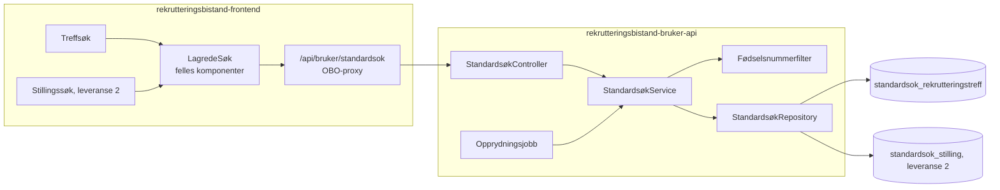
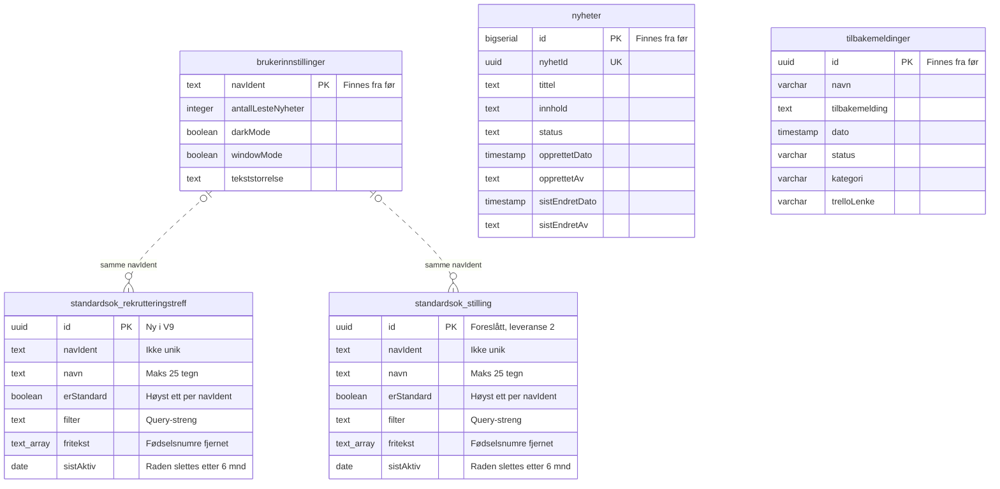
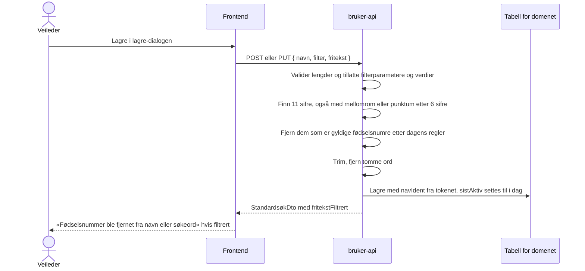
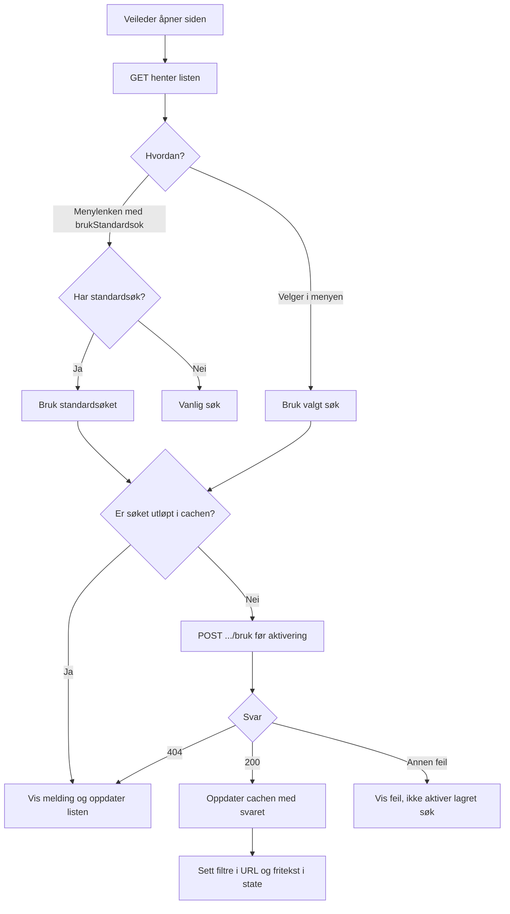
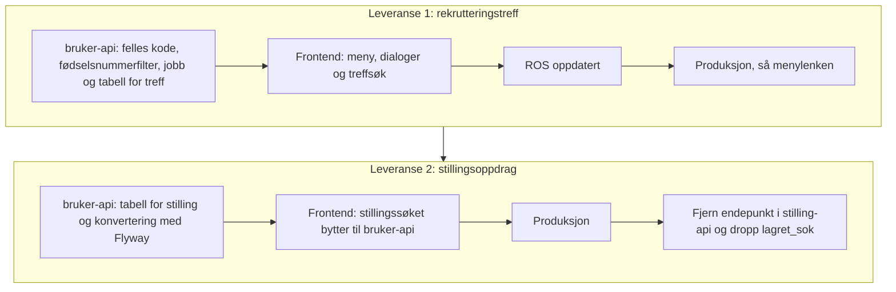

# Plan: Lagrede søk for stillingsoppdrag og rekrutteringstreff i bruker-api

**Status:** Leveranse 1 (rekrutteringstreff) er implementert i bruker-api og frontend, men ikke rullet ut. ROS gjenstår før produksjon. Leveranse 2 (stilling) er ikke startet.

## Kort fortalt

- Rekrutteringstreff får lagrede søk i `rekrutteringsbistand-bruker-api`. Hver veileder kan lagre opptil 10 søk per domene, gi dem navn, bruke dem og slette dem. Ett av dem kan være standardsøket som menylenken åpner.
- Standardsøk for stillingsoppdrag flyttes senere fra `rekrutteringsbistand-stilling-api` til samme API og får samme støtte for flere søk.
- Vi planlegger begge nå, men leverer én applikasjon av gangen helt til produksjon. Rekrutteringstreff kommer først.
- Hvert domene får sin egen tabell med lik oppbygning. De deler kode og opprydningsjobb.
- Hvert søk har en id (søkeident). Nav-identen er ikke lenger unik i tabellen.
- Navn bør være beskrivende, men trenger ikke være unike. Like navn gir ingen feilmelding. Alle valg og endringer bruker søkeidenten.
- Hvert søk har datoen `sistAktiv`. Lagring, bruk og «Gjør til standard» fornyer seksmånedersfristen. Ved bruk oppdateres datoen høyst én gang i døgnet.
- Navn og fritekst lagres bare i body og database, aldri i URL-en. Backend fjerner gyldige fødselsnumre før lagring.
- Et søk uten aktivitet på seks måneder slettes helt. Etter fem måneder får det en merknad i menyen.
- Standardvalg gjøres bare i «Administrer søk». Det første søket blir automatisk standard. Når standardsøket slettes eller utløper, åpner menylenken vanlig søk.

## Slik virker det i dag (stillingsoppdrag)

Menylenken «Stillingsoppdrag» og knappen «Bruk standardsøk» går til `/stilling?brukStandardsok=true`. Da henter `page.tsx` standardsøket fra stilling-api og bytter URL-en med `window.history.replaceState`. Diskettikonet sender query-strengen med `PUT /standardsok` og overskriver det gamle søket. Hver veileder har ett søk.

| Del | Innhold |
| --- | --- |
| Frontend | `app/stilling/_ui/standardsøk/` og `app/api/stilling/standardsok/` |
| API | `GET /standardsok` gir `200` eller `404`. `PUT /standardsok` med `{ søk }` gir `201`. Nav-identen kommer fra tokenet. |
| Tabell `lagret_sok` | `id`, `nav_ident`, `sok` (query-streng), `tidspunkt` (uten tidssone) |
| Lagres ikke | `utenOppdrag`, `visStillingId`, `brukStandardsok`, `finnKandidater`, `visKandidatId`, fritekst |

Svakheter vi ikke tar med oss:

- `lagret_sok` mangler unik-indeks på `nav_ident`, og repositoryet leser før det skriver. To samtidige lagringer kan gi to rader.
- Diskettikonet er deaktivert når søket er likt det lagrede, og sammenligningen er en strengsammenligning. Med flere søk dropper vi denne sammenligningen.
- Mens `brukStandardsok` står i URL-en, ignorerer `StillingsSøkContext` fritekst. Det må endres når fritekst skal lagres.

## Arkitektur

`rekrutteringsbistand-bruker-api` har allerede brukerinnstillinger per Nav-ident, `accessPolicy` for frontend og de rollene vi trenger. Vi trenger ingen ny auth eller ny tjeneste.



Controlleren håndterer auth, input-validering og HTTP-svar. Servicen samler reglene for eierskap, antallsgrense, standardvalg og utløp, og styrer transaksjonene. Repositoryet gjør databaseoppslagene, også for opprydningsjobben.

### API

Frontend kaller `/api/bruker/standardsok/{domene}`, og proxyen sender videre til `/api/standardsok/{domene}`. `domene` er `rekrutteringstreff`, og etter leveranse 2 også `stilling`. Andre verdier gir `404`. `{id}` er søkeidenten.

| Metode | Sti | Bruk | Svar |
| --- | --- | --- | --- |
| `GET` | `/api/standardsok/{domene}` | Henter alle veilederens søk. Brukes av menyen, lagre-dialogen og menylenken. | `200` med liste av `StandardsøkDto`, sortert på navn og deretter id. Tom liste uten lagrede søk. |
| `POST` | `/api/standardsok/{domene}` | «Lagre som nytt søk» | `201` med `StandardsøkDto`. `409` når veilederen allerede har 10 søk. Like navn tillates. |
| `PUT` | `/api/standardsok/{domene}/{id}` | «Erstatt et lagret søk». Endrer ikke standardvalget. | `200` med `StandardsøkDto` |
| `PUT` | `/api/standardsok/{domene}/{id}/standard` | «Gjør til standard» i administrasjonen. Fjerner merket fra det forrige og fornyer fristen for det valgte søket. | `204` |
| `DELETE` | `/api/standardsok/{domene}/{id}` | «Slett» | `204` |
| `POST` | `/api/standardsok/{domene}/{id}/bruk` | Kontrollerer og registrerer bruk før søket aktiveres. Ingen body. | `200` med gjeldende `StandardsøkDto` |

Alle kall med `{id}` gir `404` hvis søket ikke finnes, er utløpt eller tilhører en annen veileder. Svaret skiller ikke mellom disse tilfellene. Ugyldig body gir `400` med en fast feilmelding uten innhold fra input.

`POST .../bruk` er `POST` fordi kallet endrer data. En `GET` kan sendes på nytt av SWR, forhåndshenting eller proxyer og skal ikke fornye fristen. Svaret fra `.../bruk` oppdaterer SWR-cachen uten et ekstra `GET`-kall.

| Domene | Roller |
| --- | --- |
| `rekrutteringstreff` | `ARBEIDSGIVER_RETTET`, `JOBBSOKER_RETTET`, `UTVIKLER`, som menypunktet |
| `stilling` | Alle fem rollene i bruker-api, som `/api/innstillinger`. Stillingssøket har ingen rollekrav i menyen. |

Nav-identen kommer alltid fra tokenet, aldri fra body eller sti. Hver spørring med `{id}` har både `id` og `navIdent` i `WHERE`.

| DTO | Felt | Type | Regel |
| --- | --- | --- | --- |
| `LagreStandardsøkDto` | `navn` | String | 1 til 25 tegn etter trimming. Går gjennom fødselsnummerfilteret. Like navn tillates. |
| | `filter` | String | Query-streng uten `?`, maks 2 000 tegn, kan være tom. Backend validerer tillatte parametere og verdier per domene. |
| | `fritekst` | Liste av String | Maks 10 ord og 200 tegn totalt, kan være tom |
| `StandardsøkDto` | `id` | UUID | Søkeidenten |
| | `navn` | String | |
| | `erStandard` | Boolean | |
| | `filter` | String | |
| | `fritekst` | Liste av String | Etter filtrering |
| | `sistAktiv` | Dato | Siste lagring, bruk eller valg som standard |
| | `slettes` | Dato | Seks kalendermåneder etter `sistAktiv` |
| | `visSlettevarsel` | Boolean | Beregnes av backend. Sann fra fem kalendermåneder etter `sistAktiv` til søket utløper. |
| | `fritekstFiltrert` | Boolean | Bare i svar på `POST` og `PUT`. `true` hvis backend fjernet noe fra navn eller fritekst. |

Standardvalg inngår ikke i `LagreStandardsøkDto`. Backend gjør det første søket til standard når veilederen ikke har noen aktive søk fra før. Hvis andre søk finnes uten et standardsøk, blir ikke et nytt søk automatisk standard.

### Tabeller: én per domene

Hvert domene får sin tabell i sin leveranse: `V9__standardsok_rekrutteringstreff.sql` først, så en egen migrering for stilling. Kolonnenavnene følger stilen i repoet (`navIdent`, som i `brukerinnstillinger`).

Databasen i bruker-api etter begge leveransene. Ingen tabeller har fremmednøkler. Den stiplede linjen viser at søkene og brukerinnstillingene bruker samme `navIdent`, uten at databasen håndhever koblingen. En veileder kan ha søk uten en rad i `brukerinnstillinger`. `text_array` er `text[]`, fordi Mermaid ikke tillater klammer i typenavn.



| Tabell | Status | Innhold |
| --- | --- | --- |
| `standardsok_rekrutteringstreff` | Ny, implementert i V9 | Lagrede søk for rekrutteringstreff |
| `standardsok_stilling` | Foreslått, leveranse 2 | Lagrede søk for stillingsoppdrag, med samme kolonner. Data flyttes fra stilling-api. |
| `brukerinnstillinger` | Finnes fra før | Visningsvalg per veileder |
| `nyheter` | Finnes fra før | Nyheter i Rekrutteringsbistand |
| `tilbakemeldinger` | Finnes fra før | Tilbakemeldinger fra veiledere |

Kolonnene i begge søketabellene:

| Kolonne | Type | Merknad |
| --- | --- | --- |
| `id` | `uuid` primærnøkkel | Søkeidenten, lages av backend |
| `navIdent` | `text not null` | Ikke unik. Indeks for oppslag per veileder. |
| `navn` | `text not null` | Maks 25 tegn etter trimming. Ikke unikt, heller ikke sammen med `navIdent`. |
| `erStandard` | `boolean not null default false` | Delvis unik indeks på `navIdent` der `erStandard` er sann, så hver veileder har høyst ett standardsøk |
| `filter` | `text not null` | |
| `fritekst` | `text[] not null default '{}'` | |
| `sistAktiv` | `date not null` | Settes ved lagring, bruk og valg som standard. Indeks for opprydningsjobben, som sletter rader med `sistAktiv` på eller før seneste utløpte dato. |

Regler i backend:

- Grensen på 10 aktive søk gjelder også ved samtidige opprettelser. Opprettelse og standardbytte tar en advisory lock per tabell og Nav-ident (`pg_advisory_xact_lock`), som gjelder på tvers av podene. Transaksjonen kjører med `READ COMMITTED`, så tellingen etter låsen ser det andre kall har committet. Under `REPEATABLE READ`, som er standard i bruker-api, ville tellingen vært utdatert.
- Bytte av standardsøk fjerner merket fra det gamle, setter det på det nye og oppdaterer det nye søkets `sistAktiv` i én transaksjon. Datoen for det gamle søket endres ikke. Den delvise unike indeksen er et siste vern mot flere standardsøk.
- Når standardsøket slettes eller utløper, velger vi ikke et annet automatisk. Menylenken åpner vanlig søk til veilederen velger et nytt standardsøk.
- Ett repository dekker begge tabellene. Tabellnavnet kommer fra en enum i koden, aldri fra input.
- Søk slettes når veilederen sletter dem, eller etter seks måneder uten aktivitet. Se [Sletting etter seks måneder uten aktivitet](#sletting-etter-seks-måneder-uten-aktivitet).

| | To tabeller (valgt) | Én tabell med `domene`-kolonne |
| --- | --- | --- |
| Nøkkel | `id`, indeks på `navIdent` | `id`, indeks på `navIdent` + `domene` |
| Unike regler | Høyst ett standardsøk per `navIdent`. Like navn tillates. | Høyst ett standardsøk per `navIdent` + `domene`. Like navn tillates. |
| Ulik utvikling | Hvert domene kan få egne kolonner eller regler uten å påvirke det andre | Domenespesifikke kolonner blir `null` for det andre domenet |
| Levere per applikasjon | Hver leveranse har sin egen tabell og migrering | Felles tabell fra første leveranse, nye domener kan innføres senere |
| Fjerne et domene | `DROP TABLE` | `DELETE` og en sjekk-constraint å endre |
| Opprydning | Én setning per tabell | Én setning |

Filtrene lagres som en query-streng. Frontend bruker dem, og backend validerer tillatte parametere og verdier per domene. Ulike filtre i seg selv tvinger derfor ikke fram ulike tabeller. Grunnen til å skille er at domenene trolig får ulike regler, og at vi leverer dem hver for seg. Én tabell blir bedre hvis vi får mange domener, for eksempel kandidatsøk og jobbsøkersøk i treff.

### Dato for siste aktivitet

Vi lagrer en dato og ikke et tidspunkt. Det holder for sletting etter seks måneder og for å vise «sist aktiv». Det sier også mindre om når den ansatte jobber. Backend regner datoen i tidssonen `Europe/Oslo`.

`sistAktiv` settes til i dag når veilederen lagrer søket som nytt, erstatter det, tar det i bruk eller velger «Gjør til standard». Å hente listen eller åpne menyen endrer den ikke.

`POST .../bruk` oppdaterer bare når `sistAktiv` er eldre enn i dag. Det gir høyst én databaseskriving per søk i døgnet ved bruk, selv om frontend kaller hver gang. Ved lagring og standardbytte skriver backend de øvrige endringene som vanlig.

Slettefristen er seks kalendermåneder etter `sistAktiv`, og varselet starter etter fem. Finnes ikke dagen i målmåneden, brukes månedens siste dag. Søket er utløpt fra og med slettefristen. Backend bruker samme regel for svar, oppslag og opprydning, og beregner `visSlettevarsel` for frontend. Reglene testes ved månedsslutt og skuddår.

Én dato per søk erstatter egne datoer for navn og fritekst. Begge følger raden.

## Fritekst og navn

### Hvorfor bare i body

Fritekst ligger i React-state i begge søkene i dag, og ikke i URL-en. Det hindrer at den havner i nettleserhistorikk, tilgangslogger og Umami. Vi beholder det: fritekst og navn går bare i body på `POST` og `PUT` og i svarene fra API-et. Søkeidenten brukes i stien til API-kallene, men holdes i state på søkesiden. Når et søk brukes, legges fritekst i state og vises som chips.

Backend avviser ukjente filterparametere og ugyldige verdier. `filter` kan dermed ikke brukes til å lagre navn eller fritekst som senere legges i URL-en.

### Fjerning av fødselsnumre

Backend fjerner fødselsnumre fra navn og fritekst før lagring. Søket filtreres ikke, så veilederen får treff som før.



Et tall fjernes når det er et gyldig fødselsnummer etter dagens regler:

- datoen er gyldig, også for D-nummer (dag + 40), H-nummer (måned + 40) og syntetiske nummer (måned + 40 eller + 80)
- begge kontrollsifrene stemmer med modulus 11

Andre tall blir stående, også 11-sifrede tall med feil kontrollsiffer. Reglene Skatteetaten innfører i 2032 er ikke med. Blir navnet tomt etter filtrering, gir backend `400`.

### Sletting etter seks måneder uten aktivitet

Navn er også fritekst, så vi sletter hele søket og ikke bare søkeordene. Søket utløper seks kalendermåneder etter `sistAktiv`.

- `GET` returnerer aldri utløpte søk, selv om jobben ikke har kjørt.
- Kall med `{id}` mot et utløpt søk gir `404`. Eierskap og utløp kontrolleres før eventuell oppdatering, så et kall ikke kan vekke søket til live.
- `POST` sletter veilederens utløpte søk i samme transaksjon før grensen på 10 sjekkes. Da teller ikke usynlige søk med eller blokkerer automatisk standardvalg for et nytt første søk.
- Jobben sletter raden fysisk ved neste daglige kjøring. Skjuling ved fristen og ventetiden fram til sletting må beskrives i ROS-en.

Et søk som brukes, lagres eller velges som standard jevnlig, har ingen øvre grense for hvor lenge navn og søkeord blir liggende. Fødselsnummerfilteret fjerner ikke andre personopplysninger. Denne oppbevaringen må vurderes i ROS-en før produksjon.

### Merknad før sletting

Vi markerer søk fra fem kalendermåneder etter `sistAktiv`. Merknaden lagres ikke. Backend beregner `slettes` og `visSlettevarsel`, som frontend bruker i visningen.

- Merknaden koster ingen ny kolonne, jobb eller varsling.
- Veilederen ser den i menyen og i «Administrer søk». Bruk, lagring eller «Gjør til standard» starter de seks månedene på nytt. Vi lager ingen egen knapp for å beholde søk.
- Uten merknad forsvinner søk uten forvarsel. Det er særlig ille for standardsøket, som menylenken bruker.

Vi sender ikke varsel utenfor løsningen, for eksempel e-post. Det krever mer enn gevinsten forsvarer.

### Opprydningsjobb

- Kjører én gang i døgnet i bruker-api. For hver tabell sletter den rader som har nådd slettefristen.
- Én felles jobb for alle domenetabellene.
- Jobben er idempotent. Den kan derfor kjøre på alle podene uten leader election.
- Jobben logger og teller bare antall rader, aldri innhold.
- Feil og tidspunktet for siste vellykkede kjøring måles. Det varsles hvis forventet opprydning uteblir.

## Frontend

Vi beholder plasseringen under søkefeltet. «Bruk standardsøk» blir en meny med de lagrede søkene, og diskettikonet blir stående ved siden av menyen. Skissene under er et utgangspunkt for designer, ikke et ferdig design. Alt bygges med Aksel-komponenter (`ActionMenu`, `Tooltip`, `Modal`, `RadioGroup`, `TextField`, `Select`, `Link`).

### Meny og statuslinje

Menyen erstatter knappen «Bruk standardsøk». Et klikk på et søk tar det i bruk og lukker menyen. Søkene er radiovalg (`ActionMenu.RadioItem`), så søket som er i bruk, er markert så lenge filtrene er uendret. Like navn er tillatt, men hvert menyelement bruker id-en til riktig søk.

```text
[ Lagrede søk ▾ ] [💾]
Valgt søk: Treff i Oslo

  ┌ Lagrede søk ──────────┐
  │ (•) Treff i Oslo      │
  │     Standard          │
  │ ( ) Treff Vestland    │
  │ ( ) Mine utkast       │
  │     Slettes snart     │
  │ ───────────────────── │
  │ ⚙ Administrer søk     │
  └───────────────────────┘
```

- Under navnet står en liten grå merknad: «Standard» for standardsøket og «Slettes snart» for søk med `visSlettevarsel`. Har søket begge, skilles de med « · ». Datoen står i «Administrer søk», fordi menyen er smal.
- Vi bruker ikke stjerne eller hake. Stjernen var ikke intuitiv, og Aksel fraråder hake i menyer fordi den ligner radiovalg.
- Disketten er en ikonknapp på samme rad som menyen. Sidepanelet er for smalt til en tekstknapp ved siden av menyen. Knappen har tooltip og tilgjengelig navn «Lagre søk», og er deaktivert uten filter eller søkeord.
- Statuslinjen viser navnet på søket som er i bruk, men bare så lenge filtrene og søkeordene er like det lagrede søket. Endrer veilederen noe, også med «Fjern alle filtre», forsvinner linjen og markeringen i menyen. Slik kan veilederen velge bort et søk uten en egen knapp. Linjen kommer tilbake hvis filtrene blir like søket igjen. Linjen er en `aria-live`-region.
- Uten lagrede søk viser menyen «Du har ingen lagrede søk» og «Velg filtre og trykk på disketten.».
- Fokus går tilbake til knappen som åpnet dialogen, også når dialogen lukkes etter lagring eller med Esc.

### Smale skjermer

Under 1024 px er filterpanelet skjult. Knappen «Filtrer» ved pagineringen åpner panelet i et ark, med søkefelt, lagrede søk og filtre. Kandidatsøket bruker samme mønster.

Kjent feil: Esc i menyen eller en dialog inne i arket lukker hele arket. Feilen gjelder det felles arket (`Sidepanel.tsx`), der Radix og Aksel begge lytter etter Esc. Den rettes i en egen oppgave, fordi rettingen påvirker alle sidepaneler.

### Dialog: «Lagre søk»

Disketten åpner dialogen. Gjeldende filtre og søkeord lagres. Enter sender skjemaet.

```text
┌ Lagre søk ─────────────────────────────────────┐
│ (•) Lagre som nytt søk                         │
│ ( ) Erstatt et lagret søk                      │
│                                                │
│ Søk som skal erstattes                         │
│ Filtrene og søkeordene i søket byttes ut med   │
│ dem du har valgt nå.                           │
│ [ Velg søk            ▾ ]                      │
│                                                │
│ Navn på søket                                  │
│ Maks 25 tegn. Ikke skriv personopplysninger.   │
│ [_______________]                              │
│                                                │
│ Søk du ikke har brukt på seks måneder, slettes.│
│                                                │
│            [ Avbryt ]  [ Lagre | Erstatt søk ] │
└────────────────────────────────────────────────┘
```

- Uten lagrede søk vises ikke valgene. Dialogen sier i stedet: «Det første søket du lagrer, blir standardsøk. Det brukes når du går hit fra hovedmenyen.»
- Med 10 søk er «Lagre som nytt søk» deaktivert, med teksten «Du har 10 lagrede søk. Erstatt et søk eller slett et i Administrer søk.»
- Dialogen starter på «Lagre som nytt søk», eller på «Erstatt et lagret søk» når veilederen har 10 søk. Listen starter på «Velg søk», og veilederen må velge før lagring. Vi velger ikke søket i bruk på forhånd, så veilederen ikke overskriver et søk ved et uhell.
- Navnet for nytt søk og navnet ved erstatting holdes hver for seg. Når veilederen velger søket som skal erstattes, fylles navnet inn og kan endres.
- Knappen heter «Erstatt søk» ved erstatting og «Lagre» ellers.
- Frontend og backend validerer lengden. Vi ber om et beskrivende navn, men validerer ikke at navnet er unikt.
- Dialogen har ikke standardvalg. Det første søket blir automatisk standard, senere valg gjøres i «Administrer søk».

### Dialog: «Administrer søk»

```text
Administrer søk (3 av 10)

Velg et navn for å bruke søket. Standardsøket brukes når du går hit fra hovedmenyen.
Søk du ikke har brukt på seks måneder, slettes.
──────────────────────────────────────────────────────────────
Treff i Oslo                                            [Slett]
Sist brukt 20.10.2026 · Standard
──────────────────────────────────────────────────────────────
Treff Vestland                      [Gjør til standard] [Slett]
Sist brukt 12.10.2026
──────────────────────────────────────────────────────────────
Mine utkast                         [Gjør til standard] [Slett]
Sist brukt 01.05.2026 · Slettes 01.11.2026
──────────────────────────────────────────────────────────────
                                                         [Lukk]
```

- Søkene er en liste, ikke en tabell. På smale skjermer flytter knappene seg under navnet, så datoene ikke presses sammen.
- Navnet er en lenke som tar søket i bruk og lukker dialogen.
- Linjen under navnet viser «Sist brukt», «Standard» i halvfet skrift for standardsøket og «Slettes dd.mm.åååå» for søk med `visSlettevarsel`. Vi viser ikke slettedatoen for alle søk.
- Etter «Gjør til standard» leses kvitteringen ««Treff Vestland» er nå standardsøket.» opp.
- «Slett» bytter innholdet i dialogen til «Slett lagret søk» med spørsmålet «Vil du slette «Treff i Oslo»?» og knappene «Slett» og «Avbryt». Esc og lukkeknappen går tilbake til listen.
- Fokus flyttes til «Avbryt» i bekreftelsen, tilbake til radens «Slett» ved avbryt og til «Lukk» etter sletting. Kvitteringen leses opp.

«Gjør til standard» fornyer fristen for det valgte søket. Hvis standardsøket slettes eller utløper, åpner menylenken vanlig søk. Vi gjør ikke et annet lagret søk til standard automatisk.

### Filer

| Hvor | Endring |
| --- | --- |
| `components/standardsøk/` (ny) | Felles meny, lagre-dialog og administrer-dialog. Domenet sender inn hvilke parametre som lagres og hvordan et søk tas i bruk. |
| `app/api/bruker/standardsok/[domene]/` (ny) | Proxy-rute for liste og `[id]`, SWR-hook per domene, mutasjoner, Zod-skjema og MSW-mock |
| Treffsøket | Meny og diskett under søkefeltet, og «Filtrer» for smale skjermer. `RekrutteringstreffSøkContext` holder id-en til søket som er i bruk i state, ikke i URL-en. Ved `brukStandardsok` venter søket mot `/sok` på at standardsøket er kontrollert, eller at frontend har vist en feil og gått videre med vanlig søk. |
| `AppSidebar.tsx` | `?brukStandardsok=true` på menylenken til rekrutteringstreff |
| Stillingssøket (leveranse 2) | Bytter til bruker-api og de felles komponentene. Setter fritekst fra søket i `StillingsSøkContext` og fjerner blokkeringen av fritekst under `brukStandardsok`. Lagre er mulig når filteret er tomt, men fritekst finnes. Reglene for kandidat (`visKandidatnr`) og portefølje beholdes. `app/api/stilling/standardsok/` slettes. |

Slik tas et søk i bruk:



Frontend kaller alltid `POST .../bruk` før et søk aktiveres, også når søket er brukt i dag. Søket kan være slettet eller endret i en annen fane, og svaret gir gjeldende innhold eller `404`. Menylenken venter også til listen er hentet på nytt, så den ikke velger standardsøk fra en utdatert cache.

Ved utløpt søk eller `404` fjernes søket fra cachen, listen hentes på nytt og veilederen får en melding om at søket er slettet eller utløpt. Filtre og fritekst fra det gamle søket aktiveres ikke. Ved andre feil vises en feilmelding med mulighet til å prøve igjen. Vanlig søk er fortsatt tilgjengelig. En feil ved henting av listen vises som en feil, ikke som en tom liste.

Detaljer for treffsøket:

- Lagres: `visning`, `kontorer`, `statuser`, `publisertStatuser`, `fylker`, `kommuner`, `sortering`. Lagres ikke: `side`, `visRekrutteringstreffId`, `brukStandardsok`.
- Lagret `visning=mine` blir `alle` for veiledere uten arbeidsgiverrettet rolle. `UTKAST` filtreres allerede bort for dem.
- `visning=mitt_kontor` følger veilederens aktive kontor.
- Diskettikonet er aktivt når søket har minst ett filter eller søkeord.
- Svaret fra `.../bruk` oppdaterer SWR-cachen, så merknaden forsvinner uten et ekstra `GET`-kall. Etter standardbytte hentes listen på nytt, siden også det gamle standardmerket er endret.
- Listen oppdateres ved nytt døgn og når siden får fokus igjen, slik at utløpsvarsler og slettede søk ikke blir liggende i en gammel visning.

## Leveranser

Hver leveranse går helt til produksjon før neste starter.



**Leveranse 1** kan ikke gå til produksjon før ROS-en dekker lagring av fritekst og navn: fødselsnummerfilteret, at andre personopplysninger kan bli liggende, og sletting etter seks måneder uten aktivitet. Bruk, lagring og standardvalg fornyer fristen, så aktive søk har ingen øvre oppbevaringsgrense.

**Leveranse 2** konverterer data med Flyway:

- Vi tar den nyeste raden per `nav_ident`, siden `lagret_sok` kan ha duplikater.
- Hver veileder får ett søk med navnet «Standardsøk» og `erStandard` satt. `sok` blir `filter`, og `fritekst` blir tom.
- `sistAktiv` settes til konverteringsdatoen. Stilling-api registrerer ikke bruk, og `tidspunkt` er bare når søket sist ble lagret. Med `tidspunkt` ville søk som brukes daglig, men ble lagret for lenge siden, blitt slettet med en gang.
- Konverteringen må kjøre før frontend bytter, eller hoppe over veiledere som allerede har søk i bruker-api hvis den kjører etter.
- Tilgang mellom databasene, lagringer under overgangen og tidspunktet for siste synkronisering avklares før leveranse 2.
- Nav-identer skal ikke ligge i migreringsfiler i git.

Rollback i leveranse 2, før stilling-api ryddes: frontend peker tilbake til stilling-api. Søk lagret i bruker-api i mellomtiden beholdes der, men er ikke tilgjengelige i den gamle løsningen. Flere søk kan ikke tilbakeføres direkte til dagens ene standardsøk. Rollback-vindu og håndtering av disse endringene avklares i leveranse 2 før det gamle endepunktet og tabellen fjernes.

## Tester

| Nivå | Hva |
| --- | --- |
| Enhetstest, bruker-api | Fødselsnummerfilteret: gyldige fødselsnumre, D-, H- og syntetiske nummer, nummer med mellomrom, 11 sifre med feil kontrollsiffer (skal stå), organisasjonsnumre og vanlige ord. Testene lager syntetiske nummer selv, ingen nummer som ligner ekte. |
| Komponenttest, bruker-api | Tom liste uten lagrede søk. Opprett, erstatt og slett. Like navn tillates, og endring eller sletting av ett søk påvirker ikke et annet med samme navn. Det ellevte aktive søket gir `409`, også ved samtidige opprettelser. |
| Komponenttest, bruker-api | Det første søket blir standard. Erstatting endrer ikke standardvalget. Bytte av standard fjerner det gamle merket og fornyer bare det valgte søkets dato. Samtidige standardvalg gir høyst ett standardsøk. Sletting eller utløp velger ikke automatisk et annet. |
| Komponenttest, bruker-api | En veileder får `404` på `PUT`, `DELETE`, `.../standard` og `.../bruk` mot en annen veileders søk, og listen viser bare egne søk. Ukjent domene gir `404`. Manglende rolle gir `403`. Navn på 25 tegn godtas, mens 26 tegn etter trimming gir `400` ved både opprettelse og erstatting. For lang input, ugyldige filterparametere eller verdier og ugyldig JSON gir `400` uten innholdet i svaret. |
| Komponenttest, bruker-api | Lagring, bruk og standardvalg setter `sistAktiv`. `GET` endrer den ikke. `.../bruk` skriver bare når datoen er eldre enn i dag og returnerer gjeldende søk. Jobben sletter utløpte søk. Før jobben har kjørt, skjuler `GET` slike søk, kall med id gir `404`, og de teller ikke mot grensen på 10 eller første standardvalg. |
| Enhetstest, bruker-api | Kalenderregler for varsel etter fem måneder og utløp fra seks måneder. Test månedsslutt, skuddår og dato i `Europe/Oslo`. |
| Enhetstest, frontend | Hvilke parametre som lagres og fjernes, og om `.../bruk` kalles. Utløpt cache eller `404` aktiverer ikke gamle filtre eller søkeord. Svaret ved bruk oppdaterer cachen. |
| Playwright med MSW | Valg i menyen setter filtre og chips. Fritekst og navn står ikke i URL-en. Lagre som nytt og erstatt, også med like navn. Lagre-dialogen har ikke standardvalg. «Lagre som nytt» er deaktivert ved 10 søk. Sletting med bekreftelse. Varsel etter fem måneder forsvinner ved aktivitet. Menylenken åpner vanlig søk uten standard. Feil i bruker-api blokkerer ikke vanlig søk. |

## Personvern og sikkerhet

- Tabellene har Nav-ident om ansatte og filtre uten opplysninger om jobbsøkere. Navn og fritekst kan inneholde personopplysninger. Vi fjerner gyldige fødselsnumre fra begge og sletter hele søket etter seks måneder uten aktivitet. Andre personopplysninger kan bli liggende så lenge søket holdes aktivt. Dialogen ber derfor veilederen om å ikke skrive personopplysninger i navnet.
- Datoer i stedet for tidspunkt gir mindre informasjon om når den ansatte jobber.
- Søkeidenten er en tilfeldig UUID. Eierskapet sjekkes likevel i hver spørring, og et fremmed søk gir samme `404` som et søk som ikke finnes.
- Bruker-api logger meldingen fra `IllegalArgumentException` og returnerer meldingen fra alle unntak. Valideringsfeil må derfor ha faste tekster uten innhold fra body. Jackson legger verdier inn i feilmeldinger ved ugyldig JSON, så controlleren må fange parsefeil og kaste en fast feil uten årsakens melding.
- Ingen logging av `navn`, `filter` eller `fritekst`, heller ikke på debug-nivå.

🔴 Rød sone: fødselsnummerfilteret, validering av filterparametere, Nav-ident fra tokenet, eierskap, transaksjoner for antallsgrense og standardvalg, feilhåndtering uten innhold i logg og svar, og utløpsreglene i API, cache og opprydningsjobb. Utvikleren bør skrive og forstå disse selv. Resten er grønn sone.

## Observerbarhet

- Tellere i bruker-api: opprettede, erstattede og slettede søk, søk der navn eller fritekst ble filtrert, og rader jobben slettet. Alle med `domene` som label.
- Opprydningsjobben har feilteller og tidspunkt for siste vellykkede kjøring, med varsling ved uteblitt kjøring. Ingen målinger har Nav-ident, søkeident, navn eller søkeord som label.
- Umami i frontend: søk brukt fra menyen, fra «Administrer søk» og fra menylenken, lagret som nytt, erstattet og slettet, per domene.

## Åpne spørsmål

1. Hvordan når Flyway-migreringen i bruker-api dataene i stilling-api sin database? Flyway kjører mot én database, og de to applikasjonene har hver sin. Avklares når leveranse 2 starter.
2. Tekster, plassering og om menyen skal sorteres på navn eller siste aktivitet avklares med designer. Skissene er et utgangspunkt.
