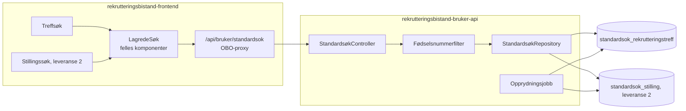
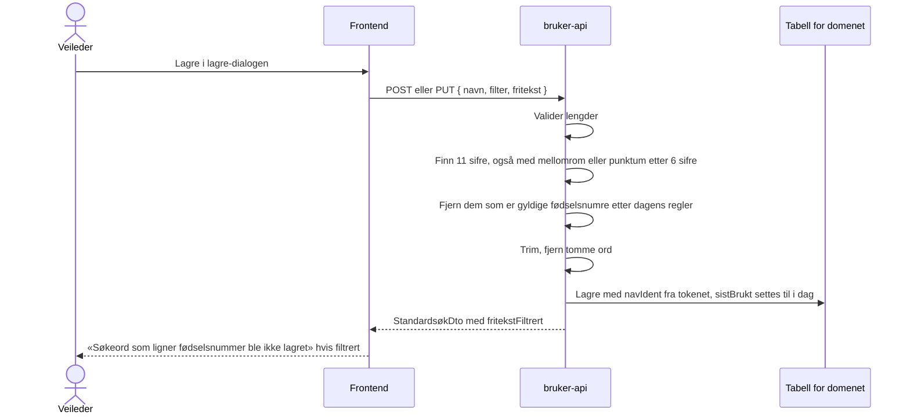
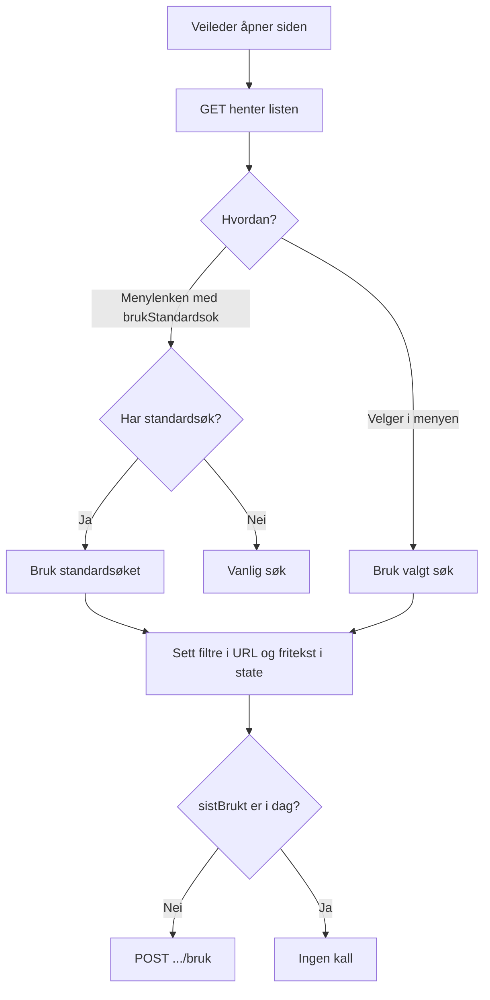
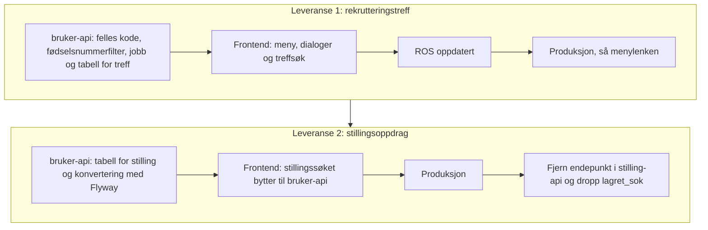

# Plan: Lagrede søk for stillingsoppdrag og rekrutteringstreff i bruker-api

**Status:** Forslag, ikke implementert.

## Kort fortalt

- Rekrutteringstreff får lagrede søk i `rekrutteringsbistand-bruker-api`. Hver veileder kan lagre opptil 10 søk per domene, gi dem navn, bruke dem og slette dem. Ett av dem kan være standardsøket som menylenken åpner.
- Standardsøk for stillingsoppdrag flyttes senere fra `rekrutteringsbistand-stilling-api` til samme API og får samme støtte for flere søk.
- Vi planlegger begge nå, men leverer én applikasjon av gangen helt til produksjon. Rekrutteringstreff kommer først.
- Hvert domene får sin egen tabell med lik oppbygning. De deler kode og opprydningsjobb.
- Hvert søk har en id (søkeident). Nav-identen er ikke lenger unik i tabellen.
- Hvert søk har datoen `sistBrukt`. En dato i stedet for et tidspunkt gjør at vi skriver den høyst én gang i døgnet per søk.
- Navn og fritekst lagres bare i body og database, aldri i URL-en. Backend fjerner gyldige fødselsnumre før lagring.
- Et søk som ikke er brukt eller lagret på seks måneder, slettes helt. Søk som snart slettes, får en merknad i menyen.

## Slik virker det i dag (stillingsoppdrag)

Menylenken «Stillingsoppdrag» og knappen «Bruk standardsøk» går til `/stilling?brukStandardsok=true`. Da henter `page.tsx` standardsøket fra stilling-api og bytter URL-en med `window.history.replaceState`. Diskettikonet sender query-strengen med `PUT /standardsok` og overskriver det gamle søket. Hver veileder har ett søk.

| Del | Innhold |
| --- | --- |
| Frontend | `app/stilling/_ui/standardsøk/` og `app/api/stilling/standardsok/` |
| API | `GET /standardsok` gir `200` eller `404`. `PUT /standardsok` med `{ søk }` gir `201`. Nav-identen kommer fra tokenet. |
| Tabell `lagret_sok` | `id`, `nav_ident`, `sok` (query-streng), `tidspunkt` (uten tidssone) |
| Lagres ikke | `utenOppdrag`, `visStillingId`, `brukStandardsok`, `finnKandidater`, `visKandidatId`, fritekst |

Svakheter vi ikke tar med oss:

- `lagret_sok` mangler unik-indeks på `nav_ident`, og repositoryet leser før det skriver. To samtidige lagringer kan gi to rader.
- Diskettikonet er deaktivert når søket er likt det lagrede, og sammenligningen er en strengsammenligning. Med flere søk dropper vi denne sammenligningen.
- Mens `brukStandardsok` står i URL-en, ignorerer `StillingsSøkContext` fritekst. Det må endres når fritekst skal lagres.

## Arkitektur

`rekrutteringsbistand-bruker-api` har allerede brukerinnstillinger per Nav-ident, `accessPolicy` for frontend og de rollene vi trenger. Vi trenger ingen ny auth eller ny tjeneste.



### API

Frontend kaller `/api/bruker/standardsok/{domene}`, og proxyen sender videre til `/api/standardsok/{domene}`. `domene` er `rekrutteringstreff`, og etter leveranse 2 også `stilling`. Andre verdier gir `404`. `{id}` er søkeidenten.

| Metode | Sti | Bruk | Svar |
| --- | --- | --- | --- |
| `GET` | `/api/standardsok/{domene}` | Henter alle veilederens søk. Brukes av menyen, lagre-dialogen og menylenken. | `200` med liste av `StandardsøkDto`, sortert på navn. Tom liste uten lagrede søk. |
| `POST` | `/api/standardsok/{domene}` | «Lagre som nytt søk» | `201` med `StandardsøkDto`. `409` når navnet finnes eller veilederen har 10 søk. |
| `PUT` | `/api/standardsok/{domene}/{id}` | «Erstatt et lagret søk» | `200` med `StandardsøkDto` |
| `PUT` | `/api/standardsok/{domene}/{id}/standard` | «Bruk som standardsøk». Fjerner merket fra det forrige. | `204` |
| `DELETE` | `/api/standardsok/{domene}/{id}` | «Slett» | `204` |
| `POST` | `/api/standardsok/{domene}/{id}/bruk` | Veilederen har tatt søket i bruk. Ingen body. | `204` |

Alle kall med `{id}` gir `404` hvis søket ikke finnes eller tilhører en annen veileder. Svaret skiller ikke mellom de to. Ugyldig body gir `400`.

`POST .../bruk` er `POST` fordi kallet endrer data. En `GET` kan sendes på nytt av SWR, forhåndshenting eller proxyer.

| Domene | Roller |
| --- | --- |
| `rekrutteringstreff` | `ARBEIDSGIVER_RETTET`, `JOBBSOKER_RETTET`, `UTVIKLER`, som menypunktet |
| `stilling` | Alle fem rollene i bruker-api, som `/api/innstillinger`. Stillingssøket har ingen rollekrav i menyen. |

Nav-identen kommer alltid fra tokenet, aldri fra body eller sti. Hver spørring med `{id}` har både `id` og `navIdent` i `WHERE`.

| DTO | Felt | Type | Regel |
| --- | --- | --- | --- |
| `LagreStandardsøkDto` | `navn` | String | 1 til 50 tegn etter trimming. Går gjennom fødselsnummerfilteret. |
| | `filter` | String | Query-streng uten `?`, maks 2 000 tegn, kan være tom |
| | `fritekst` | Liste av String | Maks 10 ord og 200 tegn totalt, kan være tom |
| | `erStandard` | Boolean | Bare ved `POST`. Det første søket blir alltid standard. |
| `StandardsøkDto` | `id` | UUID | Søkeidenten |
| | `navn` | String | |
| | `erStandard` | Boolean | |
| | `filter` | String | |
| | `fritekst` | Liste av String | Etter filtrering |
| | `sistBrukt` | Dato | |
| | `slettes` | Dato | Seks måneder etter `sistBrukt`. Frontend viser merknad når datoen er mindre enn én måned unna. |
| | `fritekstFiltrert` | Boolean | Bare i svar på `POST` og `PUT`. `true` hvis backend fjernet noe fra navn eller fritekst. |

### Tabeller: én per domene

Hvert domene får sin tabell i sin leveranse: `V9__standardsok_rekrutteringstreff.sql` først, så en egen migrering for stilling. Kolonnenavnene følger stilen i repoet (`navIdent`, som i `brukerinnstillinger`).

| Kolonne | Type | Merknad |
| --- | --- | --- |
| `id` | `uuid` primærnøkkel | Søkeidenten, lages av backend |
| `navIdent` | `text not null` | Ikke unik. Indeks for oppslag per veileder. |
| `navn` | `text not null` | Unik sammen med `navIdent` |
| `erStandard` | `boolean not null default false` | Delvis unik indeks på `navIdent` der `erStandard` er sann, så hver veileder har høyst ett standardsøk |
| `filter` | `text not null` | |
| `fritekst` | `text[] not null default '{}'` | |
| `sistBrukt` | `date not null` | Settes ved `POST`, `PUT` og bruk, høyst én gang i døgnet ved bruk. Indeks for opprydningsjobben. |

Regler i backend:

- Grensen på 10 søk sjekkes i samme transaksjon som innsettingen. To samtidige lagringer fra samme veileder kan i verste fall gi 11 søk. Det godtar vi, siden grensen gjelder oversikt og ikke sikkerhet.
- Bytte av standardsøk fjerner merket fra det gamle og setter det på det nye i én transaksjon. Den delvise unike indeksen stopper to standardsøk hvis to bytter skjer samtidig, og taperen får `409`.
- Når standardsøket slettes, har veilederen ikke noe standardsøk før hen velger et nytt. Menylenken gir da vanlig søk, som når standardsøk mangler i dag.
- Ett repository dekker begge tabellene. Tabellnavnet kommer fra en enum i koden, aldri fra input.
- Søk slettes når veilederen sletter dem, eller når de ikke er brukt på seks måneder. Se [Sletting etter seks måneder uten bruk](#sletting-etter-seks-måneder-uten-bruk).

| | To tabeller (valgt) | Én tabell med `domene`-kolonne |
| --- | --- | --- |
| Nøkkel | `id`, indeks på `navIdent` | `id`, indeks på `navIdent` + `domene` |
| Unike regler | `navIdent` + `navn`, ett standardsøk per `navIdent` | Samme regler, men med `domene` i hver indeks |
| Ulik utvikling | Hvert domene kan få egne kolonner eller regler uten å påvirke det andre | Domenespesifikke kolonner blir `null` for det andre domenet |
| Levere per applikasjon | Hver leveranse har sin egen migrering | Første leveranse må lage en tabell for begge |
| Fjerne et domene | `DROP TABLE` | `DELETE` og en sjekk-constraint å endre |
| Opprydning | Én setning per tabell | Én setning |

Filtrene lagres som en query-streng som bare frontend tolker. Ulike filtre i seg selv tvinger derfor ikke fram ulike tabeller. Grunnen til å skille er at domenene trolig får ulike regler, og at vi leverer dem hver for seg. Én tabell blir bedre hvis vi får mange domener, for eksempel kandidatsøk og jobbsøkersøk i treff.

### Dato for sist brukt

Vi lagrer en dato og ikke et tidspunkt. Det holder for sletting etter seks måneder og for å vise «sist brukt». Det sier også mindre om når den ansatte jobber. Backend regner datoen i tidssonen `Europe/Oslo`.

`sistBrukt` settes til i dag når veilederen lagrer søket som nytt, erstatter det eller tar det i bruk. Å bytte standardsøk endrer den ikke.

`POST .../bruk` oppdaterer bare når `sistBrukt` er eldre enn i dag. Det gir høyst én skriving per søk i døgnet, uansett hvor ofte søket brukes. Frontend kan droppe kallet når `sistBrukt` i listen allerede er i dag. Det er trygt, siden søket da har seks måneder igjen.

Én dato per søk erstatter et eget `fritekstLagret`. Navn og fritekst er begge fritekst, så de følger raden.

## Fritekst og navn

### Hvorfor bare i body

Fritekst ligger i React-state i begge søkene i dag, og ikke i URL-en. Det hindrer at den havner i nettleserhistorikk, tilgangslogger og Umami. Vi beholder det: fritekst og navn går bare i body på `POST` og `PUT` og i svarene fra API-et. URL-en har bare søkeidenten. Når et søk brukes, legges fritekst i state og vises som chips.

### Fjerning av fødselsnumre

Backend fjerner fødselsnumre fra navn og fritekst før lagring. Søket filtreres ikke, så veilederen får treff som før.



Et tall fjernes når det er et gyldig fødselsnummer etter dagens regler:

- datoen er gyldig, også for D-nummer (dag + 40), H-nummer (måned + 40) og syntetiske nummer (måned + 40 eller + 80)
- begge kontrollsifrene stemmer med modulus 11

Andre tall blir stående, også 11-sifrede tall med feil kontrollsiffer. Reglene Skatteetaten innfører i 2032 er ikke med. Blir navnet tomt etter filtrering, gir backend `400`.

### Sletting etter seks måneder uten bruk

Navn er også fritekst, så vi sletter hele søket og ikke bare søkeordene. Et søk slettes når `sistBrukt` er over seks måneder gammel. Søk som brukes, blir liggende. Søk ingen bruker, forsvinner helt.

- `GET` returnerer aldri søk der `sistBrukt` er over seks måneder gammel, selv om jobben ikke har kjørt.
- `PUT`, `.../standard` og `.../bruk` mot et slikt søk gir `404`. Ellers kan et kall vekke til live et søk som skulle vært slettet.
- `POST` sletter veilederens utløpte søk i samme transaksjon før grensen på 10 og unike navn sjekkes. Da teller ikke usynlige søk med.

Et søk som brukes jevnlig, har ingen øvre grense for hvor lenge navn og søkeord blir liggende. Begrunnelsen er at veilederen fortsatt bruker søket, og at fødselsnumre er fjernet. Det må stå i ROS-en. Krever ROS-en en fast grense, kan vi legge til `sistLagret` og slette søk et bestemt antall måneder etter lagring.

### Merknad før sletting

Vi markerer søk som slettes innen en måned, altså fem måneder etter siste bruk. Merknaden lagres ikke. Backend regner ut `slettes` fra `sistBrukt`, og frontend viser merknaden når datoen er mindre enn én måned unna.

- Merknaden koster ingen ny kolonne, jobb eller varsling.
- Veilederen ser den i menyen og i «Administrer søk». Vil hen beholde søket, bruker hen det, og de seks månedene starter på nytt. Vi lager ingen egen knapp for å beholde søk.
- Uten merknad forsvinner søk uten forvarsel. Det er særlig ille for standardsøket, som menylenken bruker.

Vi sender ikke varsel utenfor løsningen, for eksempel e-post. Det krever mer enn gevinsten forsvarer.

### Opprydningsjobb

- Kjører én gang i døgnet i bruker-api. For hver tabell sletter den rader der `sistBrukt` er over seks måneder gammel.
- Én felles jobb for alle domenetabellene.
- Jobben er idempotent. Den kan derfor kjøre på alle podene uten leader election.
- Jobben logger og teller bare antall rader, aldri innhold.

## Frontend

Endringen er minimal: knappen «Bruk standardsøk» blir en meny med de lagrede søkene, og diskettikonet åpner en dialog. Skissene under er et utgangspunkt for designer, ikke et ferdig design. Alt bygges med Aksel-komponenter (`ActionMenu`, `Modal`, `RadioGroup`, `TextField`, `Select`, `Checkbox`, `Table`).

### Meny: «Lagrede søk»

Erstatter knappen «Bruk standardsøk». Et klikk på et søk tar det i bruk. Søk som slettes innen en måned, har en merknad.

```text
[ Lagrede søk ▾ ]  [ 💾 ]

  ┌───────────────────────────────────────────┐
  │ ★ Treff i Oslo (standard)                 │
  │   Publiserte i Vestland                   │
  │   Mine utkast            Slettes 01.11    │
  │ ───────────────────────────────────────── │
  │   Administrer søk …                       │
  └───────────────────────────────────────────┘
```

Uten lagrede søk viser menyen «Du har ingen lagrede søk» og en kort forklaring om diskettikonet.

### Dialog: «Lagre søk»

Diskettikonet åpner dialogen. Gjeldende filtre og søkeord lagres.

```text
┌ Lagre søk ─────────────────────────────────────┐
│ (•) Lagre som nytt søk                         │
│     Navn [______________________]              │
│ ( ) Erstatt et lagret søk                      │
│     [ Velg søk            ▾ ]                  │
│ [x] Bruk som standardsøk                       │
│                                                │
│ Søk du ikke har brukt på seks måneder, slettes.│
│ Ikke skriv personopplysninger i navnet.        │
│                                                │
│ [ Lagre ]  [ Avbryt ]                          │
└────────────────────────────────────────────────┘
```

- Med 10 søk er «Lagre som nytt søk» deaktivert, med teksten «Du har 10 lagrede søk. Erstatt et søk eller slett et i Administrer søk.»
- Er et lagret søk i bruk, er «Erstatt et lagret søk» og det søket forhåndsvalgt.
- «Bruk som standardsøk» er avkrysset når veilederen ikke har noe standardsøk.

### Dialog: «Administrer søk»

```text
Administrer søk (3 av 10)

Navn                     Sist brukt   Slettes
★ Treff i Oslo           20.10.2026   20.04.2027                          [Slett]
  Publiserte i Vestland  12.10.2026   12.04.2027  [Gjør til standard]     [Slett]
  Mine utkast            01.05.2026   01.11.2026  [Gjør til standard]     [Slett]

                                                                          [Lukk]
```

«Slett» ber om bekreftelse: «Vil du slette «Treff i Oslo»?» med knappene «Slett» og «Avbryt».

### Filer

| Hvor | Endring |
| --- | --- |
| `components/standardsøk/` (ny) | Felles meny, lagre-dialog og administrer-dialog. Domenet sender inn hvilke parametre som lagres og hvordan et søk tas i bruk. |
| `app/api/bruker/standardsok/[domene]/` (ny) | Proxy-rute for liste og `[id]`, SWR-hook per domene, mutasjoner, Zod-skjema og MSW-mock |
| Treffsøket | Meny og diskettikon under søkefeltet. `RekrutteringstreffSøkContext` holder id-en til søket som er i bruk i state, ikke i URL-en. Søket mot `/sok` venter til listen er hentet når `brukStandardsok` står i URL-en. |
| `AppSidebar.tsx` | `?brukStandardsok=true` på menylenken til rekrutteringstreff |
| Stillingssøket (leveranse 2) | Bytter til bruker-api og de felles komponentene. Setter fritekst fra søket i `StillingsSøkContext` og fjerner blokkeringen av fritekst under `brukStandardsok`. Lagre er mulig når filteret er tomt, men fritekst finnes. Reglene for kandidat (`visKandidatnr`) og portefølje beholdes. `app/api/stilling/standardsok/` slettes. |

Slik tas et søk i bruk:



Detaljer for treffsøket:

- Lagres: `visning`, `kontorer`, `statuser`, `publisertStatuser`, `fylker`, `kommuner`, `sortering`. Lagres ikke: `side`, `visRekrutteringstreffId`, `brukStandardsok`.
- Lagret `visning=mine` blir `alle` for veiledere uten arbeidsgiverrettet rolle. `UTKAST` filtreres allerede bort for dem.
- `visning=mitt_kontor` følger veilederens aktive kontor.
- Diskettikonet er aktivt når søket har minst ett filter eller søkeord.
- Etter bruk henter SWR listen på nytt, så merknaden forsvinner.

## Leveranser

Hver leveranse går helt til produksjon før neste starter.



**Leveranse 1** kan ikke gå til produksjon før ROS-en dekker lagring av fritekst og navn: fødselsnummerfilteret, at andre personopplysninger kan bli liggende, og at søk slettes først seks måneder etter siste bruk, uten øvre grense for søk som brukes.

**Leveranse 2** konverterer data med Flyway:

- Vi tar den nyeste raden per `nav_ident`, siden `lagret_sok` kan ha duplikater.
- Hver veileder får ett søk med navnet «Standardsøk» og `erStandard` satt. `sok` blir `filter`, og `fritekst` blir tom.
- `sistBrukt` settes til konverteringsdatoen. Stilling-api registrerer ikke bruk, og `tidspunkt` er bare når søket sist ble lagret. Med `tidspunkt` ville søk som brukes daglig, men ble lagret for lenge siden, blitt slettet med en gang.
- Konverteringen må kjøre før frontend bytter, eller hoppe over veiledere som allerede har søk i bruker-api hvis den kjører etter.
- Nav-identer skal ikke ligge i migreringsfiler i git.

Rollback i leveranse 2, før stilling-api ryddes: frontend peker tilbake til stilling-api. Søk lagret i bruker-api i mellomtiden går tapt.

## Tester

| Nivå | Hva |
| --- | --- |
| Enhetstest, bruker-api | Fødselsnummerfilteret: gyldige fødselsnumre, D-, H- og syntetiske nummer, nummer med mellomrom, 11 sifre med feil kontrollsiffer (skal stå), organisasjonsnumre og vanlige ord. Testene lager syntetiske nummer selv, ingen nummer som ligner ekte. |
| Komponenttest, bruker-api | Tom liste uten lagrede søk. Opprett, erstatt og slett. Det første søket blir standard. Bytte av standard fjerner det gamle merket. Det ellevte søket og like navn gir `409`. |
| Komponenttest, bruker-api | En veileder får `404` på `PUT`, `DELETE`, `.../standard` og `.../bruk` mot en annen veileders søk, og listen viser bare egne søk. Ukjent domene gir `404`. Manglende rolle gir `403`. For lang input og ugyldig JSON gir `400` uten innholdet i svaret. |
| Komponenttest, bruker-api | `POST`, `PUT` og `.../bruk` setter `sistBrukt`. Bytte av standard endrer den ikke. `.../bruk` skriver bare når `sistBrukt` er eldre enn i dag. Jobben sletter bare søk der `sistBrukt` er eldre enn seks måneder. Før jobben har kjørt, skjuler `GET` slike søk, kall mot dem gir `404`, og de teller ikke mot grensen på 10 eller unike navn. `slettes` er seks måneder etter `sistBrukt`. |
| Enhetstest, frontend | Hvilke parametre som lagres og fjernes, og om `.../bruk` kalles |
| Playwright med MSW | Valg i menyen setter filtre og chips. Fritekst og navn står ikke i URL-en. Lagre som nytt og erstatt. «Lagre som nytt» er deaktivert ved 10 søk. Sletting med bekreftelse. Merknad for søk som slettes innen en måned, og at den forsvinner når søket brukes. Menylenken bruker standardsøket. Varsel når fritekst er filtrert. |

## Personvern og sikkerhet

- Tabellene har Nav-ident om ansatte og filtre uten opplysninger om jobbsøkere. Navn og fritekst kan inneholde personopplysninger. Vi fjerner gyldige fødselsnumre fra begge og sletter hele søket seks måneder etter siste bruk. Andre personopplysninger blir liggende til da, så dialogen ber veilederen om å ikke skrive personopplysninger i navnet.
- Datoer i stedet for tidspunkt gir mindre informasjon om når den ansatte jobber.
- Søkeidenten er en tilfeldig UUID. Eierskapet sjekkes likevel i hver spørring, og et fremmed søk gir samme `404` som et søk som ikke finnes.
- Bruker-api logger meldingen fra `IllegalArgumentException` og returnerer meldingen fra alle unntak. Valideringsfeil må derfor ha faste tekster uten innhold fra body. Jackson legger verdier inn i feilmeldinger ved ugyldig JSON, så controlleren må fange parsefeil og kaste en fast feil uten årsakens melding.
- Ingen logging av `navn`, `filter` eller `fritekst`, heller ikke på debug-nivå.

🔴 Rød sone: fødselsnummerfilteret, at Nav-identen hentes fra tokenet, eierskapssjekken på søkeidenten, feilhåndteringen uten innhold i logg og svar, og sletting av søk i jobben og regelen om at `GET` og kall med `{id}` ikke ser utløpte søk. Utvikleren bør skrive og forstå disse selv. Resten er grønn sone.

## Observerbarhet

- Tellere i bruker-api: opprettede, erstattede og slettede søk, søk der navn eller fritekst ble filtrert, og rader jobben slettet. Alle med `domene` som label.
- Umami i frontend: søk brukt fra menyen, søk brukt fra menylenken, lagret som nytt, erstattet og slettet, per domene.

## Åpne spørsmål

1. Hvordan når Flyway-migreringen i bruker-api dataene i stilling-api sin database? Flyway kjører mot én database, og de to applikasjonene har hver sin. Avklares når leveranse 2 starter.
2. Tekster, plassering og om menyen skal sorteres på navn eller sist brukt avklares med designer. Skissene er et utgangspunkt.
